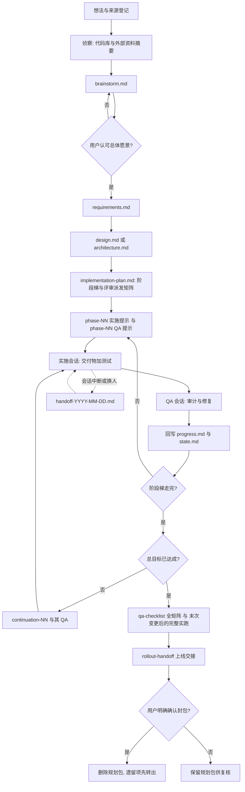
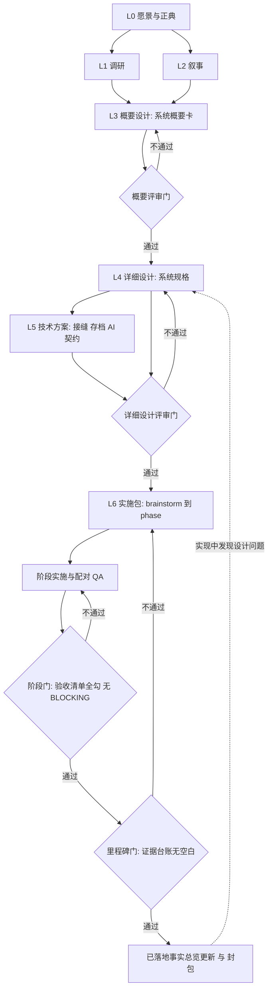

# 主工程执行指导方案的方法论与模板提炼

| 项         | 内容                                                                                      |
| ---------- | ----------------------------------------------------------------------------------------- |
| 文档性质   | 调研归档（`docs/10_research/`），只记录事实、分析与可借鉴点，不做最终决定                 |
| 调研对象   | world-of-claudecraft 主工程内的规划包、PRD、交接、QA 门、技能与审查代理定义               |
| 核对日期   | 2026-11-14                                                                                |
| 路径约定   | 文中反引号路径若无特别说明，均相对主工程仓库根目录；`hakoniwa/` 开头的路径指本作目录      |
| 下游使用者 | `docs/60_production/`（研发流程、质量门、里程碑）与 `docs/50_tech/`（工程原则）的定稿作者 |

## 0. 阅读指引

本文回答六个问题，对应六章：

| 章  | 问题                                                       | 适合谁读             |
| --- | ---------------------------------------------------------- | -------------------- |
| 1   | 主工程的执行指导方案有哪些种类，各写什么                   | 所有人               |
| 2   | 从想法到交付，阶段如何流转，每步的输入、产出与验收         | 制作、技术负责人     |
| 3   | 每类文档的推荐章节骨架（可直接复制）                       | 写文档的人与 AI 代理 |
| 4   | 主工程的质量门与工程原则，哪些适用于本作                   | 技术负责人           |
| 5   | 让 AI 代理跨会话长期推进大项目的经验与反模式               | 编排 AI 代理的人     |
| 6   | 面向《箱庭纪》的文档分层与阶段流程建议，及后续应补文档清单 | 制作、全体           |

---

## 1. 文档体系总览

### 1.1 调研来源盘点

| 来源                                                                                                                         | 形态                                                 | 说明                                                                                                                                                                                                                                                                                                                          |
| ---------------------------------------------------------------------------------------------------------------------------- | ---------------------------------------------------- | ----------------------------------------------------------------------------------------------------------------------------------------------------------------------------------------------------------------------------------------------------------------------------------------------------------------------------- |
| `CLAUDE.md` 与各子目录 `CLAUDE.md`（如 `src/sim/CLAUDE.md`、`src/world_api/CLAUDE.md`、`docs/CLAUDE.md`、`tests/CLAUDE.md`） | 规则层                                               | 根文件定架构与不变量；子文件只写本目录的局部约定，不重复根文件                                                                                                                                                                                                                                                                |
| `docs/ambient-player-bots/`                                                                                                  | 完整规划包（16 个阶段加 18 个续作，每个都有配对 QA） | 最完整的"长期推进"样本，含 README、brainstorm、requirements、architecture、implementation-plan、phase、continuation、qa-checklist、progress、state、rollout-handoff、post-packet-archive                                                                                                                                      |
| `docs/hosted-party-autonomy/`                                                                                                | 中型规划包（6 个阶段，每个配 QA）加日期化交接        | 含 design.md 与 `handoff-2026-07-01.md`，展示"未完成状态下的交接"                                                                                                                                                                                                                                                             |
| `.claude/skills/feature-plan/SKILL.md`                                                                                       | 规划包生成器                                         | 规定了规划包的文件集合、阶段切分、启动提示与 QA 提示的固定结构，是上面两个包的"母版"                                                                                                                                                                                                                                          |
| `.claude/skills/extract-and-test/SKILL.md`                                                                                   | 实现方法论                                           | 模块优先与先测后修                                                                                                                                                                                                                                                                                                            |
| `.claude/skills/qa/SKILL.md` 与 `.claude/agents/*.md`                                                                        | 质量门与审查代理                                     | 一个总闸加八个领域审查角色                                                                                                                                                                                                                                                                                                    |
| `docs/qa-gate.md`                                                                                                            | 质量门说明                                           | 四层 QA 门                                                                                                                                                                                                                                                                                                                    |
| `docs/prd/`                                                                                                                  | PRD、实施计划、交接                                  | 如 `talents-and-specializations.md`（长 PRD）、`dungeon-finder.md`（紧凑 PRD）、`professions-combo-attunement-implementation-plan.md`（单文件分阶段计划）、`FRONTIER_PHASE1_HANDOFF.md`（切片交接）、`DELVE_HANDOFF.md`（合并型交接）、`ai-social-sequences.zh_CN.md`（中文需求卡）、`build-prompts.md`（PRD 驱动的执行提示） |
| `docs/design/master-spec.md`                                                                                                 | 内容总规格                                           | 故事主线、区域、怪物、任务、XP 预算、物品表，数值按源码常量重算                                                                                                                                                                                                                                                               |
| `docs/design/current-game-design.zh_CN.md`                                                                                   | 已落地事实总览                                       | 明确声明"描述已落地事实，不是新目标方案，冲突以源码为准"                                                                                                                                                                                                                                                                      |
| `docs/design/planning-docs.zh_CN.md`                                                                                         | 文档导航                                             | 每篇文档的定位、核心设计点、与当前实现关系、注意事项                                                                                                                                                                                                                                                                          |
| `docs/architecture/refactor-architecture-v0.15.0.md`                                                                         | 目标架构                                             | 不动约束、接缝模式、模块契约、验证网、绞杀式迁移                                                                                                                                                                                                                                                                              |
| `docs/refactor/world-api-to-server-runtime-handoff.md`                                                                       | 工作流边界交接                                       | 上游交付了什么、下游继承什么、下游负责什么、必须保持的不变量                                                                                                                                                                                                                                                                  |
| `docs/design/eastbrook-vale-rebuild/`                                                                                        | 证据型交付包                                         | 最终报告、验证矩阵、图像生成提示记录与来源、建模受理、实测场地规划                                                                                                                                                                                                                                                            |
| `docs/design/professions-system/`                                                                                            | 分片 HTML 设计书                                     | `manifest` 排序加 `sections/` 片段加 `build.sh` 构建；第二部分专门写给后续贡献者（脆弱点、已否决方案、未来、切片、待定）                                                                                                                                                                                                      |

### 1.2 文档分类：各写什么

| 类别               | 典型文件                                                                  | 回答的问题                         | 写什么                                                                                                                                         | 不写什么           | 生命周期                             |
| ------------------ | ------------------------------------------------------------------------- | ---------------------------------- | ---------------------------------------------------------------------------------------------------------------------------------------------- | ------------------ | ------------------------------------ |
| 入口与导航         | 包内 `README.md`、`planning-docs.zh_CN.md`                                | 从哪读起、按什么顺序读             | 一段话概述、全部文件索引、阅读顺序、使用方法、锁定意图                                                                                         | 细节设计           | 活文档                               |
| 头脑风暴           | `brainstorm.md`                                                           | 为什么做、已有什么、可能怎么做     | 产品愿景、仓库已有基础（可复用文件与接缝）、锁定的大方向、LLM 或外部方案建议、风险、开放问题、延后愿景                                         | 逐条需求、实现步骤 | 规划期活文档，之后转历史             |
| 需求               | `requirements.md`                                                         | 做成什么样才算对                   | 产品目标、体验要求（玩家视角）、功能要求（分组编号 A、B、C）、非功能要求（安全、性能、可维护）、验收信号                                       | 组件划分、文件路径 | 活文档，锁定决策变化时要回写         |
| 设计与架构         | `design.md`、`architecture.md`                                            | 怎么搭                             | 架构摘要、组件模型（每个组件的主要文件与职责）、契约（偏好、组队、恢复、意图、可观看性）、运行流、权威边界、状态来源、当前设计优先级           | 进度、日志         | 活文档                               |
| PRD 与详细规格     | `docs/prd/*.md`                                                           | 一个功能的完整规格                 | 元信息表、摘要、背景、参考做法、代码现状、目标与非目标、功能需求、架构与集成、性能、玩法与数值、分期、测试策略、遥测、风险、开放问题、验收标准 | 会话日志           | 实施前是规格，实施后转历史记录       |
| 实施计划           | `implementation-plan.md`、单文件分阶段计划                                | 分几步做                           | 规范工作流、阶段梯表（实现与 QA 成对）、每阶段交付物与范围外、提交节奏、停止条件、评审派发矩阵                                                 | 设计论证           | 活文档                               |
| 阶段包（实施提示） | `phase-NN-<slug>.md`                                                      | 这一步具体做什么                   | 目标、范围（要做与不做）、必守约束、建议验证命令、验收标准                                                                                     | 其他阶段内容       | 执行前后不改，作为"承诺了什么"的凭证 |
| 阶段包（QA 提示）  | `phase-NN-qa-*.md`                                                        | 怎么验这一步                       | 目标、审计清单、验证命令、停止条件（何种问题必须先修再进下一阶段）                                                                             | 新功能             | 同上                                 |
| 总 QA 清单         | `qa-checklist.md`                                                         | 整个功能收官时验什么               | 按维度分组的勾选矩阵、上线门、实跑产物要求、封包处理                                                                                           | 中间过程           | 收官时一次性使用                     |
| 进度台账           | `progress.md`                                                             | 做到哪了、每步发生了什么           | 状态表（阶段、状态、开始、完成）、每阶段勾选清单、备注（实际运行的验证命令与结果、已知基线问题、遗留）                                         | 当前真相的权威表述 | 只追加的日志                         |
| 状态速查           | `state.md`                                                                | 现在什么是真的                     | 当前阶段、编号锁定决策、不可协商约束、按变更类型的验证矩阵、计划文件与接口、数据库形态、运行开关、已知开放项                                   | 过程叙述           | 持续改写，应保持精简                 |
| 交接               | `handoff-YYYY-MM-DD.md`、`DELVE_HANDOFF.md`、`FRONTIER_PHASE1_HANDOFF.md` | 换人或换会话时怎么接               | 当前目标、本次完成的切片、已完成验证（命令加结果）、本地备份与恢复命令、最近一次实跑观察、已知缺口、下一步编号清单                             | 完整历史           | 日期化快照，被新交接取代             |
| 续作               | `continuation-NN-<slug>.md` 与其 QA                                       | 原阶段梯走完但总目标未达，如何续推 | 与阶段包同构                                                                                                                                   | 同上               | 同上                                 |
| 封包后归档         | `post-packet-archive.md`                                                  | 封包之后的零散补强放哪             | 范围（按日期）、需求增补、设计说明、当前开放设计问题                                                                                           | 新阶段             | 历史                                 |
| 运维与上线交接     | `rollout-handoff.md`                                                      | 运营者怎么上线、演练、止血、回滚   | 前置条件、推荐冒烟顺序、本地栈、事故控制顺序、回滚说明                                                                                         | 开发细节           | 活文档                               |
| 证据台账           | `verification-matrix.md`、`final-report.md`、`imagegen-provenance.md`     | 凭什么说做完了                     | 每条要求的编号、证据位置、当前结果、状态（PASS、VERIFY、N/A、FAIL、BLOCKED，不接受空白）、完成规则、剩余风险与妥协                             | 无证据的断言       | 交付凭证                             |
| 已落地事实总览     | `current-game-design.zh_CN.md`                                            | 现在游戏实际是什么样               | 内容来源文件清单、产品支柱、内容盘点、各系统事实、技术约束、已知缺口                                                                           | 目标方案           | 活文档，随内容变更同步               |
| 规则层             | `CLAUDE.md`、技能、审查代理                                               | 所有人与代理必须遵守什么           | 架构、不变量、约定、工作流、审查清单                                                                                                           | 具体功能           | 活文档，架构变更时同改               |

### 1.3 五种文档"家族"形态

主工程实际存在五种组织形态，适用场景不同：

| 形态             | 代表                                                                                          | 适用场景                                         | 优点                                                     | 代价                               |
| ---------------- | --------------------------------------------------------------------------------------------- | ------------------------------------------------ | -------------------------------------------------------- | ---------------------------------- |
| 多文件规划包     | `docs/ambient-player-bots/`、`docs/hosted-party-autonomy/`                                    | 需多个会话、多个阶段、由 AI 代理连续推进的大功能 | 每个阶段提示自包含，新会话可直接接手；状态与进度分离     | 文件多，台账易膨胀，需要封包与清理 |
| 单文件分阶段计划 | `docs/prd/professions-combo-attunement-implementation-plan.md`                                | 4 个左右阶段、一个 PR 能交付的功能               | 一眼看全；每阶段有"产出、生产接缝、测试与验证、出口标准" | 不适合跨很多会话                   |
| PRD 加执行提示   | `docs/prd/talents-and-specializations.md` 配 `docs/prd/build-prompts.md`                      | 规格先行、按 PRD 分期实施                        | PRD 是唯一规格，提示只负责"读 PRD、分期做、每期全绿"     | PRD 的行号锚点会过时，需每次复核   |
| 切片交接         | `docs/prd/FRONTIER_PHASE1_HANDOFF.md`、`docs/refactor/world-api-to-server-runtime-handoff.md` | 规格已定，交给另一位实施者或另一工作流           | 有共享常量、已核实挂点表、切片依赖序、陷阱清单、派发模板 | 需在动工前按当前分支重新核实锚点   |
| 证据型交付包     | `docs/design/eastbrook-vale-rebuild/`                                                         | 美术与场景这类"看得见"的交付                     | 每条要求有证据与状态，AI 生成素材有完整来源与拒稿记录    | 维护成本高，只适合高价值交付       |

### 1.4 活文档与历史记录

`docs/CLAUDE.md` 把文档分为两类，并给出冲突规则，这对本作同样关键：

- 活文档（运行手册、未建功能的规格）才有"事实来源"的地位，且只描述"意图"。
- 历史记录（已交付项目、一次性报告）只能当记录读，不能当计划读。例如 `docs/prd/DELVE_HANDOFF.md` 描述的系统早已交付。
- 代码与文档冲突时，以代码为准，回头核实并标注偏差。
- PRD 里的 `file:line` 挂点会随代码漂移，信任意图，重新定位，不信任行号。
- `current-game-design.zh_CN.md` 开头就声明自己"描述已落地事实，不是新目标方案"，并列出内容来源文件。目标设计与事实总览分开写，是防止规划文档被误当现状的有效手段。

---

## 2. 标准流程

### 2.1 总流程图



### 2.2 阶段流转表

| 步骤           | 输入                        | 产出                                                                                | 出口验收标准                                                                            |
| -------------- | --------------------------- | ----------------------------------------------------------------------------------- | --------------------------------------------------------------------------------------- |
| 0 想法登记     | 用户诉求、社区需求、调研    | 一句话目标与来源（如 `talents-and-specializations.md` 元信息表里的"Source demand"） | 目标能一句话说清                                                                        |
| 1 侦察         | 目标、代码库、外部资料      | 侦察摘要：已有系统、可复用接缝、外部一手资料、OPEN 项                               | OPEN 项被列为阻塞项而非假设（`feature-plan` 要求"无法核实的标记为 OPEN，不得猜"）       |
| 2 brainstorm   | 侦察摘要                    | `brainstorm.md`                                                                     | 用户对总体愿景认可后才进入阶段切分                                                      |
| 3 requirements | brainstorm 与用户确认       | `requirements.md`                                                                   | 每条需求可观察、可验证；非目标与延后愿景写明                                            |
| 4 design       | requirements                | `design.md` 或 `architecture.md`                                                    | 每条需求有承载组件；权威边界与状态来源写清；契约可被测试断言                            |
| 5 实施计划     | design                      | `implementation-plan.md`                                                            | 实现与 QA 成对；每阶段 2 到 4 个交付物（超过 5 个即拆）；基础先行；评审派发矩阵只放一份 |
| 6 阶段包       | 实施计划                    | `phase-NN-*.md` 与 QA 版本                                                          | 自包含：新会话粘贴即可执行，不需回看目录                                                |
| 7 实施         | 阶段包、`state.md`          | 代码、测试、文档回写                                                                | 阶段验收清单全部勾选，验证命令全绿，评审代理无 BLOCKING                                 |
| 8 QA           | 阶段包、阶段起点以来的 diff | 审计结论、修复提交                                                                  | 无 BLOCKING；QA 提示里的停止条件未触发                                                  |
| 9 回写         | 实施与 QA 结果              | `progress.md` 状态与备注，`state.md` 锁定决策增量                                   | 下一阶段可只读 `state.md` 起步                                                          |
| 10 交接        | 会话结束、换人、长任务中断  | 日期化 handoff                                                                      | 下一个代理不读对话记录也能继续                                                          |
| 11 续作        | 阶段梯完成但总目标未达      | `continuation-NN` 与 QA，README 与实施计划同步加行                                  | 与阶段包相同                                                                            |
| 12 终验与封包  | 全部阶段                    | 总 QA 矩阵结果、上线交接、封包询问                                                  | 末次代码变更之后的一次完整通过；用户明确确认后才删包                                    |

### 2.3 实施阶段内部循环

综合 `feature-plan` 的启动提示结构、`docs/ambient-player-bots/implementation-plan.md` 与 `docs/hosted-party-autonomy/implementation-plan.md` 的规范工作流：

| 步  | 名称           | 做什么                                                                                                                                        |
| --- | -------------- | --------------------------------------------------------------------------------------------------------------------------------------------- |
| 0   | 预检           | `git status --short`，确认工作区干净或不碰无关改动；核对 `state.md` 中当前阶段与锁定决策；扫描记忆                                            |
| 1   | 载入上下文     | 由侦察子代理读规划文档与相关源码，主循环只收摘要；只读与本切片相关的文件                                                                      |
| 2   | 选编排并执行   | 选最轻的工具：侦察、并行子代理（按领域垂直切分，每个子代理自带测试，约 5 个为上限）、批量时用确定性工作流；新代码进独立模块，大文件只做薄接线 |
| 3   | 验证与评审     | 跑验证矩阵中对应变更类型的命令；按评审派发矩阵只派与 diff 相关的审查代理；要求"覆盖而非过滤"；无 BLOCKING 才提交                              |
| 4   | 提交           | 2 到 5 个提交，约定式提交带作用域，显式路径，不用 `git add -A`                                                                                |
| 5   | 验收清单       | 逐条勾选，全部满足才标完成                                                                                                                    |
| 6   | 回写文档与记忆 | 更新 `progress.md` 与 `state.md`，记录意外规则                                                                                                |
| 7   | 结束回复格式   | 阶段状态、改动文件、验证结果、评审结论、延后项、给 QA 会话的一行交接                                                                          |
| 停  | 停止规则       | 例如无法保持确定性、需要破坏性数据迁移、需要关闭权威或限流才能达标、服务无法重启时，停下来报告或询问                                          |

### 2.4 QA 阶段内部循环

| 步     | 做什么                                                                                                                                                                                                                    |
| ------ | ------------------------------------------------------------------------------------------------------------------------------------------------------------------------------------------------------------------------- |
| 0 预检 | 确认实施已提交，工作区干净                                                                                                                                                                                                |
| 1 载入 | 侦察子代理汇总：阶段承诺（阶段包）、`state.md` 新增接口、阶段起点以来所有改动文件                                                                                                                                         |
| 2 审计 | 并行三类子代理：正确性（每个交付物与验收条是否真的落地、边界与错误路径）、测试覆盖（缺测路径、确定性测试、断言是否有决定性）、死代码清理（未用导入、注释掉的代码、未解决的 TODO、命名漂移）；再按派发矩阵加领域审查与总闸 |
| 3 修复 | 修全部 BLOCKING 与 SHOULD-FIX，修复提交与结论分开                                                                                                                                                                         |
| 4 回写 | 标记 QA 完成，记录延后项与 QA 中发现的漂移                                                                                                                                                                                |
| 5 封包 | 仅最后一个阶段：先转出遗留项，再请求用户明确确认删除规划包                                                                                                                                                                |
| 6 结论 | PASS、PASS-WITH-FOLLOWUPS 或 FAIL，各级问题数量，给下一阶段的一行交接                                                                                                                                                     |

### 2.5 阶段切分与排序原则

来自 `feature-plan` 的规则，两个规划包都遵守了：

- 宁可多个小阶段，不要少数大阶段。描述里出现"并且还要"就拆。
- 第 1 阶段永远是地基：接口、数据模型、模式样板，后续阶段照此扩展。
- 离线与在线（或模拟与表现）随做随对齐，不留到最后。
- 持久化在行为之后，表现与本地化在持久化之后，打磨与优化最后。
- 每个实现阶段后紧跟一个 QA 阶段，两者是不同会话。
- 每阶段写"不做什么"（Do not build），防止范围蔓延。例如 `docs/ambient-player-bots/phase-01-foundation.md` 明确不做真实注册流程、WebSocket 运行器、任务执行、LLM 社交与后台界面。

### 2.6 停止条件汇总

| 类型       | 主工程原文中的例子                                                                             | 抽象规则                               |
| ---------- | ---------------------------------------------------------------------------------------------- | -------------------------------------- |
| 前置未满足 | 规划器分不清人类与机器人会话、注册表未接入启动流程时，不得进入下一阶段                         | QA 停止条件写成"若 X 不成立，先修再进" |
| 触碰底线   | 需要破坏性数据库迁移，或需要关闭服务器权威、确定性、限流、审核、归属检查才能达标时，停下来询问 | 不变量冲突一律上报，不自行取舍         |
| 环境阻塞   | 栈无法重启、端口被外部进程占用时，报告确切阻塞                                                 | 阻塞写清原因，不伪造通过               |
| 验收时序   | 末次代码变更之后的完整实跑通过之前，不得宣布目标完成                                           | 任何代码变更都使之前的实跑作废         |
| 不可逆操作 | 删除规划包前必须询问                                                                           | 删除、迁移、发布一律需要人明确确认     |

### 2.7 两个规划包的实际轨迹对比

| 维度     | `ambient-player-bots`                                                        | `hosted-party-autonomy`                                                                            |
| -------- | ---------------------------------------------------------------------------- | -------------------------------------------------------------------------------------------------- |
| 规模     | 16 个阶段加 18 个续作，均为实现与 QA 成对                                    | 6 个阶段加 6 个 QA                                                                                 |
| 文档     | requirements、architecture、brainstorm、post-packet-archive、rollout-handoff | requirements、brainstorm、design、日期化 handoff                                                   |
| 终点     | 续作梯完成到最终首领，封包删除被有意延后待复核                               | 最终 20 级一次性干净实跑仍在进行，交接中把目标暂降为 10 级候选实跑                                 |
| 实跑验证 | 管理端冒烟脚本                                                               | 可机读的实跑测试架，输出 JSON 报告，含组队时间线、聊天数、支援动作、死亡、卡住重置、错误与最终结论 |
| 暴露问题 | 早期续作的 QA 行长期停在 pending；需求与锁定决策数字不一致；台账膨胀         | 前两个阶段的 QA 行停在 pending；实跑中多次发现新问题，需反复"修复、重启、重跑"                     |

---

## 3. 模板提炼

### 3.0 使用说明

- 下列骨架按"多文件规划包"给出，单文件计划可把 3.6 到 3.8 合并为一篇（参考 `professions-combo-attunement-implementation-plan.md` 的每阶段四小节：产出、生产接缝、测试与验证、出口标准）。
- 尖括号内为占位符。不适用的小节写"不适用"并说明原因，不要删空。
- 模型名不写进模板（`FRONTIER_PHASE1_HANDOFF.md` 的做法："不要把模型名烘焙进包"），只写"所需推理强度"之类的中性要求。
- 文件名：下文骨架沿用主工程的连字符写法（如 `phase-01-<slug>.md`）以便对照原件；在 `hakoniwa/` 内落地时按 `hakoniwa/CLAUDE.md` 改用小写加下划线，例如 `phase_01_<slug>.md`、`phase_01_qa.md`、`continuation_01_<slug>.md`、`handoff_<YYYY_MM_DD>.md`。

### 3.1 包入口 README

```markdown
# <功能名>（规划包）

<一段话：目标体验是什么，玩家或运营者会看到什么。>
<当前状态一句话：例如"阶段 3 进行中"或"续作梯完成，封包待复核"。>
本目录是跨会话脚手架，不是交付物。

## 索引

横切文档：

- `requirements.md`：产品与系统需求
- `design.md`：组件、契约、权威边界
- `brainstorm.md`：愿景、已有基础、风险、开放问题
- `implementation-plan.md`：规范工作流与阶段梯
- `state.md`：当前真相速查
- `progress.md`：状态表与每阶段清单
- `qa-checklist.md`：收官总矩阵
- `handoff-<日期>.md`：最近一次交接（如有）

阶段提示：

- `phase-01-<slug>.md`：<一句话>
- `phase-01-qa.md`：阶段 1 的 QA
- ...

续作提示（如有）：

- `continuation-01-<slug>.md`：<一句话>
- `continuation-01-qa-<slug>.md`

## 使用方法

1. 依次读本文件、`requirements.md`、`design.md`、`state.md`、`brainstorm.md`。
2. 在 `progress.md` 找到下一个未完成阶段。
3. 执行该阶段，验证，回写 `progress.md` 与 `state.md`，立即交给对应 QA。
4. <本功能的底线一句话，例如"AI 只产生有界意图，模拟层仍是唯一权威"。>

## 锁定意图

<两三句：无论阶段如何推进都不变的体验目标与底线。>
```

### 3.2 brainstorm

```markdown
# 头脑风暴：<功能名>

## 产品愿景

- <玩家可感知的目标感受 1>
- <目标感受 2>

## 现状与已有基础

- <已有系统 1>：`<路径>`，可复用于 <用途>
- <已有接缝 2>：`<路径或导出符号>`

## 锁定的大方向

### 1. <方向名>

<为什么这样选，排除了什么。>

### 2. <方向名>

## 外部方案与调研结论

- <结论>（来源：<链接或调研文件>）
- OPEN：<无法核实的事项，作为阻塞项进入计划>

## 按层的新增工作

| 层           | 新增工作 |
| ------------ | -------- |
| 模拟核心     |          |
| 服务或运行时 |          |
| 表现与界面   |          |
| AI 与内容    |          |
| 运营与后台   |          |

## 风险与缓解

| 风险 | 缓解 |
| ---- | ---- |

## 开放问题

- <需要人做决定的问题>

## 延后愿景

<有意放在本包之外的更大目标，以及为什么先不做。>
```

### 3.3 requirements

```markdown
# 需求：<功能名>

## 产品目标

<一段话，可验证的结果描述。>

## 体验需求（玩家视角）

### 1. <体验主题>

- <可观察的表现>
### 2. <体验主题>

## 功能需求

### A. <功能组>

- <需求，使用"必须、应当、不得">
### B. <功能组>

## 非功能需求

### 安全与权威

### 性能

### 可维护性

## 非目标

- <明确不做的事>

## 验收信号

- <可以在实跑或测试中观察到的信号 1>
- <信号 2>

## 变更记录

| 日期 | 变更 | 触发原因（锁定决策编号或实跑发现） |
| ---- | ---- | ---------------------------------- |
```

说明：主工程的 requirements 没有"变更记录"一节，导致后续锁定决策改变时需求未同步（见 5.6）。建议本作加上。

### 3.4 design 或 architecture

```markdown
# 设计：<功能名>

## 设计摘要

<一段话：分几层，各层做什么，什么不做。>

## 组件模型

### 1. <组件名>

主要文件：

- `<路径>`
  职责：
- <职责>

## 契约

### <契约名，例如"组队契约">

满足以下全部条件时才 <行为>：

- <条件>
### <意图契约>

- 可产出的有界意图枚举：<列表>
- 只有校验通过的意图会被消费；自由文本永不作为权威。

## 运行流

<按时序描述，或附流程图。>

## 权威边界

- 谁决定结果：<模块>
- 谁只能提议：<模块>

## 状态来源

- <状态>：来自 <实时快照、持久化、运行时有界记忆>

## 验证设计

- 快速验证：<单元与集成测试>
- 实跑验证：<测试架与产物>

## 当前设计优先级

1. <优先级>
```

### 3.5 PRD 或详细规格（单文件）

综合 `talents-and-specializations.md`（长）与 `dungeon-finder.md`（紧凑）的结构：

```markdown
# PRD：<功能名>

| 项       | 内容                                      |
| -------- | ----------------------------------------- |
| 状态     | 草案、已评审、实施中、已交付              |
| 负责人   |                                           |
| 创建日期 |                                           |
| 需求来源 | <用户诉求、调研文件>                      |
| 相关系统 | <路径或文档>                              |
| 配套文档 |                                           |
| 规模     | <单 PR、里程碑；是否建议先做一个垂直切片> |

## 1. 摘要

## 2. 背景与动机

## 3. 参考做法（同类作品如何做，好处与陷阱）

## 4. 当前状态（代码或设计现状，挂点用路径与符号）

## 5. 目标与非目标

## 6. 功能需求（编号小节，每节可测试）

## 7. 架构与集成（模拟、接口、界面、持久化分别写）

## 8. 性能要求

## 9. 玩法与数值（每个数值回链公式表或调研）

## 10. 分期（每期可独立交付）

## 11. 测试策略

### 11.1 纯逻辑与模拟测试

### 11.2 接口与一致性测试

### 11.3 界面、无障碍与性能测试

### 11.4 手动验证

## 12. 遥测与指标

## 13. 风险与缓解

## 14. 开放问题

## 15. 验收标准（编号，每条可判定）
```

### 3.6 implementation-plan

```markdown
# 实施计划：<功能名>

## 规范工作流

第 0 步 预检：<命令>；不碰无关改动；核对 `state.md`。
第 1 步 载入上下文：只读本切片相关文件。
第 2 步 实施最小完整切片：新代码进独立模块；大文件只做命名的接线点。
第 3 步 验证与评审：跑 `state.md` 验证矩阵中对应条目；按派发矩阵派审查。
第 4 步 回写文档并提交：更新 `progress.md`、`state.md`；显式路径提交。

## 阶段梯

| 阶段 | 类型 | 标题 | 主要产出 | 验证 |
| ---- | ---- | ---- | -------- | ---- |
| 1    | 实现 |      |          |      |
| 1 QA | QA   |      |          |      |

## 阶段详情

### 阶段 1：<标题>

交付物：

- <2 到 4 条>
  范围外：
- <条目>

## 评审派发矩阵（全包唯一一份，阶段提示只引用不复制）

| 审查角色 | 仅当 diff 触及 | 以下情况跳过 |
| -------- | -------------- | ------------ |

## 提交节奏

- `<type>(<scope>): <标题>`

## 停止条件

- <条件>

## 后续路线（阶段梯之后仍属长期目标但未排期的事项）
```

### 3.7 阶段实施提示 phase-NN

主工程有两种详略：规划包内的精简版（目标、范围、约束、验证、验收）与 `feature-plan` 的完整版（第 0 到第 7 步加停止规则）。下面合并为一份，精简使用时可删去第 0、1、2、6、7 步：

```markdown
# 阶段 <N>：<标题>

目标：<一句话>

## 范围

要做：

- <交付物>
  不做：
- <明确排除>

## 源上下文（先读）

- `<文件>`

## 必守约束

- <本阶段涉及的不变量，逐条点名，例如确定性、权威边界、文本键>

## 执行步骤

第 0 步 预检：工作区干净；核对 `state.md`。
第 1 步 载入上下文：由侦察子代理汇总上面的源上下文，返回 <本阶段需要的信息>。
第 2 步 执行：<子代理 A 交付物>；<子代理 B 交付物>。
第 3 步 验证与评审：见下方验证；按派发矩阵派审查，要求覆盖而非过滤。
第 4 步 提交：<提交标题列表>
第 5 步 验收：见下方清单。
第 6 步 回写：`progress.md`、`state.md`。
第 7 步 结束回复：阶段状态、改动文件、验证结果、评审结论、延后项、给 QA 的一行交接。

## 建议验证

- `<命令>`

## 验收标准

- [ ] <可判定的条目>

## 停止规则

- <若 X 则停止并询问>
```

### 3.8 阶段 QA 提示

```markdown
# 阶段 <N> QA：验证 <标题>

目标：在进入阶段 <N+1> 之前，审计阶段 <N> 的正确性、缺失测试、数据安全与死代码。

## 审计清单

- 核对阶段 <N> 每个交付物确已落地
- 核对测试覆盖：<列出必须被测试覆盖的行为>
- 核对 <约束> 仍成立
- 清理死代码，修正命名漂移

## 建议验证

- <与实施阶段相同的命令，必要时加回归套件>

## 停止条件

- 若 <前置条件> 不成立，先修再进入下一阶段

## 结论格式

PASS、PASS-WITH-FOLLOWUPS 或 FAIL；BLOCKING、SHOULD-FIX、NICE-TO-HAVE 的发现数与修复数；延后项；一行交接。
```

### 3.9 收官总矩阵 qa-checklist

```markdown
# 总 QA 清单：<功能名>

本清单用于封包收官，不用于每次中间提交。

## 核心行为

- [ ] <需求文档中的验收信号逐条转写>

## 权威与完整性

- [ ] <结果只由权威层决定>

## 确定性与架构

- [ ] <模拟核心无非确定性调用>
- [ ] <新逻辑在独立模块，协调器只有薄接线>

## AI 安全（如涉及）

- [ ] 输出结构化并校验
- [ ] 预算、缓存、回退对运营可见
- [ ] 模型输出不直接修改状态

## 持久化与运营

- [ ] 存档向后兼容
- [ ] 诊断与开关可用

## 性能

- [ ] <预算>

## 实跑产物要求

- 起止时间、环境、角色或存档信息、关键指标时间线、错误计数、最终结论

## 上线门

- [ ] 每阶段目标测试全绿
- [ ] 全量门禁全绿
- [ ] 上线与回滚步骤已文档化

## 封包

收官通过后询问用户是否删除本规划包；未经明确确认不删除。
```

### 3.10 progress

```markdown
# 进度：<功能名>

<历史说明：若早期条目引用了已废弃的流程或工具，在此一句话说明现行做法。>

## 状态表

| 阶段 | 状态      | 开始 | 完成 | 提交号 |
| ---- | --------- | ---- | ---- | ------ |
| 1    | completed |      |      |        |
| 1 QA | pending   |      |      |        |

## 阶段 1 清单

- [x] <交付物>
- [ ] <交付物>

备注：

- 实际运行的验证：
  - `<命令>`：<结果，如通过文件数与用例数>
- 已知基线问题（与本阶段无关的既有失败）：<列表>
- 延后项：<列表，并注明转到哪里跟踪>

## 阶段 1 QA 清单

- [x] 按 `phase-01-qa.md` 审计
- [x] 补齐 <缺失测试>
- [x] 修复 BLOCKING 与 SHOULD-FIX

备注：

- QA 发现：<问题与修复方式>
```

说明：主工程状态表只有日期，没有提交号；同一天完成数十个阶段时无法追溯先后。建议本作加"提交号"列。

### 3.11 state

```markdown
# 状态：<功能名>

## 当前阶段

- 当前阶段：<编号与名称>
- 阶段状态：<一两句>

## 锁定决策

1. <决策>。（日期，来源：阶段 N 或实跑发现）
2. <决策>。取代第 <k> 条。

## 不可协商约束

- <底线>

## 验证矩阵

- 仅文档：<检查方式>
- 模拟核心：<命令>
- 服务或运行时：<命令>
- 存档或数据结构：<命令>
- 表现与界面：<命令>
- 全量合入前：<命令>

## 关键文件

- 既有：`<路径>`
- 本包新增（按阶段）：`<路径>`

## 接口与数据增量（按阶段）

- 新接口成员：
- 新事件：
- 新存档字段或表：
- 新运行开关：
- 新文本键：

## 已知开放项

- <开放项与负责人>
```

规则：`state.md` 只写"现在什么是真的"，过程叙述放 `progress.md`。超过一定篇幅（建议数百行）时，把已稳定的历史阶段细节移入归档文件。

### 3.12 交接 handoff

综合 `docs/hosted-party-autonomy/handoff-2026-07-01.md`、`docs/prd/DELVE_HANDOFF.md`、`docs/refactor/world-api-to-server-runtime-handoff.md`：

```markdown
# 交接：<功能名>，<YYYY-MM-DD>

## 一览

| 项       | 状态 |
| -------- | ---- |
| 类型检查 |      |
| 测试     |      |
| 构建     |      |
| 功能代码 |      |
| 最大阻塞 |      |

## 当前目标

<总目标一句话；当前操作者设定的近期目标一句话。>

## 本次完成的切片

- <改动与原因>

## 已完成的验证

- `<命令>`：<结果>

## 交付给下游的产物（工作流边界交接时使用）

| 产物 | 位置 | 它锁定了什么 |
| ---- | ---- | ------------ |

## 下游负责的事

1. <事项>

## 下游必须保持的不变量

- <不变量与对应的守卫测试>

## 范围外

- <保持原样的部分>

## 本地备份与恢复

- 备份：`<补丁或分支>`
- 恢复命令：`<命令>`，失败时的退路：<说明>

## 最近一次实跑观察

- 报告：`<路径>`
- 观察：<问题与已采取的处理>

## 已知缺口

- <缺口>

## 下一步

1. <可直接执行的动作>
2. <复核重点>
```

### 3.13 续作 continuation

```markdown
# 续作 <NN>：<标题>

目标：在 <上一个完成点> 之后，把 <能力> 扩展到 <新范围>。

## 范围

要做：

- <交付物>
- 复用 <既有系统>，不新建平行路径
  不做：
- <封包删除、新编排系统、新 AI 行为等>

## 必守约束

- 保持 <之前所有续作的行为> 不回退
- <底线约束>

## 建议验证

- <本续作聚焦测试>
- <全量回归套件>

## 验收标准

- <新能力可观察>
- <复用而非特例>
- <早期能力完好>
```

续作 QA 与 3.8 同构，退出条件多一条："包内记录写清续作梯是否已完成，以及哪些封包事项延后等待复核"。新增续作时同步在 README 索引与实施计划的续作梯表加行。

### 3.14 封包后归档 post-packet-archive

```markdown
# 封包后归档：<功能名>

本文件归档封包收官之后陆续落地的补强，避免继续膨胀 `state.md` 与 `progress.md`。

## 范围

- <日期>：<补强一句话>

## 需求增补

- <新增或修订的需求>

## 设计说明

- `<模块>` 负责 <职责>，为什么不放进 <原大模块>。

## 当前开放设计问题

- <例如：早期 QA 行仍是 pending，需要显式复核或宣布被取代>
```

### 3.15 轻量需求卡（迭代用）

来自 `docs/prd/ai-social-sequences.zh_CN.md`，适合已在实现中、按轮迭代的体验问题：

```markdown
# <主题>需求卡

> 状态：<已进入实现并持续迭代（日期）>

## 目标

## 用户体验要求

## 本轮新增需求

### 体验目标

### 明确禁止

### 验收标准补充（含真实坏样本回归）

## 本轮范围

## 非目标

## 验收标准

## 对应实现（文件与测试路径）
```

亮点："明确禁止"与"真实坏样本回归"把主观体验（例如"像人在说话"）变成了可判定的验收项。

### 3.16 证据台账 verification-matrix

来自 `docs/design/eastbrook-vale-rebuild/verification-matrix.md`：

```markdown
# <交付名>：验证矩阵

本文是当前交付的证据台账。叙述性内容见 `final-report.md`。

状态词表：

- PASS：所列来源、测试或产物证明了要求
- VERIFY：证据不完整或最终集成结果未记录
- N/A：不适用，并写明原因
- FAIL：实测证据违反契约
- BLOCKED：因指名的外部阻塞无法执行

不接受空白状态。<写明证据类别边界，例如"模拟器截图是视觉证据，不是真机性能证据"。>

## <分组名>

| 编号   | 要求 | 证据 | 当前结果 | 状态 |
| ------ | ---- | ---- | -------- | ---- |
| REF-01 |      |      |          |      |

## 完成规则

<哪些行必须为 PASS 才算完成；哪些行允许以 VERIFY 显式遗留。>
```

### 3.17 多切片实施交接

来自 `docs/prd/FRONTIER_PHASE1_HANDOFF.md`：

```markdown
# 实施交接：<功能>，第 <N> 期

| 项       | 内容                                                             |
| -------- | ---------------------------------------------------------------- |
| 状态     | 可实施（未经操作者同意不开始切片）                               |
| 源 PRD   | `<路径与章节>`                                                   |
| 范围     | <只做什么；明确不做哪些后续期内容>                               |
| 核实基准 | <快照日期；动工前按当前分支重新核实所有锚点，信任符号不信任行号> |
| 执行路由 | <实现技能、QA 技能、表现层审查；不绑定具体模型>                  |

## 0. 每个实施提示都要遵守的基本规则

## 1. 共享设计常量（第一个切片定义，其余只导入不重定义）

## 2. 已核实的挂点表

## 3. 切片（依赖顺序：S1 到 S2 到 S3，之后 S4、S5、S6 可并行）

### S1 <名称>

- 改动点
- 测试
- 验收命令
## 4. 新增玩家可见文本（完整清单）

## 5. 陷阱（每个切片动工前都要读，编号 G1、G2）

## 6. 代理派发模板（何时可派、派给谁、要求返回什么）
```

---

## 4. 质量门：哪些适用于本作

### 4.1 主工程的四层 QA 门

来自 `docs/qa-gate.md`：

| 层         | 运行什么                                                                                                     | 何时             | 是否阻断     | 本作适用性                                         |
| ---------- | ------------------------------------------------------------------------------------------------------------ | ---------------- | ------------ | -------------------------------------------------- |
| 即时文案门 | `.claude/hooks/qa-stop.sh`（Stop 钩子），扫描新增行中的长短破折号、emoji、`.only(`、`debugger`               | 每次代理回合结束 | 是           | 已对 `hakoniwa/` 生效，直接沿用                    |
| 确定性底线 | `.githooks/pre-push`：类型检查、确定性与纯度守卫、文本守卫、变更文件格式检查                                 | 推送前           | 是           | 进入实现后接入本作的守卫测试                       |
| 全量本地门 | `npm run gate`（`scripts/gate.mjs`）：生成物新鲜度、恶意代码扫描、格式、全量测试、浏览器回归、类型检查、构建 | 宣称可合入之前   | 是           | 本作应有自己的等价入口，且是唯一可信的"可合入"判据 |
| 判断型评审 | `/qa` 加领域审查代理                                                                                         | 一次贡献结束     | 本地为建议性 | 沿用流程，审查角色需按本作领域重设（见 4.5）       |

关键做法：

- 每层只做最便宜边界上能做的事；能用确定性测试守住的，不交给代理判断。
- 用唯一命令代替临时拼接的命令链（管道会吞掉测试退出码，无界并发会让重测试抖动）。
- 架构变化时，同一改动内同步更新审查代理与测试；只有当某类问题大到需要专门判断、且没有确定性测试守住时，才新增审查角色。

### 4.2 审查代理职责

| 代理                            | 职责                                                                                                                                                                                                                                  | 何时派                           |
| ------------------------------- | ------------------------------------------------------------------------------------------------------------------------------------------------------------------------------------------------------------------------------------- | -------------------------------- |
| `qa-checklist`                  | 总闸：读 diff，交叉引用根与子目录 `CLAUDE.md`，跑匹配的守卫测试，按十个类别（确定性、多宿主一致、权威与安全、持久化、本地化、渲染与界面、内容保真、性能、测试覆盖、构建与文案）检查，点名需派的领域审查，最后做"还缺什么"的对抗式收尾 | 一组交付物完成时                 |
| `architecture-reviewer`         | 模拟层：随机数抽取顺序、tick 阶段顺序、共享入口委托、`SimContext` 契约、纯度、迁移时"只搬不改写"                                                                                                                                      | 改动 `src/sim/`                  |
| `cross-platform-sync`           | 三宿主与两个 `IWorld` 实现的一致性：接口成员、线协议、事件覆盖、命令覆盖、文本匹配器                                                                                                                                                  | 改动接口、模拟行为、线协议       |
| `migration-safety`              | 追加式幂等 DDL、JSONB 存档向后兼容、新增非空列、索引、参数化 SQL、启动锁、上一版本加载路径                                                                                                                                            | 改动表结构或存档形状             |
| `database-performance-reviewer` | 查询成本、调用频率、索引匹配、连接池、锁、超时、写放大、数据增长                                                                                                                                                                      | 改动 SQL 或数据增长              |
| `privacy-security-review`       | 服务器权威与反作弊、开发命令门控、密钥、认证、输入校验与限流、授权、隐私                                                                                                                                                              | 改动服务端、后台、网络           |
| `frontend-seam-reviewer`        | 纯视图核心、薄绘制器写入省略、每帧性能预算、画质公平、样式与移动端、文本落点分类、先复用家族再定制                                                                                                                                    | 改动界面、样式、渲染             |
| `test-coverage-auditor`         | 断言是否有决定性（回归时真的会失败）、常量自比较陷阱、只测了桩、"任一或全部"类声明是否每个分支都测、多字段检查的逐维反例                                                                                                              | 新增或改写测试，或验收声称有覆盖 |
| `release-malware-audit`         | 故意植入的恶意代码：挖矿、数据外传、后门、远程执行与混淆                                                                                                                                                                              | 发布前                           |

共同工作法（值得本作的所有审查角色继承）：

| 做法                       | 含义                                                                                                            |
| -------------------------- | --------------------------------------------------------------------------------------------------------------- |
| 先过范围门                 | 第一步判断 diff 是否在本角色范围内，不在就廉价退出                                                              |
| 只读                       | 审查者只分析不修改                                                                                              |
| 新起会话，绝不让实现者自审 | 避免"用产生结论的同一推理去验证结论"                                                                            |
| 覆盖优先，过滤在后         | 提示里写明"报告所有问题，包括低严重度与不确定的，排序是后一步"                                                  |
| 严重度与证据               | BLOCKING、SHOULD-FIX、NICE-TO-HAVE，每条带文件位置与一句原因                                                    |
| 状态标记                   | PASS（读代码确认）、FAIL（附位置）、VERIFY（代码层面无法确认，需要实跑）、N/A；不能确认就标 VERIFY，不得标 PASS |
| 对抗式复核                 | 原始发现约有一半经不起二次检查，行动前逐条复核                                                                  |
| 截断恢复                   | 审查代理中途截断时，发送"停止读文件，立即按格式输出完整报告"                                                    |
| 交付即完成                 | 报告必须作为最终消息完整交付，不能只给状态行                                                                    |

### 4.3 守卫测试类型

| 守卫         | 主工程实例                                                | 守住什么                                      | 本作对应建议                                     |
| ------------ | --------------------------------------------------------- | --------------------------------------------- | ------------------------------------------------ |
| 架构纯度扫描 | `tests/architecture.test.ts`                              | 模拟层不导入 DOM 与渲染，无非确定性时钟与随机 | 必建：模拟核心纯度与确定性扫描                   |
| 接口成员一致 | `tests/world_api_parity.test.ts`                          | 两个世界实现的成员集合一致                    | 若有多宿主（游戏、无头测试、编辑器），必建       |
| 线协议与快照 | `tests/snapshots.test.ts`、`tests/command_schema.test.ts` | 编码与解码字段名字节一致、命令表只追加        | 联机或存档序列化时建                             |
| 黄金轨迹一致 | `tests/parity/`                                           | 搬迁代码前后同种子同输入的行为逐字节一致      | 必建：重构与 AI 大改的安全网                     |
| 本地化漂移   | `tests/localization_fixes.test.ts`                        | 模拟与服务端发出的玩家文本有客户端匹配规则    | 若多语言则建；只做中文也建议守住"玩家文本走键表" |
| 内容引用完整 | `tests/progression.test.ts` 等                            | 任务、物品、怪物 id 引用无断链，等级带覆盖    | 必建：数据驱动内容的引用与数值区间检查           |
| 资产契约     | GLB 解析与源指纹测试                                      | 资产可复现、预算内                            | 素材模板的尺寸、命名、锚点检查与金样截图比对     |
| 文案禁用字符 | Stop 钩子                                                 | 破折号、emoji                                 | 已生效                                           |

### 4.4 工程原则逐条评估

| 原则                     | 主工程形态                                                                                                                                | 对本作适用度   | 迁移建议                                                                                                                     |
| ------------------------ | ----------------------------------------------------------------------------------------------------------------------------------------- | -------------- | ---------------------------------------------------------------------------------------------------------------------------- |
| 确定性模拟核心           | 固定 20 Hz tick，随机只走 `Rng`，禁用 `Math.random`、`Date.now`、`performance.now`；随机抽取顺序是契约的一部分                            | 高             | 城建、SLG 回合或经济结算、战斗都应可复现：便于存档回放、AI 回归测试、无头跑批与调试                                          |
| 一套模拟多个宿主         | 离线浏览器、在线服务器、无头强化学习环境共用 `src/sim/`                                                                                   | 高             | 游戏客户端、无头测试架（AI 代理自动游玩与平衡跑批）、编辑器共用同一模拟层                                                    |
| 表现只读接缝（`IWorld`） | 渲染与界面只依赖按领域拆分的接口，接口成员有一致性测试                                                                                    | 高             | HD-2D 渲染层（含平面降级档）与模拟层彻底分离；接口按领域拆文件；新成员同一改动内补测试                                                          |
| 服务器权威               | 客户端只发意图，结算全在服务端                                                                                                            | 取决于联网形态 | 单机为主时改写为"模拟层权威"：任何 AI、脚本、界面都只能提交意图                                                              |
| LLM 有界意图             | 结构化 JSON、校验后才用、只命名有界意图、预算与冷却与缓存与审计、失败回退到模板、永不直接改权威状态；低频规划交给模型，逐帧行为保持启发式 | 极高           | 这是 AI 女神 GM 与 AI NPC 的核心契约：模型可提议剧情事件、对白、关系变化，执行由确定性状态机校验后落地；关闭模型时游戏仍可玩 |
| 模块优先，协调器不增长   | 四个大协调器只做薄接线；新逻辑进独立小模块；"是否需要协调器的私有可变状态"是唯一判据                                                      | 高             | 从第一天起就按系统建目录与桶文件，避免出现单一巨型主循环文件                                                                 |
| 系统接缝（`SimContext`） | 系统模块只依赖上下文端口，状态留在协调器上作为实时视图                                                                                    | 高             | 战斗、城建、外交、经济、AI 导演各为一个系统模块，经统一上下文交互                                                            |
| 内容即数据               | 内容是 `src/sim/content/` 下的声明式记录，共享代码不得出现 `id ===` 分支                                                                  | 高             | 角色、技能、建筑、科技、事件、对白节点都是数据表；特殊行为声明在记录上                                                       |
| 数值不发明               | 采用真实经典 MMO 公式                                                                                                                     | 中（需改写）   | 改写为"数值溯源"：每个数值回链公式表或调研出处；无出处的数值必须标为待定                                                     |
| 文本键                   | 玩家可见文本全部走 `t()` 键，英文先行，发布时补齐他语                                                                                     | 中             | 先决定是否多语言；即使只做中文，也建议固定文本走键表，便于与 AI 生成文本区分与审计                                           |
| 画质设置不影响可操作信息 | 档位只能削减装饰，不能隐藏玩家需反应的信息                                                                                                | 中             | 画质档（含平面档）与特效开关同样不得隐藏战斗与 SLG 决策所需信息                                                              |
| 锚点规则                 | 文档引用稳定路径、导出符号、测试名，不写行号与会过时的数量                                                                                | 高             | 已写入 `hakoniwa/CLAUDE.md`，继续执行                                                                                        |
| 生成文件不手改           | 生成物只能由构建步骤再生                                                                                                                  | 高             | 数据表编译产物、本地化包、资产清单一律由脚本生成                                                                             |
| 追加式持久化             | DDL 只追加且幂等，旧存档必须能加载，加往返测试                                                                                            | 高             | 存档格式带版本号，每个历史版本都有加载测试                                                                                   |
| 先测后修                 | 先写能复现缺陷的失败测试，再做最小修复；高风险修复由不同子代理分别写测试、实现、审查                                                      | 高             | 原样沿用                                                                                                                     |
| 三次再抽象               | 两处相似代码不动，第三处才抽模块；不为单一调用者抽象                                                                                      | 高             | 原样沿用                                                                                                                     |
| 依赖集极小               | 无明确必要不加包                                                                                                                          | 中             | 渲染依赖（`three`，与母工程同版本）与 AI SDK 的引入需单独评审                                                                |
| 规则写全称               | 模型按字面执行，规则覆盖所有情况时写"每个""全部"                                                                                          | 高             | 本作所有规则文档沿用                                                                                                         |
| 内容配套衍生记录         | 每个可征服内容同一改动内补成就记录与百科                                                                                                  | 中             | 若有图鉴、成就、百科，采用"内容与其衍生记录同改"原则                                                                         |

### 4.5 本作建议的审查角色

| 角色           | 来源                             | 职责要点                                                                                                             |
| -------------- | -------------------------------- | -------------------------------------------------------------------------------------------------------------------- |
| 模拟架构审查   | 改编 `architecture-reviewer`     | 确定性、随机抽取顺序、tick 阶段顺序、系统接缝、搬迁不改写                                                            |
| 存档兼容审查   | 改编 `migration-safety`          | 存档版本、旧档加载、字段默认值、往返测试                                                                             |
| 测试覆盖审查   | 原样沿用 `test-coverage-auditor` | 断言决定性、分支完整、逐维反例                                                                                       |
| 表现接缝审查   | 改编 `frontend-seam-reviewer`    | 渲染只读接口、界面纯核心、画质档公平                                                                                 |
| AI 边界审查    | 新增                             | 意图枚举、校验器覆盖、回退路径、预算与缓存、审计可解释"为什么发生、为什么没发生"、模型永不直接改状态                 |
| 正典一致性审查 | 新增                             | 对照 `docs/20_world/world_bible.md` 与术语表，检查设定、命名、时间线冲突，并按 `hakoniwa/CLAUDE.md` 的正典优先级裁决 |
| 数值溯源审查   | 新增                             | 每个数值是否回链公式表或调研出处，等级带与资源曲线是否有覆盖性检查                                                   |
| 安全与隐私审查 | 改编 `privacy-security-review`   | 模型密钥、联网、用户数据、提示注入面                                                                                 |

---

## 5. 让 AI 代理长期推进大项目的经验

### 5.1 跨会话记忆的四件套

主工程的核心思路：会话会结束，对话记录不可依赖，下一个会话只读文件。`feature-plan` 原话的要义是："阶段结束时把状态写入 `progress.md`、`state.md`，大包再加每阶段续接文件，这就是跨会话记忆；下一个会话读摘要，不读记录。"

| 文件                | 回答                         | 读者                     | 写法要点                                                                 |
| ------------------- | ---------------------------- | ------------------------ | ------------------------------------------------------------------------ |
| `README.md`         | 我在哪个包，从哪读起         | 第一次进入的代理         | 索引完整、阅读顺序明确、底线一句话                                       |
| `state.md`          | 现在什么是真的               | 每个阶段开始时           | 编号锁定决策、不可协商约束、验证矩阵、文件与接口清单；只写现状，保持精简 |
| `progress.md`       | 做到哪了，发生过什么         | 选下一阶段时、追查问题时 | 状态表加每阶段清单加备注；备注写实际跑过的命令与结果                     |
| `handoff-<日期>.md` | 上一位停在哪里，下一步做什么 | 中断后接手的代理         | 一览表、已完成验证、备份与恢复、最近实跑观察、编号下一步                 |

### 5.2 让下一个代理接得上的写法

| 要点                   | 来源证据                                                                             | 做法                                                                   |
| ---------------------- | ------------------------------------------------------------------------------------ | ---------------------------------------------------------------------- |
| 阶段提示自包含         | `feature-plan` 要求"新会话粘贴即可执行，不需回看目录"                                | 每个阶段文件都带目标、范围、不做、约束、验证命令、验收条               |
| 锁定决策编号、只追加   | `docs/ambient-player-bots/state.md` 有二十多条编号决策                               | 新决策取代旧决策时写"取代第 k 条"，并回写需求与设计                    |
| 验证命令写全           | 两个包的 progress 与 state 都逐条记录完整命令与结果（如"7 个文件 287 个用例通过"）   | 写可复制的完整命令和量化结果，不写"测试已通过"                         |
| 记录既有基线问题       | ambient 包每阶段都列出与本阶段无关的既有类型错误                                     | 让下一位能区分"新回归"与"老问题"                                       |
| 备份与恢复命令         | hosted 交接保存了补丁文件并给出 `git apply` 恢复命令及失败退路                       | 交接时工作区若有未提交状态，必须给出可执行的恢复路径                   |
| 下一步可执行           | hosted 交接末尾是编号的下一步动作与复核重点                                          | 每条下一步是一个可以直接执行的动作                                     |
| 证据类别诚实           | Eastbrook 报告明确"模拟器证据不冒充真机证据"，并把未验证项显式留为 VERIFY            | 未验证就写 VERIFY，绝不写 PASS                                         |
| 合并交接、指明取代关系 | `DELVE_HANDOFF.md` 开头声明"唯一事实来源，取代并删除了三份旧交接"                    | 新交接取代旧交接时写清，并删除或标注旧文件                             |
| 边界交接列清继承物     | `world-api-to-server-runtime-handoff.md` 用表格列出下游继承的产物、位置与锁定内容    | 工作流之间交接写"已交付、下游继承、下游负责、必须保持的不变量、范围外" |
| 已否决方案保留         | 专业系统设计书有"Considered and discarded"一节，注明"保留以免已定论的想法被重新争论" | 否决的方案与理由写入文档，避免下一个代理重新提出                       |
| 脆弱点前置             | 同一设计书有"Fragility"一节，警告后续贡献者不要随意增加第十一种工艺                  | 结构性约束写在贡献者最先读到的位置                                     |
| 待定只放真正待定       | 同一设计书"Open questions"注明"已定的点写在正文里"                                   | 待定清单不混入已决事项                                                 |

### 5.3 上下文纪律

- 主循环不读大文件与大文档，交给侦察子代理返回摘要。
- 每个实施子代理只拿到它需要的摘要与自己的文件，不拿原始规划文档。
- 网络与外部文档查询交给子代理，原始资料不进主上下文。
- 子代理按领域垂直切分（例如"模拟行为加其测试""界面加其测试"），不按文件类型切分。
- 手动并行约 5 个为上限；超过时改用确定性工作流脚本并对每个结果做对抗式核验。
- 共享工作区时显式路径提交，绝不 `git add -A`。

### 5.4 防跑偏手段

| 手段           | 做法                                                                 |
| -------------- | -------------------------------------------------------------------- |
| 范围字面化     | 规则覆盖所有情况就写"每个""全部""三个宿主"，模型不会自行类推         |
| 强调分级       | 全大写或"不可协商"只用于确定性、权威、安全、数据完整性，其余平铺直叙 |
| 不做清单       | 每个阶段都写"不做什么"                                               |
| 停止条件       | 每个阶段与 QA 都写何时必须停下询问                                   |
| 锚定可运行检查 | 每个自主步骤以能跑的检查为依据，不以"看起来完成"为依据               |
| 规则不随模型变 | 不变量、安全、正确性不因模型身份而放宽，身份标识可能过时             |

### 5.5 验收纪律

| 纪律                                                                                                                 | 来源                                                              |
| -------------------------------------------------------------------------------------------------------------------- | ----------------------------------------------------------------- |
| 末次代码变更之后的一次完整通过才算完成；任何修复都使之前的实跑作废                                                   | `docs/hosted-party-autonomy/state.md` 锁定决策与 `phase-06-qa.md` |
| 区分"程序失败"与"玩法事件"：角色死亡、团灭是玩法事件，只作为策略诊断；运行错误、卡住、失去组队、行为噪声才是程序失败 | `docs/hosted-party-autonomy/design.md` 可观看性契约               |
| 实跑产物可机读：固定字段（起止时间、环境、角色、时间线、动作计数、错误、结论）                                       | `docs/hosted-party-autonomy/qa-checklist.md` 实跑产物要求         |
| 测试架本身要能失败：例如跟随启停噪声出现即判失败                                                                     | 同上设计文档                                                      |
| 证据台账不接受空白状态                                                                                               | `verification-matrix.md`                                          |
| 主观体验转为可判定条款：明确禁止项加真实坏样本回归                                                                   | `ai-social-sequences.zh_CN.md`                                    |

### 5.6 观察到的反模式与教训

这些问题真实存在于被调研的文档里，本作应主动避免：

| 现象                     | 证据                                                                                                                              | 教训                                                                  |
| ------------------------ | --------------------------------------------------------------------------------------------------------------------------------- | --------------------------------------------------------------------- |
| QA 行长期停在 pending    | ambient 包续作 01 到 03 的 QA、hosted 包阶段 1 与 2 的 QA 在状态表中仍是 pending，`post-packet-archive.md` 把它列为待复核开放问题 | QA 不可跳过；若被后续 QA 实质覆盖，要显式写"被取代"并关闭，不能悬置   |
| 需求与锁定决策数字不一致 | ambient 的 `requirements.md` 写单人约看到 5 个机器人，`state.md` 锁定决策写约 30 个、共享上限 50 个                               | 锁定决策改变时同一改动内回写需求与设计；需求文档加变更记录            |
| 台账膨胀                 | 本次核对时，ambient 的 `progress.md` 与 hosted 的 `state.md` 都已达上千行量级，hosted 的 `state.md` 里混入了逐阶段改动与实跑日志  | `state.md` 只写现状并设篇幅上限；过程放 `progress.md`；稳定后移入归档 |
| 日期粒度不足             | ambient 状态表中数十个阶段的开始与完成都是同一天                                                                                  | 状态表加提交号列                                                      |
| 行号锚点过时             | 多份 PRD 与交接自承"行号会漂移"，`build-prompts.md` 要求每次动工前复核                                                            | 文档只写路径与符号，行号最多作为交接当时的临时提示并注明              |
| 模型名写进流程           | `feature-plan` 绑定具体模型与推理档位；后来的 `FRONTIER_PHASE1_HANDOFF.md` 改为"不绑定模型"                                       | 流程文档写能力要求，不写模型名                                        |
| 旧文档含禁用字符         | 早期 PRD 与交接含 emoji 与长破折号                                                                                                | 本作文档从一开始就受 Stop 钩子约束                                    |
| 实跑目标反复后移         | hosted 包的 20 级一次性干净实跑多轮未达成，交接中改为先跑 10 级候选                                                               | 大目标拆出中间里程碑，并在 state 中显式记录目标调整及原因             |

### 5.7 交接最低标准（自检清单）

```markdown
- [ ] 新代理只读文件、不读对话记录，就能说出：当前目标、当前阶段、下一步动作
- [ ] state.md 的当前阶段与 progress.md 状态表一致
- [ ] 所有锁定决策已编号，被取代的决策已标注，需求与设计已回写
- [ ] 本次验证命令与结果原样记录，既有基线问题单列
- [ ] 未提交的工作有备份与恢复命令
- [ ] 未验证项写 VERIFY 并说明需要什么环境或证据
- [ ] 下一步是编号的可执行动作
- [ ] 停止条件与需要人确认的事项列明
```

---

## 6. 《箱庭纪》研发流程建议

本章是建议，不是决定。按 `hakoniwa/CLAUDE.md` 的分工，最终流程应由 `docs/60_production/` 采纳后才具约束力。

### 6.1 文档分层

| 层   | 名称       | 位置（建议）                                                                            | 内容                                                           | 主要负责                  |
| ---- | ---------- | --------------------------------------------------------------------------------------- | -------------------------------------------------------------- | ------------------------- |
| L0   | 愿景与正典 | `docs/00_vision/`、`docs/20_world/`                                                     | 设计支柱、术语表、世界观总纲                                   | 人主导，AI 起草           |
| L1   | 调研       | `docs/10_research/`                                                                     | 事实、分析、可借鉴点（不具约束力）                             | AI 主导，人审             |
| L2   | 叙事       | `docs/30_story/`                                                                        | 叙事结构、主线、分幕、角色、谜团台账                           | 人主导，AI 起草           |
| L3   | 概要设计   | `docs/40_design/`                                                                       | 总框架、系统概要卡、内容清单                                   | 人与 AI 共写              |
| L4   | 详细设计   | `docs/40_design/systems/<系统>/`（建议由概要卡升格为目录）                              | 规格（3.5 模板）、数据表结构、公式、状态机、AI 契约、验收标准  | AI 起草，人评审           |
| L5   | 技术方案   | `docs/50_tech/`                                                                         | 架构、接缝、存档格式、AI 方案、复用映射、美术与素材方案、测试策略 | AI 起草，技术负责人评审   |
| L6   | 实施包     | 建议新增目录（例如 `docs/70_packets/<功能>/`），或放在 `docs/60_production/packets/` 下 | 规划包全套（第 3 章模板）                                      | AI 代理按阶段推进         |
| L7   | 代码与测试 | `data/`、`src/`、`assets/`、`tools/`、`tests/`                                          | 实现                                                           | AI 代理实现，审查代理把关 |
| 横向 | 制作管理   | `docs/60_production/`                                                                   | 路线图、里程碑、风险、决策日志、质量门、验证矩阵、交接         | 制作负责人                |

### 6.2 从概要到实现的流程



### 6.3 层间评审门

| 门             | 进入条件       | 检查项                                                                                                                            | 建议执行者                     |
| -------------- | -------------- | --------------------------------------------------------------------------------------------------------------------------------- | ------------------------------ |
| 概要评审门     | 系统概要卡完成 | 对齐设计支柱；不与正典冲突（按 `hakoniwa/CLAUDE.md` 正典优先级）；结论回链调研；与相邻系统的接口已列出；非目标写明                | 人加正典一致性审查             |
| 详细设计评审门 | 系统规格完成   | 每条需求可测试；数值回链公式表；状态机完整（含失败与回退态）；AI 介入点有意图枚举、校验、回退、预算；存档字段与版本；验收标准编号 | 人加数值溯源审查加 AI 边界审查 |
| 实施包门       | 规划包生成     | 阶段 2 到 4 个交付物；第 1 阶段是地基；每阶段有不做清单与停止条件；验证命令可运行；评审派发矩阵唯一一份                           | AI 生成，人确认                |
| 阶段门         | 阶段实施完成   | 验收清单全勾；验证命令全绿；领域审查无 BLOCKING；progress 与 state 已回写                                                         | 新起会话的 QA 代理             |
| 里程碑门       | 一组功能完成   | 证据台账无空白状态；末次变更后的完整实跑通过；已落地事实总览已更新                                                                | 人加总闸代理                   |

### 6.4 适配本作的特殊规则

| 主题                  | 建议规则                                                                                                                                                     | 借鉴来源                                                                                              |
| --------------------- | ------------------------------------------------------------------------------------------------------------------------------------------------------------ | ----------------------------------------------------------------------------------------------------- |
| AI 女神 GM 与 AI NPC  | 模型只产出有界意图（例如剧情事件提议、对白、关系变化、任务提议），由确定性层校验后执行；必须有模板回退、预算、冷却、语义缓存、审计；关闭模型时核心循环仍可玩 | ambient 包阶段 11、hosted 包社交意图契约、`docs/design/planning-docs.zh_CN.md` 中 AI 生命层的定位说明 |
| 低频与高频分工        | 模型负责低频规划与表达；逐帧战斗、寻路、经济结算保持确定性启发式                                                                                             | ambient 包 brainstorm "LLM 用于稀疏推理与社交质感"                                                    |
| 聊天不作权威          | 自由文本永不被解析为权威；行为由结构化意图驱动，测试断言意图被下游读取                                                                                       | hosted 包 brainstorm 与 design                                                                        |
| 素材来源与许可记录    | 每个素材模板与位图例外记录作者、来源、许可与金样截图；仓库外的参考图只作设计参考，不入库、不随游戏分发                                                     | `docs/design/eastbrook-vale-rebuild/imagegen-prompts.md`、`imagegen-provenance.md`                    |
| 内容数据化与引用完整  | 角色、技能、建筑、科技、事件、对白节点为数据记录，配引用完整与区间覆盖测试                                                                                   | `src/sim/content/`、`master-spec.md` 的等级带覆盖护栏                                                 |
| 目标设计与事实分开    | 进入实现后另建"已落地事实总览"，目标设计不冒充现状                                                                                                           | `current-game-design.zh_CN.md`                                                                        |
| 否决方案留档          | 每个系统规格设"已否决方案与理由"                                                                                                                             | 专业系统设计书                                                                                        |
| 运营开关              | AI 功能有分级开关：暂停生成、只关模型保留模板、全局止血，并写运营手册                                                                                        | `rollout-handoff.md`                                                                                  |

### 6.5 `hakoniwa/docs/` 后续应补文档清单

优先级：P0 为概要设计阶段即需要，P1 为进入详细设计前需要，P2 为进入实现前需要，P3 为实现中持续产出。

| 优先级 | 建议路径                                                        | 文档                                                                   | 作用                                                                                                        | 参考模板                                      |
| ------ | --------------------------------------------------------------- | ---------------------------------------------------------------------- | ----------------------------------------------------------------------------------------------------------- | --------------------------------------------- |
| P0     | `docs/README.md`                                                | 总索引与导航                                                           | 每篇文档的定位、状态（草案、评审中、已定稿、历史）、阅读顺序；`hakoniwa/CLAUDE.md` 已要求新增文件后同步更新 | 3.1、`planning-docs.zh_CN.md` 的逐篇导航写法  |
| P0     | `docs/00_vision/vision.md`                                      | 愿景与设计支柱                                                         | 一切设计的出发点                                                                                            | 3.2 的"产品愿景"小节                          |
| P0     | `docs/00_vision/glossary.md`                                    | 术语表                                                                 | 专有名词、原文或英文代号、首次出现位置                                                                      | 无（新建）                                    |
| P0     | `docs/20_world/world_bible.md`                                  | 世界观总纲                                                             | 单一事实源                                                                                                  | 无（新建）                                    |
| P0     | `docs/40_design/overview.md`                                    | 设计总框架                                                             | 系统地图与系统间接口                                                                                        | 3.4                                           |
| P0     | `docs/40_design/systems/<系统>.md`                              | 系统概要卡（女神 GM、AI NPC、战斗、城建、SLG、经济、成长、穿越主线等） | 每个系统的目标、核心循环、与其他系统的接口、非目标、开放问题                                                | 3.2 与 3.3 精简合并                           |
| P0     | `docs/60_production/decisions.md`                               | 全局决策日志                                                           | 编号锁定决策、日期、取代关系、影响文档                                                                      | 3.11 的"锁定决策"                             |
| P0     | `docs/60_production/process.md`                                 | 研发流程与质量门                                                       | 采纳本文第 2、4、6 章后的正式版本                                                                           | 本文                                          |
| P1     | `docs/40_design/balance/formulas.md`                            | 数值公式表                                                             | 所有数值的唯一出处，标注调研来源或待定                                                                      | 新建；对照 `master-spec.md` 的 XP 预算写法    |
| P1     | `docs/40_design/systems/<系统>/spec.md`                         | 系统详细规格                                                           | 可直接拆实施包的规格                                                                                        | 3.5                                           |
| P1     | `docs/50_tech/architecture.md`                                  | 技术架构                                                               | 不动约束、分层、接缝模式、模块契约、决策树                                                                  | `refactor-architecture-v0.15.0.md` 的章节结构 |
| P1     | `docs/50_tech/ai_contract.md`                                   | AI 意图契约                                                            | 女神 GM 与 NPC 的意图枚举、输入上下文、校验、回退、预算、缓存、审计、提示注入防护                           | 3.4 的契约小节，加 ambient 包阶段 11          |
| P1     | `docs/50_tech/reuse_map.md`                                     | 主工程复用映射                                                         | 哪些模块、守卫、流程可复用，如何改造                                                                        | 本目录其他调研                                |
| P1     | `docs/50_tech/save_format.md`                                   | 存档格式与版本策略                                                     | 版本号、字段默认值、历史版本加载测试                                                                        | 4.4 追加式持久化                              |
| P1     | `docs/50_tech/art_pipeline.md`                                  | 美术与素材方案（HD-2D 场景）                                           | 风格规范、渲染方案、纸娃娃、程序化素材模板、命名与清单、自动校验                                            | my_ai_town 美术调研、4.3 资产契约             |
| P1     | `docs/60_production/roadmap.md`、`milestones.md`、`risks.md`    | 路线图、里程碑、风险登记                                               | 里程碑定义与退出条件                                                                                        | 3.9、3.16                                     |
| P2     | `docs/60_production/qa_gate.md`                                 | 本作 QA 门                                                             | 四层门在本作的落地、守卫测试清单、审查角色清单                                                              | 4.1 到 4.5                                    |
| P2     | `docs/50_tech/test_strategy.md`                                 | 测试策略                                                               | 确定性、黄金轨迹、内容完整性、AI 校验器、实跑测试架与产物格式                                               | 4.3、5.5                                      |
| P2     | 实施包目录（例如 `docs/70_packets/<功能>/`）                    | 规划包                                                                 | 按阶段推进                                                                                                  | 第 3 章全套                                   |
| P2     | 各代码目录的 `CLAUDE.md`                                        | 局部约定                                                               | 只写本目录约定，不重复根文件                                                                                | 主工程子目录 `CLAUDE.md`                      |
| P3     | `docs/60_production/milestones/<里程碑>/verification_matrix.md` | 里程碑证据台账                                                         | 交付凭证                                                                                                    | 3.16                                          |
| P3     | 包内 `handoff_<YYYY_MM_DD>.md`                                  | 交接                                                                   | 中断续接                                                                                                    | 3.12                                          |
| P3     | `docs/current_design.md`（名称待定）                            | 已落地事实总览                                                         | 实现后现状，冲突以代码与数据为准                                                                            | `current-game-design.zh_CN.md`                |
| P3     | `docs/60_production/ops/ai_runbook.md`                          | AI 运营手册                                                            | 开关、降级、预算、事故止血、回滚                                                                            | `rollout-handoff.md`                          |
| P3     | `docs/60_production/playtests/`                                 | 试玩与实跑报告                                                         | 可机读产物加结论                                                                                            | 5.5                                           |

### 6.6 首批规划包的切分示例

仅为示意，具体由 `docs/60_production/` 排期：

| 包                 | 第 1 阶段（地基）                                           | 后续阶段方向                                           | 关键守卫                                   |
| ------------------ | ----------------------------------------------------------- | ------------------------------------------------------ | ------------------------------------------ |
| 模拟核心与表现接缝 | 固定 tick、种子随机、系统上下文、只读表现接口、纯度扫描测试 | HD-2D 渲染适配、存档版本化、无头测试架                 | 纯度扫描、确定性测试、接口一致性           |
| AI 意图通道        | 意图枚举、校验器、模板回退、审计记录（先不接真实模型）      | 接入模型、预算与缓存、女神 GM 剧情导演、NPC 对白与关系 | 校验器覆盖、回退测试、"模型永不改状态"断言 |
| 内容数据层         | 数据记录格式、引用完整测试、公式表接入                      | 角色与技能、建筑与科技、事件与对白节点                 | 引用完整、数值区间覆盖                     |

### 6.7 待 `docs/60_production/` 决定的事项

- 实施包放在新目录 `docs/70_packets/` 还是 `docs/60_production/packets/`。
- 详细设计是否采用"概要卡升格为目录"的形式，以及 `hakoniwa/CLAUDE.md` 目录分工表是否相应更新。
- 本作是否多语言，从而决定文本键与本地化守卫的强度。
- 联网形态（单机、联机、异步），从而决定"权威"原则采用服务器权威还是模拟层权威。
- 本作专属审查角色（AI 边界、正典一致性、数值溯源）的定义文件放在何处。
- 规划包收官后是删除还是转为历史记录保留（主工程默认询问后删除，但两个被调研的包都选择了保留待复核）。

---

## 附录：来源索引

| 主题               | 路径                                                                                                                                                                                                                                                                                                                                                                                                                                                                                      |
| ------------------ | ----------------------------------------------------------------------------------------------------------------------------------------------------------------------------------------------------------------------------------------------------------------------------------------------------------------------------------------------------------------------------------------------------------------------------------------------------------------------------------------- |
| 根规则与工作流     | `CLAUDE.md`                                                                                                                                                                                                                                                                                                                                                                                                                                                                               |
| 文档目录约定       | `docs/CLAUDE.md`                                                                                                                                                                                                                                                                                                                                                                                                                                                                          |
| 模拟层局部约定     | `src/sim/CLAUDE.md`、`src/world_api/CLAUDE.md`、`tests/CLAUDE.md`                                                                                                                                                                                                                                                                                                                                                                                                                         |
| 规划包生成器       | `.claude/skills/feature-plan/SKILL.md`                                                                                                                                                                                                                                                                                                                                                                                                                                                    |
| 模块优先与先测后修 | `.claude/skills/extract-and-test/SKILL.md`                                                                                                                                                                                                                                                                                                                                                                                                                                                |
| QA 编排            | `.claude/skills/qa/SKILL.md`、`docs/qa-gate.md`                                                                                                                                                                                                                                                                                                                                                                                                                                           |
| 审查代理           | `.claude/agents/qa-checklist.md`、`architecture-reviewer.md`、`cross-platform-sync.md`、`migration-safety.md`、`database-performance-reviewer.md`、`privacy-security-review.md`、`frontend-seam-reviewer.md`、`test-coverage-auditor.md`、`release-malware-audit.md`                                                                                                                                                                                                                      |
| 完整规划包         | `docs/ambient-player-bots/`（`README.md`、`brainstorm.md`、`requirements.md`、`architecture.md`、`implementation-plan.md`、`phase-01-foundation.md`、`phase-02-qa-foundation.md`、`phase-03-real-runner.md`、`phase-11-llm-social-plan-integration.md`、`phase-16-final-qa-teardown.md`、`continuation-01-expanded-solo-progression.md`、`continuation-18-gravewyrm-final-boss-bridge.md`、`qa-checklist.md`、`progress.md`、`state.md`、`rollout-handoff.md`、`post-packet-archive.md`） |
| 中型规划包与交接   | `docs/hosted-party-autonomy/`（`README.md`、`brainstorm.md`、`requirements.md`、`design.md`、`implementation-plan.md`、`phase-01-party-defaults.md`、`phase-01-qa.md`、`phase-06-level-20-run.md`、`phase-06-qa.md`、`qa-checklist.md`、`progress.md`、`state.md`、`handoff-2026-07-01.md`）                                                                                                                                                                                              |
| PRD 与计划         | `docs/prd/talents-and-specializations.md`、`docs/prd/dungeon-finder.md`、`docs/prd/professions-combo-attunement-implementation-plan.md`、`docs/prd/build-prompts.md`、`docs/prd/ai-social-sequences.zh_CN.md`                                                                                                                                                                                                                                                                             |
| 交接样本           | `docs/prd/FRONTIER_PHASE1_HANDOFF.md`、`docs/prd/DELVE_HANDOFF.md`、`docs/refactor/world-api-to-server-runtime-handoff.md`                                                                                                                                                                                                                                                                                                                                                                |
| 设计总览与导航     | `docs/design/master-spec.md`、`docs/design/current-game-design.zh_CN.md`、`docs/design/planning-docs.zh_CN.md`                                                                                                                                                                                                                                                                                                                                                                            |
| 目标架构           | `docs/architecture/refactor-architecture-v0.15.0.md`                                                                                                                                                                                                                                                                                                                                                                                                                                      |
| 证据型交付         | `docs/design/eastbrook-vale-rebuild/`（`final-report.md`、`verification-matrix.md`、`imagegen-prompts.md`、`imagegen-provenance.md`、`img2threejs-intake.md`、`measured-site-plan.md`）                                                                                                                                                                                                                                                                                                   |
| 分片设计书         | `docs/design/professions-system/`（`manifest`、`build.sh`、`sections/`）                                                                                                                                                                                                                                                                                                                                                                                                                  |
| PR 模板            | `.github/PULL_REQUEST_TEMPLATE.md`                                                                                                                                                                                                                                                                                                                                                                                                                                                        |
