# 开发计划：成品 1.0 的全部开发（Development Plan）

> 归属：`docs/60_production/`（制作计划，正典优先级第 5 级）。与 `../00_vision/`、`../20_world/`、`../30_story/` 冲突时以后者为准，并回头修订本文。
> 作用：把《箱庭纪》从第一轮可玩实现推进到 Steam 上发售的 1.0 与之后的 1.x，所需的全部开发工作分解成实施包：每个包写明范围、依赖、工作流、交付物、可运行的验收与量级；
> 给出每个里程碑的 AI 素材生成批次、关键路径与并行线、甘特图、按工作流与里程碑的总量矩阵、每个里程碑的退出检查清单，以及本计划的维护规则。
> 姊妹文档：[roadmap.md](roadmap.md)（里程碑的目标、进入与退出标准、验收条目、砍线）、[project_state.md](project_state.md)（项目现状，每个包完成后更新）、
> [risks.md](risks.md)（风险登记）、[dev_process.md](dev_process.md)（实施包流程与质量门）、[first_playable.md](first_playable.md)（第一轮交付）。
> 上游：[decision_log.md](../00_vision/decision_log.md) 全部已锁定决策，特别是 D-010、D-018、D-050、D-057、D-059、D-060 与 D-067 到 D-081；
> 技术方案 [release_engineering.md](../50_tech/release_engineering.md)（第 17 节 RE-01 到 RE-31）、[llm_providers.md](../50_tech/llm_providers.md)（第 14、15 节）、
> [ai_architecture.md](../50_tech/ai_architecture.md)、[architecture.md](../50_tech/architecture.md)、[art_pipeline.md](../50_tech/art_pipeline.md)（第 9、13、15 节）；
> 设计文档 [builtin_ai.md](../40_design/systems/builtin_ai.md)（第 17、19 节）、[thousand_doors.md](../40_design/systems/thousand_doors.md)（第 23 节）、
> [companions_and_party.md](../40_design/systems/companions_and_party.md)（第 17 节）、[travel_and_exploration.md](../40_design/systems/travel_and_exploration.md)（第 9、10 节）、
> [progression_and_pacing.md](../40_design/progression_and_pacing.md)（第 17、18 节）、[world_state_registry.md](../40_design/world_state_registry.md)（第 9 到 11 节）、
> [ux_and_onboarding.md](../40_design/ux_and_onboarding.md)（第 23、24 节）、[audio_direction.md](../40_design/audio_direction.md)（第 10、13、14 节）、
> [map_briefs.md](../40_design/world/map_briefs.md)（第 14、15 节）与 [world_map.md](../40_design/world/world_map.md)（第 7 节）、各内容目录（`../40_design/content/`）；
> 提示词库 [assets/prompts/README.md](../../assets/prompts/README.md) 与 `node tools/prompts/build.ts --validate` 的统计。
> 约束：里程碑名称全作统一为 M0 基线与管线、M1 垂直切片（序章与第一幕，成品品质）、M2 Alpha（第二、三幕，城建与 RTS）、M3 Beta（第四到第六幕与终章，SLG）、
> M4 内容完成与打磨、M5 发布（1.0）、M6 发布后（1.x 语言与扩展）；无模型档能从序章完整通关是每个里程碑的硬性验收（D-010）；
> 美术与音频全部由用户用小九 AI 按提示词库生成（D-018、D-080），代码、数据、测试与文档由 AI 代理完成；不设官方模型代理（D-067）。

## 0. 一页结论

1. **全部开发分成 168 个实施包。** 编号 `PK-<里程碑>-<两位序号>`：M0 33 个、M1 43 个、M2 35 个、M3 34 个、M4 12 个、M5 5 个、M6 6 个。
   发行工程的 RE-01 到 RE-31、内置 AI 的 19 个实现步骤、大模型提供方的分里程碑交付、各系统文档的验收行、内容导入批次与素材生成批次全部落进这些包（第 4 节、第 8 节）。
2. **两个角色，一条交接线。** 用户负责主审、拍板与用小九 AI 生成全部美术与音频；Claude（AI 代理）负责设计、代码、数据导入、测试与文档。
   每类工作都有固定的交接物与验收：代理交"可运行的检查加证据"，用户交"决定、通过或返工的原因码、生成好的原文件"（第 2 节）。
3. **M0 先还债、建管线、补设计。** 首批是三份被中断的设计（战斗与职能续写、技能天赋光环目录、任务目录（后）续写）；
   接着是 Git LFS 与素材目录、美术与音频导入管线、素材解析器、PT-07 的 56 张样板与通过率实测、文本键迁移、变量注册表与数据修正、历法与成长重标、存档容器与迁移、
   架构债（`entity_ops`、硬编码内容 ID、逐帧重画、localStorage）、玩家自配模型与内置 AI 的骨架、桌面壳骨架与本地全量门（第 4.1 节）。
4. **M1 是成品品质的序章与第一幕。** 约 2,300 张美术与约 700 条音频全部到位，垂直切片里不出现程序化占位；内置 AI 让第一幕在无模型档下完整、活着；
   桌面网关与玩家自配模型可用；手柄全程可玩（第 4.2 节）。
5. **M2 加城建与 RTS，M3 加 SLG、审庭与全部结局。** M2 约 3,200 张、约 300 条音频，战场进入 HD-2D，Steam Playtest 起承诺存档兼容；
   M3 约 3,600 张、约 200 条音频，11 个结局全部自动验证，商店页与 AI 披露提交（第 4.3、4.4 节）。
6. **素材生成是用户的主要工时。** 全作约 10,200 张入库位图（提示词库现有 9,173 条，加技能类图标约 1,050）与 1,214 条音频，按首轮通过率五成估算约 106 个用户人日用于美术、23 个用于音频；
   每个批次在对应的代码包（导入管线、解析器、图集、音频引擎、HD-2D 战场）之后开工，先出风格板与三视图再批量（第 5 节）。
7. **总量约 613 个代理人日加 278 个用户人日。** 按代理并行 4 条线、用户每周投入 4 个工作日计，M0 到 M5 约 70 周；M1 到 M3 的时长由用户工时决定（第 6、7 节）。
8. **关键路径**：M0 是"内容 ID 解耦、变量注册表、内容管线、成长重标、跳时"与"条款、LFS、导入、解析器、PT-07"两条；M1 起是"用户生成与审核素材"与"内置 AI 加台词内容"两条并行的长链（第 6.1 节）。
9. **每个里程碑有可运行的退出清单**：`npm run typecheck`、`npm test`、`npm run playthrough`、`npm run build`、`npm run prompts:check`、`npm run gate` 之外，
   还有注册表、内容校验、素材覆盖、存档、模型路径、基准与人工评审项（第 9 节）。
10. **本计划是活文档。** 每个包完成后同一次改动里更新本文的状态列与 [project_state.md](project_state.md)；每个里程碑门用实测单位成本重估后续量级；编号只追加不复用（第 10 节）。

---

## 1. 范围、口径与假设

### 1.1 范围

本计划覆盖成品 1.0 所需的全部开发，以及 1.x 的语言与扩展：

| 包含 | 不包含 |
| --- | --- |
| 内核、系统、AI 层（玩家自配模型与内置 AI）、客户端、HD-2D 渲染、编辑器、数据与内容导入、AI 素材的生成批次与导入、音频、工具链、桌面壳与 Steam 发行、测试与持续集成、文档 | 配音（D-080 不做）；移动端（D-081 不在 1.0 范围）；官方模型代理与运营后台（D-067）；市场推广与社区运营；异步"他人的箱庭"（D-002，单独立项） |

繁体中文与英文在 M6（1.1、1.2，D-077）。新周目"下一期"在 M6。

### 1.2 量级口径

| 项 | 口径 |
| --- | --- |
| 代理人日 | AI 代理一个工作日的产出：多个会话按实施包流程（[dev_process.md](dev_process.md) 第 3 节）完成实现、测试、修复与新起会话的审查，含写回状态与交接 |
| 用户人日 | 用户一个工作日（8 小时）的投入：评审与拍板、素材生成与审核、试玩、真机与参考机操作 |
| 素材生成工时 | 每张入库位图约 2 次生成（首轮通过率五成），每次 1.5 分钟（复制提示词、附参照、下载、命名）；主审每天约 300 张（[art_pipeline.md](../50_tech/art_pipeline.md) 第 15.5 节）；每条音频约 2 次生成，每次 3 分钟，试听每天约 200 条 |
| 并行 | 代理同时推进约 4 条线；用户每周投入 4 个工作日；时长取两者的较大约束 |
| 不确定度 | M0 的量级误差约正负三成；PT-07 与 M1 的实测单位成本出来后，在 M1 门与 M2 门各重估一次（第 10 节） |

### 1.3 编号、别名与状态

| 项 | 规则 |
| --- | --- |
| 包编号 | `PK-<里程碑>-<两位序号>`，例如 `PK-M0-01`；只追加，不复用；取消的包保留行并标"已取消"与决策编号 |
| 包目录 | `docs/70_packets/pk_<里程碑小写>_<两位序号>_<英文短名>/`（D-057；[dev_process.md](dev_process.md) 第 3.1 节） |
| 别名 | 一个包实现的发行工程编号（`RE-xx`）、内容批次名（`content_<幕>_<类别>_<两位序号>`）、内置 AI 步号写在包的范围栏与包 `README.md` 的首行 |
| 状态 | 未开始、进行中、已完成、已取消；"已完成"指验收栏的检查在末次改动之后全部通过，证据进包内 `verification_matrix.md` |

### 1.4 工作流

| 工作流 | 内容 | 主要目录 |
| --- | --- | --- |
| 内核 | 确定性内核、存档、命令日志、文本键、节拍 | `src/core/`、`src/systems/world/` 的端口 |
| 系统 | 各玩法系统的规则 | `src/systems/` |
| AI | 内置 AI、玩家自配模型的契约、路由、预算、网关 | `src/core/brain/`、`src/ai/`、`src/game/ai_roles/`、`desktop/llm_gateway/` |
| 客户端 | 界面、输入、设置、字符串表 | `src/client/`、`src/shared_ui/`、`locales/` |
| 渲染 | HD-2D 与平面档、素材解析、帧调度 | `src/client/hd2d/`、`src/client/render/`、`src/client/assets/` |
| 编辑器 | 内容编辑器与审核工作台 | `src/editor/` |
| 数据 | 注册表、重标、平衡回灌 | `data/`、`tools/registry/` |
| 内容 | 按目录导入的内容批次与地图 | `data/`、`data/_staging/` |
| 美术导入 | 提示词库收尾、美术批次的导入与验收 | `assets/prompts/`、`assets/art/`、`assets/processed/` |
| 音频 | 音频引擎、音频批次的导入与验收 | `src/client/audio/`、`tools/assets/core/audio/`（导入分支）、`tools/audio/`（打包）、`assets/audio/` |
| 工具 | 导入管线、内容管线、全量门 | `tools/` |
| 发行 | 桌面壳、打包签名、Steam、崩溃与遥测 | `desktop/`、仓库根 `.github/workflows/` |
| 测试 | 通关矩阵、基准、端到端、截图、里程碑门 | `tests/`、`src/game/autoplay/` |
| 文档 | 设计续写、对账与回写、流程与法律文件 | `docs/` |

---

## 2. 工作流分工与交接

### 2.1 两个角色

| 角色 | 负责 | 不做 |
| --- | --- | --- |
| 用户 | 主审（设计、正典、平衡拍板、里程碑放行）；用小九 AI 生成全部美术与音频；素材审核（通过、返工、淘汰）；试玩与参考机、真机测试；用自己的密钥跑真实模型 | 不需要写代码、写数据或写测试 |
| Claude（AI 代理） | 设计与内容目录的撰写与续写；全部代码；数据导入与校验；测试与持续集成；提示词库的条目与模板；素材的登记、导入、自动校验与预审报告；文档与状态维护 | 不批准正典变更；不替用户放行里程碑；不把代理之间的消息当作用户批准（[dev_process.md](dev_process.md) 第 6.1 节） |

### 2.2 每类工作的交接物与验收

| 工作类别 | 发起方 | 交接物 | 接收方的验收 |
| --- | --- | --- | --- |
| 设计文档与目录 | 代理 | 文档改动、禁用字符扫描结果、正典一致性审查报告、"需用户决定"清单 | 用户逐条决定清单；正典改动走正典变更单（[dev_process.md](dev_process.md) 第 5 节） |
| 代码实施包 | 代理 | 代码、测试、`verification_matrix.md`（每条验收的命令与结果）、审查报告、`state.md` 与交接 | 用户抽看验证矩阵与关键截图或录屏；`npm run gate` 绿是前提，不是全部 |
| 内容导入批次 | 代理 | 合入的 `data/`、批次报告（新增、改动、删除的 ID，V1 到 V10 结果，平衡摘要）、抽检样例 | 用户按批次卡的抽检比例看台词语气、关键剧情与数值拍板项 |
| 提示词批次 | 代理 | `npm run prompts` 生成的 `out/<名>.md` 与 `.csv`，本批条目清单与参照依赖 | 用户确认本批可以开工（参照依赖已通过） |
| 素材生成 | 用户 | 按编号命名的原文件放进条目指定目录；`npm run assets:register` 已运行（或交给代理登记） | 代理导入、自动校验、出预审报告（联系表与原因码）；用户在编辑器素材浏览器与 HD-2D 预览里定状态 |
| 素材返工 | 代理或用户 | 原因码与改过的条目 `subject` 或 `notes`；或导入参数调整 | 同上一轮 |
| 拍板项 | 代理 | 选项、推荐与理由、影响范围、复查条件 | 用户决定；代理在同一次改动里写进决策日志并回写下游 |
| 试玩与真机 | 用户 | 录屏、输入日志、存档、问卷；真机矩阵的勾选结果 | 代理整理成证据台账与缺陷，标严重度 |
| 里程碑门 | 代理整理，用户放行 | 证据台账（每条 PASS、FAIL、VERIFY、N/A）、风险与砍线建议 | 用户放行或要求返工；结论写进决策日志 |

### 2.3 送审节奏

- 代理把"需用户决定"的事项集中成每周一份送审单，按阻塞程度排序；能用确定性检查判断的不送人审（[risks.md](risks.md) RK-25）。
- 素材生成按批次排队：代理在每个里程碑开始时给出该里程碑的批次顺序（第 5.2 节），用户按顺序生成；每批不超过 50 条，同模板同风格包一起做。
- 用户的工时优先给关键路径：M0 给设计审定与 PT-07，M1 到 M3 给素材生成与审核，门前给试玩。

---

## 3. 里程碑一览

各里程碑的目标、进入与退出标准、验收条目以 [roadmap.md](roadmap.md) 第 2 到 4 节为准；本表只列工作量与时长。

| 里程碑 | 版本 | 目标一句话 | 包数 | 代理人日 | 用户人日 | 计划时长 | 相对周 |
| --- | --- | --- | --- | --- | --- | --- | --- |
| M0 基线与管线 | 0.1.x | 还清第一轮的架构债，建好内容与素材两条管线，补完被中断的设计；第一轮内容保持无模型通关 | 33 | 110 | 25.1 | 7 周 | 第 1 到 7 周 |
| M1 垂直切片 | 0.2.x | 序章与第一幕达到成品品质：素材全到位、无模型档完整且活着、玩家自配模型可用、手柄全程可玩 | 43 | 166 | 66.7 | 17 周 | 第 8 到 24 周 |
| M2 Alpha | 0.4.x | 第二、三幕与城建、RTS 完整可玩；战场进入 HD-2D；Steam Playtest 开始，存档兼容承诺生效 | 35 | 137 | 60.1 | 15 周 | 第 25 到 39 周 |
| M3 Beta | 0.6.x | 第四到第六幕与终章、SLG、审庭与 11 个结局；自动降档与超高档；商店页与试玩版 | 34 | 129 | 71.9 | 18 周 | 第 40 到 57 周 |
| M4 内容完成与打磨 | 0.9.x | 内容完成（占位为 0、台词达量）、平衡回灌、全平台打磨，进入发布候选 | 12 | 37 | 32.5 | 9 周 | 第 58 到 66 周 |
| M5 发布（1.0） | 1.0.0 | 通过 1.0 发布检查清单并发售 | 5 | 8 | 9.5 | 4 周 | 第 67 到 70 周 |
| M6 发布后（1.x） | 1.0.x、1.1、1.2 | 补丁节奏、繁体中文、英文、提供方适配与扩展 | 6 | 26 | 12.5 | 16 周 | 第 71 到 86 周 |

计划时长按代理并行 4 条线、用户每周 4 个工作日计算，取两者的较大值并留出门前评审；M6 列的是 1.1 与 1.2 两次语言更新的时长，补丁节奏持续进行。

---

## 4. 实施包清单

每个包的"验收"一栏都是可运行的检查或可判定的评审项；"代理人日"与"用户人日"是本包的量级；"状态"按第 1.3 节。
包的依赖写包编号；"M<n> 退出"表示依赖上一个里程碑门通过。

### 4.1 M0 基线与管线（33 个包）

首批是设计包 PK-M0-01 到 PK-M0-04；架构债与管线包可以与之并行。

| 编号 | 标题 | 工作流 | 范围 | 依赖 | 交付物 | 验收 | 代理人日 | 用户人日 | 状态 |
| --- | --- | --- | --- | --- | --- | --- | --- | --- | --- |
| PK-M0-01 | 战斗与职能设计续写 | 文档 | `docs/40_design/systems/combat_and_classes.md` 第 8 节起写完：状态与控制、首领机制库、魔物机制字段注册表（第 11 节）、物品实例与 `procs`（第 13 节）、消耗品、死亡代价（以 `thousand_doors.md` 第 6.3 节为准）、难度四档、可读性清单（第 18 节）、平衡目标、数据结构（第 19 节）、验收、第一轮捷径的目标方案（第 21 节）；组队经验写"玩家份额不摊薄，同伴另算"（成长第 3.3 节）；命中音效的选择字段（武器类别、护甲类型、蓄力或重击，音频第 7.16 节） | 无 | 完整的战斗与职能文档 | 第 0 节引用的第 8 到 21 节全部存在；禁用字符扫描为 0；无未决措辞；正典一致性审查无 BLOCKING | 3 | 1 | 进行中 |
| PK-M0-02 | 技能、天赋与光环目录 | 文档 | 新写 `docs/40_design/content/catalog_abilities_talents.md`：九职能各约 26 项基础技能、3 个流派（真意与奥义）、七道铭纹；编外者的门授技能族与技架；魔物与首领技能；战场技能 `sk_bf_`（战争目录第 14.2 节的 8 个与英雄技能，共 17 个）；光环 `aur_`；`data/combat/abilities.json` 与 `auras.json` 现有 ID 到自有编号的对照表（RE-27 的输入） | PK-M0-01 | 目录文档与对照表 | 每个 `sk_`、`tal_`、`aur_` 只有一个主人；对照表覆盖两份数据文件的全部现有 ID；主工程技能显示名与已知作品名扫描为 0 | 5 | 2 | 未开始 |
| PK-M0-03 | 任务目录（后）续写 | 文档 | `docs/40_design/content/catalog_quests_acts4_6.md` 第 1.6 节之后写完：第四幕到终章的主线、支线、纷争链、委托板模板 `cmm_`、动态事件 `ev_`、女神请托；周窗（第四幕 31 周、第五幕 33 周、第六幕 26 周）；经验预算按共用数字；必经战斗与 `bat_` 对照（以战争目录为准）；每张卡的无模型做法 | 无 | 完整的任务目录（后） | 每幕任务经验合计在预算 ±5% 以内；引用的变量全部在注册表；第四、五幕各至少一场必经战斗；禁用字符为 0 | 4 | 1 | 进行中 |
| PK-M0-04 | 设计对账与回写收尾 | 文档 | 落实过场目录 `catalog_cutscenes.md` 第 15 节的请求回写：注册表登记约 270 个过场旗标与 17 个计算函数（含 `ep_guest.<人>`、`companion.<人>.lost`、`ep_cat_name`、`ep_old_chair_taken`），音频方向第 7.15 节登记 127 条 `sfx_cin_*` 并补提示词条目，提示词库补无貌者的立绘与头像（`art_bust_faceless`、`art_por_faceless`）与过场所需的特写、特效、特殊动作和无名角色头像，界面文档登记 `ui_mode_credits`、`ui_mode_record`、`ui_pop_deja` 与梗概键 `cut.<id>.summary`，地图登记 `earth` 区域与七个过场布景，第六幕文档补 `ep_guest` 与结局判定细则，揭示台账采纳各幕新标记；过场各幕"请求方"的任务显示编号与任务目录对账；审定任务目录（前）、过场目录、台词目录与分幕台词文件、女神、城建、战争目录之间的引用 | PK-M0-01、PK-M0-02、PK-M0-03 | 回写完成的文档与决策条目 | 决策日志第 3 节全部关闭或写明落点；索引列全文档；禁用字符为 0；正典一致性审查无 BLOCKING | 3 | 2 | 进行中（过场目录回写 `a270138484`、其余回写与五处美术裁定 `9578be7e26` 已提交；决策日志第 3 节的 B 项随 PK-M0-01 到 PK-M0-03 关闭） |
| PK-M0-05 | 生成工具能力与商用条款核实 | 发行 | 核实小九 AI 的图像能力（画布尺寸、洋红或透明底、参照图、种子、批量）与音频能力（时长、循环、分轨、格式）；条款快照（商用许可、生成物权利、隐式标识）；`assets/tools.json` 登记生成工具与排版字体；Steam AI 内容披露的要点草稿 | 无 | `assets/tools.json`、条款快照、决策条目 | 登记字段齐全；条款允许商用（不允许时启用替代工具，提示词库与工具无关）；结论写进决策日志 | 1 | 1 | 未开始 |
| PK-M0-06 | Git LFS 与素材目录 | 工具 | 仓库根 `.gitattributes` 把 `hakoniwa/assets/art/**`、`hakoniwa/assets/audio/**` 交给 LFS；`.gitignore` 忽略 `hakoniwa/assets/_rejected/`；建立 `assets/art/<类>/`、`assets/audio/<类>/`、`assets/processed/` 与 `assets/manifest.json`；实测 LFS 配额、带宽与克隆耗时；提交流水线不拉原图 | 无 | LFS 配置与目录骨架 | 一张测试 PNG 与一条测试 OGG 经 LFS 往返；`git lfs ls-files` 列出原图；`assets/processed/` 不进 LFS | 1 | 0.5 | 已完成（LFS 规则在 `hakoniwa/.gitattributes`；本机往返已验证；远端配额与克隆耗时随 PK-M0-11 首批素材实测） |
| PK-M0-07 | 提示词库收尾 | 美术导入 | `tools/prompts/build.ts` 写入 `promptHash`（`out/` 在本机生成，不提交）；按 PK-M0-02 的技能目录追加技能、天赋、光环图标（约 1,050）；后处理：首领条目依赖人物三视图并复用人物固定描述块，任务道具图标，成就图标用 64 乘 64 的 `ico_achievement` 模板，商店图尺寸条目，界面图标与兵种图标去重，草原马的里程碑与依赖，曙光圣柱道具，希尔薇的半鹿半狼兽；魔物用"只画生灵"的风格锚变体 | PK-M0-02、PK-M0-05 | 完整的规格文件与 `out/` | `npm run prompts:check` 通过；`node tools/prompts/build.ts --validate` 的各类入库张数与美术方案第 9.1 节相差不超过一成；`tests/prompts_library.test.ts` 通过 | 4 | 1 | 进行中（`promptHash` `1e3084789e`、规格后处理 `3645babd0e` 已提交；技能、天赋、光环图标随 PK-M0-02） |
| PK-M0-08 | 美术导入管线 | 工具 | `tools/assets/`（`register`、`import`、`atlas`、`check` 四个入口，纯逻辑核心 `tools/assets/core/`，自写 `png.ts`）；美术方案第 13 节 13 步；`assets/manifest.json` 登记字段；导入别名表（`dian_wolf` 对 `grey_wolf`、`dian_boar` 对 `forest_boar`、`ashhorn_deer` 对 `greyelm_deer`、`mudspawn` 对 `mud_fiend`）；纸娃娃键色核对（`life_a` 动作条里的箱子色 `#b48a58` 不得落进皮革色槽）；联系表；`tests/art_import.test.ts`、`tests/art_coverage.test.ts`（`ART_GATE`） | PK-M0-06 | 导入工具与测试 | 样例图走通 13 步；同一原图同一工具版本得到同一结果；`npm run assets:check` 对坏样例给出原因码 | 6 | 0.5 | 已完成（`72590d59f9`） |
| PK-M0-09 | 音频导入分支与事件表 | 音频 | `tools/assets/core/audio/`（拼接与切分、裁切、循环点、分轨、响度 -18 LUFS 与真峰值、Ogg 48 kHz 编码、元数据、校验）接进 `assets:*`；`data/audio/cues.json` 首版（事件、条件、音效或选择规则、优先级、字幕键）；`src/client/audio/` 的 `audio_director` 纯逻辑骨架 | PK-M0-06 | 音频导入工具、事件表、状态机骨架 | 三条试做素材走通；`assets:check` 报出响度、真峰值、循环点问题；状态机单测通过 | 4 | 0.5 | 已完成（`72590d59f9`；导入分支实现在 `tools/assets/core/audio/`；分轨未接入，多层曲目暂按单层导入，随 PK-M1-06 接入） |
| PK-M0-10 | 素材解析器与外观数据 | 渲染 | `src/client/assets/` 的 `AssetResolver`；`Appearance` 增 `sheet`、`doll`、`portrait`、`bust`、`variants`；`src/systems/world/look.ts` 的 `STYLE_IDS` 扩到 16 个风格包、`REGION_STYLE` 用图集区域、`ROOF_SHAPES` 加穹顶、圆锥帐顶、尖塔；`quality.ts` 加 `ultra`（M3 开放）；`anim_spec.ts` 的 `AnimName` 对齐 13 条动作条；`lookFromEntity` 按体型分流；`data/combat/monsters.json` 加 `base`；未通过审核的编号退回程序化占位 | PK-M0-08 | 解析器与外观字段 | `tests/client_sprites.test.ts`、`tests/client_hd2d.test.ts`、`tests/look_layer.test.ts` 扩充后通过；没有素材时画面与第一轮一致 | 4 | 0.5 | 已完成（`c3d01bd356`） |
| PK-M0-11 | PT-07 AI 素材样板 | 美术导入 | 美术 56 张（`lothar_plain` 风格板、H 人台待机与行走、一套居民服装、夜羽三视图与待机行走、澱鼠一套、20 个图标、4 套特效）与音频 3 条（`mus_town_borderstone_day`、`amb_town_day`、`sfx_hit_slash_flesh`）走通生成、登记、导入、校验、图集、解析与 HD-2D 评审；实测每张的生成与审核耗时、首轮通过率、原因码分布 | PK-M0-05、PK-M0-07、PK-M0-08、PK-M0-09、PK-M0-10 | 样板素材、实测报告、决策条目 | 美术方案第 15.4 节 M0 闸门全部项通过；单位成本与通过率写进决策日志；据此重估 M1 到 M3 的用户人日 | 3 | 4 | 未开始 |
| PK-M0-12 | 世界端口取代直写 | 内核 | RE-11：`src/systems/world/ports.ts` 导出生死、标签、停步、速度端口；战斗调用点替换；删除 `src/systems/combat/entity_ops.ts`；`tests/architecture.test.ts` 增实体字段写入守卫 | 无 | 端口与守卫 | 守卫零命中；两条既有结局路线与确定性测试的世界哈希逐字节不变 | 1 | 0.2 | 已完成（`c32a13bf18`） |
| PK-M0-13 | 内容 ID 解耦 | 内核 | RE-12：`npc/tiers.ts` 的 `MAP_ACTS`、`economy/competitor.ts` 的市场字面量、`city/court.ts` 的村落字面量、`scenes/court.ts` 的 `SITTING` 与按女神分支、`goddess/types.ts` 的 `GoddessId` 全部改读数据；`tests/content_id_guard.test.ts`；自动玩家路线表移到 `data/autoplay/routes.json` | 无 | 数据驱动的系统与守卫 | 系统目录的允许名单为空；`npm run playthrough` 通过 | 3 | 0.3 | 已完成（`ff48818963`） |
| PK-M0-14 | 内核文本键迁移 | 内核 | RE-13：`src/core/text.ts` 的 `TextRef` 与 `tr`；`CommandResult` 原因与共享事件的文字字段换成 `TextRef`；16 个系统按发行工程第 8.4 节顺序迁出约 1050 行到 `locales/zh-Hans/sys_<系统>.json`；`tests/i18n_kernel_guard.test.ts` 棘轮逐批下调 | PK-M0-12 | 文本键与字符串表 | 棘轮上限为 0；每批的金样重录有报告且除文字字段外无行为差异；全部测试与通关回归通过 | 5 | 0.5 | 进行中 |
| PK-M0-15 | 界面字符串表、窗口编号与键位核心 | 客户端 | RE-14 与界面第 24.2 节 M0 项：`locales/` 布局、`t` 与 `tc`、键类型生成、内容文本抽取 `content.generated.json`、伪本地化 `qps-wide`；`src/shared_ui/text*.ts` 迁到 `ui.json`；窗口登记表带 `ui_` 编号；按情境的键位表与改键纯核心；文本检查工具 | PK-M0-14 | 字符串表与界面纯核心 | 界面第 23.1 节 M0 行全部通过；伪本地化三屏截图无溢出 | 4 | 0.5 | 未开始 |
| PK-M0-16 | 存档容器 | 内核 | RE-04：`SaveBackend` 接口与文件、IndexedDB 两种后端；卷与内容寻址、槽位头、写入顺序、回收、可恢复存档；替换 `src/client/hud/save_slots.ts` 的 `SaveStore` 与 localStorage | PK-M0-21（文件后端） | 存档容器 | 发行工程第 10.4 节断电注入与云冲突模拟通过；第六幕夹具读写通过 | 5 | 0.5 | 已完成（`90b1e12f8a`） |
| PK-M0-17 | 命令日志分段与回放工具 | 内核 | RE-28：`Engine.drainLog`、`commands` 分段落盘、`logLimit` 触发安全点自动存档、`tools/replay/run.ts` | PK-M0-16 | 分段日志与回放工具 | 完整路线中途存档 40 次，从任一锚点回放到终点的世界哈希与原局一致 | 2 | 0.2 | 已完成（`90b1e12f8a`） |
| PK-M0-18 | 存档迁移与恢复 | 内核 | RE-05：五个版本号、逐版本迁移链、`validateSlice`、`data/registry/renames.json`、四级恢复、`tests/fixtures/saves/`；铁人存档规则 | PK-M0-16、PK-M0-17、PK-M0-27 | 迁移框架与夹具 | 发行工程第 10.4 节迁移链、重命名表、损坏注入、向前不兼容全部通过 | 3 | 0.3 | 进行中 |
| PK-M0-19 | 帧调度器与按需重画 | 渲染 | RE-06：脏标记、按需重画、输入轮询与重画分离，取代 `GameSession.start` 的逐帧无条件重画 | 无 | 帧调度器 | 发行工程第 6.3 节验收；画面回归不变 | 3 | 0.3 | 已完成（`96d28572e6`） |
| PK-M0-20 | 设置存储 | 客户端 | RE-29：`SettingsStore` 的同步份与本机份；迁移 `hk.view`、`hk.quality`、`hakoniwa.settings.ai` 三个键 | PK-M0-21 | 设置存储 | 设置往返测试；损坏文件回退默认并备份为 `.bad` | 1 | 0.2 | 已完成（`ab5f4d6f80`） |
| PK-M0-21 | 桌面壳骨架 | 发行 | RE-01：`desktop/` 主进程、`app://` 协议、安全设置、单实例、窗口与显示、预载桥 `window.hk`、`PlatformHost` 三种实现、日志脱敏；`npm run build:desktop`、`npm run pack:win` | 无 | 可启动的桌面壳 | 发行工程第 2.6 节安全清单测试全绿；Windows 开发机上桌面壳玩到第一场战斗 | 5 | 1 | 已完成（`c00a7ddc61`、`83898f0829`） |
| PK-M0-22 | 本地全量门与提交流水线 | 工具 | RE-19 提交部分：`tools/gate.ts` 与 `npm run gate`（类型检查、单元与守卫、内容校验、存档、模型路径、通关冒烟、构建、`prompts:check`、禁用字符、改动文件的 Biome、发布包开发面扫描）；`.github/workflows/hakoniwa-ci.yml`；`tests/playthrough/smoke.playthrough.test.ts` | 无（门的步骤随各包建成后加入） | 全量门与提交流水线 | `npm run gate` 的退出码如实反映每一步；推送到 `main` 时流水线运行 | 2 | 0.3 | 已完成（`9cd3e354b6`） |
| PK-M0-23 | 大模型契约与适配器 | AI | 大模型提供方第 14、15 节 M0 部分：`LlmCallSpec`、`ProblemCode`（20 个问题代码）；`none`、`anthropic`、`openai_compat`、`local` 四个纯函数适配器；模式方言改写；能力探测；`data/llm/price_book.json` 与 `known_models.json`；开发代理加 `/api/llm/test`、`/api/llm/models` | 无 | 契约、适配器、价目与型号数据 | `tests/llm_adapters.test.ts`、`llm_schema_dialect`、`llm_capabilities`、`llm_dev_proxy_contract` 通过 | 4 | 0.5 | 已完成（`9afe88d70d`） |
| PK-M0-24 | 路由、预算与模型替身 | AI | `src/ai/llm_config/` 的设置模型与四种预设；档位乘轮次的路由解析与最高档类别；`Budget` 三窗口（小时、日、局）的金额与 token 口径、`DegradeLevel` 0 到 9；估算器；`TransportProvider` 与三种传输；`AiBridge` 改造；RE-22 的脚本、混沌、录带、回声替身与本机模拟服务、假钥匙串 | PK-M0-23 | 路由与预算模块、替身 | `tests/llm_settings.test.ts`、`llm_routing`、`llm_budget`、`llm_estimate` 通过；无模型档序章通关 | 4 | 0.5 | 已完成（`452c53ee83`） |
| PK-M0-25 | 内置 AI 原语与台词选择器 | AI | 内置 AI 第 19 节第 1、2 步：`src/core/brain/`（曲线、效用、行为树、HTN、规则表、解释记录）；`src/systems/dialogue/lines/` 的装载、回退链、选择器、重复抑制；`data/dialogue/templates.json` 与 `data/cognition/lines.json` 的键迁入 `ln_common`；台词内容校验进数据门 | PK-M0-14 | 原语与台词选择器 | 原语单测覆盖每种节点与平分规则；架构守卫扫描原语无现实时钟与非命名随机；现有对话与认知测试通过 | 4 | 0.5 | 未开始 |
| PK-M0-26 | 意图分类器与大脑检查器 | AI | 第 3、4 步：`src/systems/dialogue/intent/` 取代 `src/systems/dialogue/replies.ts` 的 `answer()`；词典与 52 种意图规则；试句语料 500 句；调试面板的大脑检查器骨架 | PK-M0-25 | 意图分类器、语料、检查器 | 语料的非 `unknown` 覆盖率不低于 68%，被分类句正确率不低于 72%（内置 AI 第 14.3 节线的八成）；分类结果驱动关系与认知写入 | 4 | 1 | 未开始 |
| PK-M0-27 | 世界状态变量注册表 | 数据 | 注册表第 10 节五步：`tools/registry/build.ts` 生成 `data/registry/vars.json`、加载器别名解析、数据与代码别名迁移（任务数据编号按第 6.2 节）、第 11 节导入修正清单、开发构建写未登记名抛错；补登本轮新变量（界面开放旗标、千门、地图、战争、女神目录第 16 节等）；文档别名替换走正典变更单 | PK-M0-13 | 注册表数据、生成脚本、迁移批次 `content_base_registry_01` | 第 9.3 节 14 条校验全部实现；迁移前后回放在别名换算后世界状态一致；数据与代码零别名 | 4 | 0.5 | 已完成（`355ee87db3`） |
| PK-M0-28 | 内容管线与校验层 | 工具 | RE-24：`tools/content/import_catalog.ts` 与 `mappings/`、`data/_staging/`、`tools/content/validate.ts`、校验器 V1 到 V10、`tests/content_validation.test.ts`；编辑器的批次视图与变量注册表视图 | PK-M0-27 | 抽取、校验工具与编辑器视图 | 第一个批次走通发行工程第 7.3 节七步；V1 到 V10 全绿 | 6 | 0.5 | 进行中 |
| PK-M0-29 | 历法与成长重标 | 系统 | `src/core/time.ts` 每季 91 日与至日函数；等级带与落后补正 1.5；`rewards.award` 不摊薄玩家份额；`threat.syncToParty` 只在等级不高于带下限减 2 时生效、偏移 0；传授池 `xp_overflow`；成长第 18.1 节 37 条任务经验与第 18.2 节首领倍率同一批重标；RTS 英雄等级下限；V6 数值带 | PK-M0-27、PK-M0-28 | 重标后的内核与数据 | 两条既有结局路线通关；第一幕极简路线幕末等级不低于 12；首领同步只在补正线下触发的单测 | 3 | 0.5 | 未开始 |
| PK-M0-30 | 数据基线重标批次 | 数据 | `content_base_rebase_01`：价格重标（C45）、掉落口径（C46）、`a3_danger_door_vow` 改 `a3_vow_taken`（C91，登记重命名表）、`sleepscale` 与 Hoarmane、Moon Cistern 显示名、人物 ID 别名表、`faceless_king` 等级（C30）、`wool` 改名（C41）、`spring_herb` 标签（C40）、`dian_dreg` 显示名（X16） | PK-M0-28 | 重标后的数据与批次报告 | 经济校验、V1 到 V10 与通关回归通过；批次报告列出全部改动 ID | 2 | 0.5 | 未开始 |
| PK-M0-31 | 跳时内核 | 系统 | `src/systems/travel/skip.ts`（短跳、长跳、`registerSkipHandler`）与 `rest.ts`（`canWait`、`canSleep`）；命令 `time.wait`、`time.sleep`、`time.skip`；NPC、经济、城建、刷新、天气、任务时限的小时粗步处理器；跳时期间模型请求延到结束；自动玩家改用玩家同样可用的跳时 | PK-M0-29 | 跳时内核与自动玩家动作 | 旅行文档 T-08 到 T-11、T-16 通过；单条完整路线无模型自动通关不超过 8 分钟 | 4 | 0.3 | 未开始 |
| PK-M0-32 | 项目文档与流程落地 | 文档 | 建立 `docs/70_packets/` 与包模板；`docs/60_production/reviewers/` 审查角色清单；`docs/60_production/progress_log.md`；`implementation_conventions.md` 写 `TextRef` 约定；`architecture.md` 对齐发行工程（发布版无模型代理、桌面网关、性能见发行工程第 6 节）；`hakoniwa/CLAUDE.md` 目录分工表加入 `docs/70_packets/` | 无 | 流程文件与模板 | 文档守卫（禁用字符、链接、索引）通过 | 2 | 1 | 已完成（`14f7a24558`） |
| PK-M0-33 | M0 门与证据台账 | 测试 | 按第 9.1 节 M0 退出清单逐项跑命令与评审，填证据台账；更新 `project_state.md` 与本计划状态列 | M0 其余各包 | M0 证据台账 | 退出清单全部为 PASS 或经用户书面接受 | 1 | 1 | 未开始 |
| 合计 | 33 个包 | | | | | | 110 | 25.1 | |

### 4.2 M1 垂直切片（43 个包）

内容批次在对应系统包之后开工；素材批次在 PT-07 通过后开工（第 5.2 节）。

| 编号 | 标题 | 工作流 | 范围 | 依赖 | 交付物 | 验收 | 代理人日 | 用户人日 | 状态 |
| --- | --- | --- | --- | --- | --- | --- | --- | --- | --- |
| PK-M1-01 | 桌面大模型网关与密钥 | AI | RE-02 与 RE-03：`desktop/llm_gateway/`（utility 进程，适配器直接复用 `src/ai/providers/`，不另写一份）；`hk:llm.*` 通道，`hk:llm.request` 请求体上限 256 KiB；网关守卫六项、纵深花费上限、代理设置；`safeStorage` 封装与 Linux 无钥匙串分支；独立密钥录入窗 `desktop/key_entry/`；`IpcTransport` | PK-M0-21、PK-M0-24 | 网关、密钥存储、录入窗 | `tests/llm_gateway.test.ts`、`llm_fault`、`llm_record_replay`、`llm_switch`、`desktop_secrets` 通过；日志、台账、审计、存档中密钥扫描为 0 | 5 | 0.5 | 未开始 |
| PK-M1-02 | 大模型设置与消耗台账界面 | 客户端 | `src/client/windows/llm/` 屏 A 到屏 J：总览、连接、密钥录入窗（屏 D）、连接测试、模型槽（高中低）与按角色绑定（按档位路由、固定某档、内置 AI）、花费上限（小时、日、局，金额与 token，配置云端时必填）、消耗台账、首次告知；问题提示条与修复按钮；适配标签"可用、勉强、不建议"；网页试玩只开放关闭与本机 | PK-M1-01、PK-M0-15 | `ui_set_llm`、`ui_pop_llm_key_entry` 与台账界面 | 真机矩阵的 Anthropic、一个 OpenAI 兼容服务、Ollama 三项通过；VS-05 | 5 | 1.5 | 未开始 |
| PK-M1-03 | 地面分块与纹理台账 | 渲染 | RE-07：地面、水体遮罩、光照图按 64 乘 64 格分块与逐块重画；纹理台账 | PK-M0-19 | 分块地面 | 发行工程第 6.5、6.8 节验收；BM-03 可跑 | 3 | 0.2 | 未开始 |
| PK-M1-04 | 图集与流式加载 | 渲染 | RE-08：`tools/assets/pack.ts` 与 `atlas_manifest.json`、用途组、按地图预取、占位、Worker 解码、素材登记字段检查 | PK-M0-08、PK-M0-10 | 图集打包与流式加载 | 发行工程第 6.9、7.7 节；首批 M1 素材进图集；缺登记字段即打包失败 | 4 | 0.3 | 未开始 |
| PK-M1-05 | 基准场景与参考机 | 测试 | RE-10：BM-01 到 BM-07、BM-T1、BM-T2；启动参数 `--hk-bench=<编号>`；设置页"性能测试"；推荐参考机基线；浸泡脚本 | PK-M0-19、PK-M0-21 | 基准与基线 | 全部场景可跑；推荐机基线入库 | 3 | 1 | 未开始 |
| PK-M1-06 | 音频引擎 | 音频 | 导入分支接入分轨（多层曲目拆层）；RE-15：`src/client/audio/` 八个模块、五条总线、音乐导演、环境层、声部池与抢占、空间化；设置与无障碍（声音字幕、减少突发巨响、减少闪烁和震动）、手柄震动表；图集地图字段 `music`、`musicNight`、`ambience`、`ambiencePoints`、`reverbZone` 与 `atlasProblems` 校验；命中音效选择字段 | PK-M0-09 | 音频子系统 | 音频第 10.6 节 M1 验收；纯逻辑单测；无音频设备时静默运行 | 5 | 0.5 | 未开始 |
| PK-M1-07 | 输入、手柄与改键 | 客户端 | RE-16 与界面第 16 节：动作层、按情境绑定、24 格快捷栏、软锁定、四种环形菜单、焦点导航、虚拟光标、按键图示、浮动键盘、手柄镜头绑定 | PK-M0-15 | 输入层 | 模拟手柄从序章走到第一场战斗；界面第 23.2 节键位检查通过 | 5 | 0.5 | 未开始 |
| PK-M1-08 | 端到端与截图回归 | 测试 | RE-20：网页与桌面端到端（`puppeteer-core`）、截图回归（SwiftShader）、画质公平清单自动核对 | PK-M0-21、PK-M1-05 | `tests/e2e/`、`tests/visual/` | 发行工程第 10.5、10.6 节；控制台无未处理异常 | 3 | 0.3 | 未开始 |
| PK-M1-09 | Windows 内部包与夜间流水线 | 发行 | RE-18 的 Windows 未签名包；RE-19 的 `hakoniwa-nightly.yml`（通关矩阵、端到端、截图、性能、迁移样本、可复现构建） | PK-M0-21、PK-M0-22 | 内部包与夜间流水线 | `npm run pack:win` 产物在干净机器启动；夜间报告生成 | 2 | 0.3 | 未开始 |
| PK-M1-10 | 通关矩阵与节奏测量（第一批） | 测试 | RE-21 第一批：序章到第一幕末的短路线、两条既有结局路线、路线决策表数据化、卡住诊断；内置 AI 第 17 节运行矩阵（20 种子乘关闭、断网、角色混合，即第 19 节第 11 步的 M1 门）；成长第 17 节极简、常规、全收集三条路线与指标采集 | PK-M0-31 | 矩阵与节奏报告 | 矩阵可在夜间 90 分钟内跑完；报告含成长第 17.2 节全部指标 | 4 | 0.3 | 未开始 |
| PK-M1-11 | 战斗规则扩展 | 系统 | 按战斗文档：门授资源池、编外者技架（8 到 24 格）、位阶威压与等级差封顶、死亡五项代价（千门第 6.3 节）、难度四档、命中音效字段、可读性清单的数据面 | PK-M0-01、PK-M0-29 | 战斗规则 | 战斗文档验收中标 M1 的测试通过；确定性金样有重录报告 | 4 | 0.5 | 未开始 |
| PK-M1-12 | 首领机制库与魔物机制字段 | 系统 | 阶段、读条、五种地面预警（圆、锥、直线、环、脉冲区）、增援、软硬狂暴、站位、打断窗口、护盾阶段、地形机关、非战斗解法接口；魔物机制字段注册表中第一幕用到的字段 | PK-M1-11 | 机制库 | 每种机制一条单测；一击致命的预警提前不少于 2 秒 | 4 | 0.5 | 未开始 |
| PK-M1-13 | 物品实例层与耐久 | 系统 | D-072：可堆叠商品与带实例物品分离；耐久（到 0 失效不损毁、死亡扣 10%）、器痕、署名、澱纹与净化、精炼、附纹；`ItemDef` 扩 `procs`、`set`、`sed`、`use.group`；生业上限 150；存档迁移 | PK-M0-18 | 物品实例层 | 实例往返与迁移测试；修理与耐久单测 | 4 | 0.3 | 未开始 |
| PK-M1-14 | 千门系统第一批 | 系统 | 门阶曲线、封印三量（点数、按幕封顶的阶段）、`seal_unrest` 规则、淤塞折算、门疲、钥的 15 个原语与 4 种组合、替钥、物钥、第一幕互斥组、无随机的提示导演、回廊段与翼、`door_messenger` 声明传书功能、`seal_looseness_known` 之后回廊显示阶段名；千门第 23 节标 M1 的行 | PK-M0-27 | 千门第一批 | 千门第 23 节 M1 行全部通过 | 5 | 0.5 | 未开始 |
| PK-M1-15 | 同伴与队伍第一批 | 系统 | 第一幕随队 3 位、并行经验不摊薄、追赶倍数、羁绊关与红线、`bond` 镜像、六层行为树、四姿态九指令、重伤退场、铁人单向开关；同伴第 17.5 节标 M1 的行 | PK-M1-11 | 同伴第一批 | 同伴第 17.5 节 M1 行全部通过 | 4 | 0.3 | 未开始 |
| PK-M1-16 | 世界与地图机制 | 系统 | 开关格 `switches`、`SpawnDef.level`、`requiresFlags` 否定、`LocationDef.sediment`、跨图日程、7 种新装饰、`MapDef.sediment` 存正典级与渲染换算、`MapDef.region` 用图集区域；图集补登 18 条与新路线；`atlasProblems` 扩充；`tests/map_metrics.test.ts` | PK-M0-10 | 地图机制与图集 | `tests/world_atlas.test.ts`、`look_layer`、`map_metrics` 通过 | 4 | 0.3 | 未开始 |
| PK-M1-17 | 区域图行进、迷雾与发现 | 系统 | `src/systems/travel/` 的 `graph`、`planner`、`events`、`discovery`、`fog`、`system`；途中遭遇表 `wayside_maps`；NPC 离场出行同表；南大路在第一幕末可走；界面 `ui_region_map`、`ui_wait_sleep`、`ui_time_skip`、`ui_travel_event`、`ui_travel_log` 与小地图迷雾 | PK-M0-31、PK-M1-16 | 行进系统与界面 | 旅行文档 T-01 到 T-07、T-14、T-15 通过；3 日行程长跳耗时 1 秒以内 | 5 | 0.5 | 未开始 |
| PK-M1-18 | 内置 AI：NPC 大脑与社会 | AI | 内置 AI 第 19 节第 5、6 步：九项需求、心情、五层状态机、通用与第一幕功能角色动作库、目标与主动性、社交互动、传话决策、记忆与日记模板、认知台词驱动、反应表与身份暴露、纷争决策点效用 | PK-M0-25、PK-M0-26 | NPC 大脑 | 第一幕"活着"十二项指标达阈值；认知弧与喜剧节流测试通过 | 6 | 0.5 | 未开始 |
| PK-M1-19 | 内置 AI：话题图与对话 | AI | 第 7 步：话题图、通用话题、第一幕话题实例、拒答与转移；序章分支对话树；自由输入在两档都出现，无模型时由规则意图分类器作答 | PK-M1-18 | 对话系统 | 序章与第一幕对话可完整进行；泄露扫描命中为 0 | 4 | 0.5 | 未开始 |
| PK-M1-20 | 内置 AI：女神大脑与导演 | AI | 第 8、9 步与女神目录 M1 部分：人格权重表、日规划、第一幕谋划、唤醒反应表；`ModifierTarget` 新通道 `route_state`、`weather`、`health`、`hazard_rate`、`door_resonance`、`resource_tag`、`loan_terms`；导演菜单 12 项与张力计；写定神行 DB-A0、DB-A1；梅尔卡硬币与供品；尊名唤醒 | PK-M1-18 | 女神大脑与导演 | 第一幕女神可见干预达阈值；硬币交易与梦可完整进行；规则覆盖报告无死行 | 5 | 0.5 | 未开始 |
| PK-M1-21 | 内置 AI：同伴战斗与闲聊 | AI | 第 10 步：同伴战斗行为树与战术倾向、队内闲聊（夜羽、希雅、罗恩）、按人格权重的姿态 | PK-M1-15 | 同伴大脑 | 队内闲聊指标达阈值；同种子同操作同伴行动序列一致 | 3 | 0.3 | 未开始 |
| PK-M1-22 | HUD、对话、过场与回廊 | 客户端 | 界面第 24.2 节 M1 前段：队伍框、焦点框、追踪、通知、门代价与澱染、提示条；对话两种版式与头像、半身立绘；过场播放器三种演出（音乐编号、起始层、静默、音效）；回廊模式；设置外壳；新游戏（难度、铁人、引导级别）；读档与存档元数据、缩略图；AI 生成文本的标识与举报入口 | PK-M0-15、PK-M1-07 | M1 前段界面 | 对应 `ui_` 编号的空与错误状态逐一核对；纯核心单测 | 7 | 1 | 未开始 |
| PK-M1-23 | 第一幕窗口、引导与无障碍 | 客户端 | 界面第 24.2 节 M1 后段：委托板、事迹、图鉴、生业、采集、迷宫、证物、传书、兽伴窗口；序章与第一幕的全部 `tut_` 与相关 `tut_any_`；色觉模式、文字大小、声音字幕、减少闪烁、长按改切换 | PK-M1-22 | M1 后段界面与引导 | 界面第 23.1 节 M1 行；引导检查与文本检查通过 | 6 | 1 | 未开始 |
| PK-M1-24 | HD-2D 表现补全 | 渲染 | 4 向显示（左由右镜像）、远景天幕分层（A-15）、头像与立绘接入、第一轮未做的像素细节（窗光采样抗锯齿、四坡屋顶像素密度、接触阴影与选中环像素化、光照图与动态光颜色统一、界外轻雾）；战斗表现公平清单 | PK-M0-10、PK-M0-19 | 表现补全 | 截图回归与公平清单核对通过；BM-01 达推荐机帧率 | 5 | 0.5 | 未开始 |
| PK-M1-25 | 编辑器 M1 能力 | 编辑器 | 台词包编辑、HD-2D 内嵌预览（A-16）、素材浏览（编号状态与引用条目）、行为树与 HTN 视图、意图试句台、话题图视图、台词覆盖报告 | PK-M0-28、PK-M1-04 | 编辑器能力 | `tests/editor_*.test.ts` 扩充后通过；工作台静态分析无新问题 | 5 | 0.3 | 未开始 |
| PK-M1-26 | 自有技能编号与第一幕技能 | 数据 | RE-27 与批次 `content_act1_abilities_01`：`data/combat/abilities.json`、`auras.json` 与全部引用处换成 `sk_`、`aur_`，登记重命名表；导入第一幕所需技能、天赋、光环 | PK-M0-02、PK-M0-28 | 自有编号的技能数据 | V3 无前缀 ID 零命中；V10 主工程技能显示名零命中；通关回归通过 | 2 | 0.3 | 未开始 |
| PK-M1-27 | 序章内容批次 | 内容 | `content_prologue_scenes_01`：序章场景、锚点台词、女神序章台词与面试题、序章 `cut_`、候见厅外观 | PK-M1-19、PK-M1-20 | 序章数据 | 序章全部锚点按序出现；无模型与模型档都能走完；泄露扫描为 0 | 3 | 1 | 未开始 |
| PK-M1-28 | 第一幕人物与人设卡 | 内容 | `content_act1_personas_01`：约 41 名有名人物与 17 个居民模板的人设卡、日程、关系、知识层级；夜羽人设卡与 `trust.yeyu` | PK-M0-27、PK-M0-28 | 第一幕人物数据 | V1 到 V10 全绿；每人有日程与台词包引用 | 3 | 1 | 未开始 |
| PK-M1-29 | 第一幕台词 | 内容 | `content_act1_lines_01`：第一幕 41 个人物包、17 个居民模板包、6 位女神第一批、共享层 `ln_common`、15 个 `ln_role_`、12 个 `ln_class_`、47 个吠叫池、`ln_party` 第一幕 20 段、序章与第一幕 228 个话题 | PK-M1-19、PK-M1-28 | 台词数据 | 内置 AI 第 7.8 节最低覆盖与第 14.1 节重复率达标；泄露与禁名扫描为 0 | 6 | 3 | 未开始 |
| PK-M1-30 | 第一幕魔物、首领与迷宫 | 内容 | `content_act1_bestiary_01`：图鉴第一幕种类、异名者、巢主、兽潮编成；封门遗迹、锈岭矿与地窖等迷宫；首领按成长第 18.2 节 | PK-M1-12 | 魔物与迷宫数据 | V6 等级在等级带内；首领首次挑战胜率与击杀时间进节奏报告 | 3 | 0.5 | 未开始 |
| PK-M1-31 | 第一幕物品与生业 | 内容 | `content_act1_items_01`：装备、消耗品、魔道具、材料、采集点、配方、商品、遗物书籍与收藏的第一幕部分；物品实例字段 | PK-M1-13 | 物品数据 | V1 到 V10 全绿；钱包收入在成长第 7.2 节目标 ±20% | 4 | 0.5 | 未开始 |
| PK-M1-32 | 第一幕门与事迹 | 内容 | `content_act1_doors_01`、`content_act1_deeds_01`：第一幕的门与回廊段翼、事迹与称号、成就来源条目 | PK-M1-14 | 门与事迹数据 | 千门第 21.6 节八条校验通过；常规路线第一幕开门数在千门第 17.2 节 ±3 以内 | 3 | 0.5 | 未开始 |
| PK-M1-33 | 第一幕任务与纷争 | 内容 | `content_act1_quests_01`：任务目录（前）的第一幕主线（A1-M01 起）、支线、9 条纷争、委托板模板 `cmm_`、动态事件 `ev_`、女神请托；经验按幕校准 | PK-M0-28、PK-M0-29 | 任务数据 | V9 全部可达；第一幕五个经验份额与目标相差不超过 5 个百分点 | 4 | 1 | 未开始 |
| PK-M1-34 | 第一幕女神与过场 | 内容 | 女神目录第一幕的动作、谋划与反应行数据；过场目录第一幕 `cut_`；史料道具 H01 起 | PK-M1-20 | 女神与过场数据 | 女神目录第 17.1 节校验通过；必达节点 100% 落地 | 3 | 0.5 | 未开始 |
| PK-M1-35 | 序章与第一幕地图 | 内容 | 地图简报 M1 十二张：P0 候见厅、X1 门内庭院、A1 到 A10（扩建与新建）；动线度量、外观层与发现点 | PK-M1-16 | 十二张地图 | 地图简报第 15 节每张图的上线检查通过 | 6 | 1 | 未开始 |
| PK-M1-36 | 美术 M1：风格板与参照 | 美术导入 | 本里程碑用到的风格板、人物三视图 16 张、魔物与生灵参照；先锚后量 | PK-M0-11 | 已审核的参照 | 主审逐张通过；参照写进条目 `refs` | 1 | 2 | 未开始 |
| PK-M1-37 | 美术 M1：人物、纸娃娃、头像与立绘 | 美术导入 | 人物动作条约 210、纸娃娃部件约 460、头像约 50、半身立绘约 34 | PK-M1-36 | 入库素材与图集 | 原因码清单逐张过审；`ART_GATE=M1` 覆盖测试中本类为"通过" | 3 | 8 | 未开始 |
| PK-M1-38 | 美术 M1：魔物、首领与生灵 | 美术导入 | 魔物约 136、首领约 18、生灵约 44（以提示词库统计为准） | PK-M1-36 | 入库素材 | 剪影与朝向审核通过；HD-2D 场景并排评审通过 | 2 | 2.5 | 未开始 |
| PK-M1-39 | 美术 M1：地面、建筑、道具与远景 | 美术导入 | 地面约 121、建筑约 100、道具约 223、远景约 22 | PK-M1-36 | 入库素材 | 贴图无缝检查通过；白天、金色时刻、夜三种光照下评审通过 | 2 | 5 | 未开始 |
| PK-M1-40 | 美术 M1：图标、特效、界面与插画 | 美术导入 | 图标约 864、特效约 116、界面主题件约 31、地图插画 3、宣传图 2 | PK-M1-36 | 入库素材 | 1 倍可读性审核通过；特效末帧亮度检查通过 | 2 | 9 | 未开始 |
| PK-M1-41 | 音频 M1 | 音频 | 726 条：音乐 57（完整乐曲 32、动机种子 8、短乐句 17）、环境声 38、音效 631；顺序按音频第 13 节 | PK-M0-09、PK-M1-06 | 入库音频与音频包 | `assets:check` 的响度、真峰值、循环点全过；声音巡游无缺失与可听接缝 | 3 | 11 | 未开始 |
| PK-M1-42 | M1 平衡与节奏回归 | 测试 | 成长第 17.4 节第一幕阈值；首领首次挑战胜率与击杀时间；经验份额、钱包、修理占比、开门间隔；结果回灌数据 | PK-M1-10、PK-M1-30、PK-M1-33 | 节奏报告与数据修正 | 成长第 17.5 节 M1 行全部阈值通过 | 3 | 1 | 未开始 |
| PK-M1-43 | M1 门：试玩、盲读与证据台账 | 测试 | 至少 3 名试玩者无模型完整通关第一幕；5 名试玩者校准现实时长模型；可用性两轮各 6 到 8 人；第一次盲读评审；真实模型跑一章（VS-05）；声音巡游；证据台账 | M1 其余各包 | M1 证据台账与切片后决策 | 第 9.2 节 M1 退出清单全部为 PASS 或经用户书面接受；切片后四选一决策写进决策日志 | 3 | 6 | 未开始 |
| 合计 | 43 个包 | | | | | | 166 | 66.7 | |

### 4.3 M2 Alpha（35 个包）

战场进入 HD-2D（PK-M2-09）必须先于第三幕战争内容与兵团素材（D-078）。

| 编号 | 标题 | 工作流 | 范围 | 依赖 | 交付物 | 验收 | 代理人日 | 用户人日 | 状态 |
| --- | --- | --- | --- | --- | --- | --- | --- | --- | --- |
| PK-M2-01 | 加速档节拍 | 内核 | RE-31：系统节拍声明、离场地图粗推、日结分片、诚实速度标注（机器达不到时显示实际倍率）；会改变模拟结果，单独成包，金样重录与平衡复核 | PK-M1-05 | 节拍化内核 | BM-T1 达发行工程第 6.4 节；平衡实验室复核；通关矩阵全绿 | 6 | 0.5 | 未开始 |
| PK-M2-02 | Steam 集成与成就 | 发行 | RE-17：`steamworks.js` 加载、成就生成器（51 个，规则生成）与同步、云存档（Auto-Cloud，可恢复存档 14 天）、Windows 覆盖层、富状态、Deck 准备；成就图标导入 | PK-M0-16、PK-M0-21 | Steam 集成 | 发行工程第 4 节各项；Playtest 真机核对成就解锁与云存档 | 4 | 1 | 未开始 |
| PK-M2-03 | 崩溃报告与诊断包 | 发行 | RE-23 第一部分：崩溃转储与脱敏上传（须经同意）、崩溃循环保护、诊断包；界面：崩溃同意、诊断导出、可恢复存档列表 | PK-M0-21 | 崩溃与诊断 | 发行工程第 12.1 到 12.3 节；脱敏后转储中测试密钥扫描为 0 | 3 | 0.3 | 未开始 |
| PK-M2-04 | 签名构建与 Playtest | 发行 | RE-18 Windows 签名、RE-19 发布流水线 `hakoniwa-release.yml`；Steam `internal` 与 Playtest 分支；存档兼容承诺自第一个 Playtest 构建起生效 | PK-M1-09、PK-M2-02 | 签名包与 Playtest | 签名校验通过；发布流水线把构建推到 `internal` | 2 | 1 | 未开始 |
| PK-M2-05 | 通关矩阵到第三幕 | 测试 | RE-21 第二批：路线延到第三幕末；每个外发构建冻结存档夹具；内置 AI 矩阵扩到城建官员与 RTS 将领的内置路径 | PK-M1-10 | 矩阵第二批 | 20 种子乘三种条件到第三幕末无卡住 | 3 | 0.3 | 未开始 |
| PK-M2-06 | 城建按建筑目录落地 | 系统 | `bld_`、`pol_`、`off_` 编号与现有 42 座建筑映射；产能修正（磨坊面包房 30 取 30、酒坊 6）、净炼坊 4 取 4 加澱渣、祛灰井改写、冶炉用炭、门扉节点解锁、政策槽公式、聚落阶段、常设命令拆分、官员俸禄、`stepLedger` 政体系数、地下分量与澱巢、门内庭院扩建总表、自治度路线 | PK-M0-28 | 城建系统 | `tests/city.test.ts` 按目录更新后通过；自治度路线与城建目录第 12 节一致（误差 3 点以内） | 6 | 1 | 未开始 |
| PK-M2-07 | 内置 AI：城建官员 | AI | 内置 AI 第 19 节第 12 步：全聚落目标调度、领域效用、过度解读链、请示与自主、偏航与腐败、汇报 | PK-M2-06 | 官员大脑 | 官员自主指标达阈值（自治度 50 以上的聚落不经请示处理不少于 60%） | 3 | 0.3 | 未开始 |
| PK-M2-08 | RTS 兵种、特性与剧本 | 系统 | 90 个兵种 `unit_`（现有 31 种加前缀，新增 59 种）、`src/systems/warfare/traits.ts`、`UnitRole`、`BattleTerrain`、`HeroAbilityKind` 扩充、征募费与军械套、`bat_` 编号与 `alias`、英雄等级下限、上限校验（每方 32 兵团、24 完整实体、每兵团 300 人）、英雄三条硬数、`sk_bf_` 战场技能 | PK-M1-26 | 兵种与剧本系统 | `tests/warfare_units_catalog.test.ts` 与扩充后的 `warfare_scenarios` 通过 | 5 | 0.5 | 未开始 |
| PK-M2-09 | 战场进入 HD-2D | 渲染 | D-078 的 A-14：战场地图进 HD-2D 场景、兵团图集实例化立牌、57 种人形兵种到阵营服装与手持物的映射、剑卫头像、攻城兵服装、一格 2 米、立牌 3,000 上限与兵团视图 | PK-M1-04、PK-M2-08 | HD-2D 战场 | BM-04 达推荐机帧率；战场公平清单核对通过 | 6 | 1 | 未开始 |
| PK-M2-10 | 内置 AI：将领与名册 | AI | 第 13 步：方案效用、兵团行为树（5 Hz 错峰）、英雄行为树、行为参数；`data/warfare/generals.json`（55 人）与七项档案派生 | PK-M2-08 | 将领大脑 | RTS 回归与自动结算的中位结果一致 | 4 | 0.3 | 未开始 |
| PK-M2-11 | 女神第二、三幕 | 系统 | 第 14 步与女神目录 M2：审判、勇者团、显光、圣柱降光、回光；瓦尔妲全部动作；DB-A2、DB-A3；越约 B05、B06、B07 与 E36；风险声明字段；敌对预算与预兆；回声累积器；察觉子流；试炼六类 | PK-M1-20 | 女神第二批 | 第二、三幕越约与敌对预算的回归测试；女神目录第 17.2 节第二、三幕指标 | 6 | 1 | 未开始 |
| PK-M2-12 | 城镇首领与纷争自走 | AI | 第 15 步：城镇与城市势力首领的 HTN 与文书模板 | PK-M1-18 | 首领大脑 | VS-08：玩家完全不介入时每条 Must 纷争走到合法结局，死锁为 0 | 3 | 0.3 | 未开始 |
| PK-M2-13 | 千门第二批 | 系统 | 千门第 23 节 M2 行：失灵顺序、门疲与门技、闭门回落、序钥、X2 幕锁、庭院扩建、生业层、提示导演；行路之门初阶门标（T-12）与进阶门址传送（T-13）；兽伴等级 | PK-M1-14 | 千门第二批 | 千门第 23 节 M2 行与旅行 T-12、T-13 通过 | 4 | 0.3 | 未开始 |
| PK-M2-14 | 同伴第二批与将领转化 | 系统 | 同伴第 17.5 节 M2 行：雇佣欠薪、任职与随队互斥、各幕锚点、重伤休养随庭院扩建、将领档案推导、默认档将领阵亡转重伤 | PK-M1-15 | 同伴第二批 | 同伴第 17.5 节 M2 行通过 | 3 | 0.3 | 未开始 |
| PK-M2-15 | 经济与商会第二、三幕 | 系统 | 市场与商队扩到第二、三幕城市；军械库与征兵费用；魔导工房产物以 `mt_` 计；套利审计 | PK-M2-06 | 经济扩展 | 分群模拟价格不发散；套利审计无固定差价 | 3 | 0.3 | 未开始 |
| PK-M2-16 | 界面 M2 | 客户端 | 领主视图与摆放（拒绝原因解释）、战场模式（部署、首领战线面板、英雄当前命令与技能范围）、议事、军队、商会与市场、区域图第二幕路段、可编辑 HUD、读屏冒烟、第二三幕 `tut_` | PK-M1-22 | M2 界面 | 界面第 23.1 节 M2 行；可用性测试的 M2 加测任务通过 | 8 | 1 | 未开始 |
| PK-M2-17 | 大模型 M2 | AI | 大模型提供方第 15 节 M2：深度测试与测验小镇、本机承载率、流式首句显示、LM Studio 与 llama.cpp 服务适配、Linux 钥匙串检测、台账剧透安全标签全量 | PK-M1-02 | 大模型第二批 | 真机矩阵全部通过；`tests/llm_ledger.test.ts`、`llm_stream` 通过 | 4 | 1 | 未开始 |
| PK-M2-18 | 编辑器 M2 | 编辑器 | 成就预览；平衡实验室的城建与 RTS 批量模拟；战场 HD-2D 预览 | PK-M2-09 | 编辑器能力 | 编辑器测试通过 | 2 | 0.2 | 未开始 |
| PK-M2-19 | 第二幕地图 | 内容 | B1、B3-1、B4、B5、B6、B6-1、B7 | PK-M1-16 | 第二幕地图 | 地图简报第 15 节逐图检查 | 4 | 1 | 未开始 |
| PK-M2-20 | 第三幕地图 | 内容 | C1-1 到 C11（含可选 C3-1、C4-1、C9-3、C10-2）；补登 A5-1、C9-4 到 C9-7；A9 的第二三幕刷新组；荒原外缘替身内容迁到 C9、C10 | PK-M2-19 | 第三幕地图 | 地图简报第 15 节逐图检查；`ash_waste` 等级带为 5 到 30 | 8 | 2 | 未开始 |
| PK-M2-21 | 第二、三幕人物与台词 | 内容 | 第二、三幕 174 个人物包（人设卡、日程、台词）、话题主干 | PK-M1-29 | 人物与台词数据 | 最低覆盖与重复率达标；泄露扫描为 0 | 8 | 4 | 未开始 |
| PK-M2-22 | 第二、三幕魔物、迷宫与首领 | 内容 | 图鉴第二、三幕种类、迷宫专属魔物、迷宫之主与剧情首领 | PK-M1-30 | 魔物与迷宫数据 | V6；首领指标进节奏报告 | 5 | 1 | 未开始 |
| PK-M2-23 | 第二、三幕物品与生业 | 内容 | 装备、消耗品、魔道具、材料、采集点、配方、商品、遗物与书籍的第二、三幕部分 | PK-M1-31 | 物品数据 | V1 到 V10；钱包收入在目标 ±20% | 4 | 0.5 | 未开始 |
| PK-M2-24 | 第二、三幕门与事迹 | 内容 | 第二、三幕的门（C88、C89 门钥按正典重写）与事迹、称号 | PK-M2-13 | 门与事迹数据 | 千门校验；常规路线开门数与门阶在千门路线表 ±3 以内 | 3 | 0.5 | 未开始 |
| PK-M2-25 | 第二、三幕任务与纷争 | 内容 | 任务目录（前）的第二、三幕：主线、支线、纷争链、委托、动态事件、女神请托 | PK-M1-33 | 任务数据 | V9；第二、三幕经验份额与目标相差不超过 5 个百分点 | 6 | 1.5 | 未开始 |
| PK-M2-26 | 城建内容批次 | 内容 | `content_act2_buildings_01`：97 个建筑 ID、71 条政策、34 个官职 | PK-M2-06 | 城建数据 | V1 到 V10；城建目录第 7 节三个阶段的解锁表可达 | 3 | 0.5 | 未开始 |
| PK-M2-27 | 战争内容批次 | 内容 | `content_act3_warfare_01`：兵种数据与第二、三幕剧本（城下潮、骨原夜袭、拾遗营夜袭、鹿渡之战、霜脊堡之战、朝阳门之夜、灰烬防线之战、第二战线）与战场地图 | PK-M2-08 | 战争数据 | 战争目录第 14.3 节校验；每个 `bat_` 都有地图 | 4 | 1 | 未开始 |
| PK-M2-28 | 第二、三幕女神与过场 | 内容 | 女神目录第二、三幕数据；过场目录第二、三幕 `cut_` | PK-M2-11 | 女神与过场数据 | 必达节点 100% 落地；泄露扫描为 0 | 3 | 1 | 未开始 |
| PK-M2-29 | 美术 M2：人物类 | 美术导入 | 人物三视图约 16、动作条约 197、头像约 130、半身立绘约 30、纸娃娃部件约 322 | PK-M1-37 | 入库素材 | 原因码清单逐张过审 | 2 | 7 | 未开始 |
| PK-M2-30 | 美术 M2：魔物、首领、生灵与兵团 | 美术导入 | 魔物约 254、首领约 139、生灵约 108、兵团约 69（以提示词库统计为准） | PK-M1-38 | 入库素材 | 剪影与朝向审核；兵团在 HD-2D 战场中并排评审 | 2 | 6.5 | 未开始 |
| PK-M2-31 | 美术 M2：地面、建筑、道具与远景 | 美术导入 | 地面约 35、建筑约 43、道具约 78、远景约 9 | PK-M1-39 | 入库素材 | 无缝与三种光照评审 | 1 | 2 | 未开始 |
| PK-M2-32 | 美术 M2：图标、特效、界面与插画 | 美术导入 | 图标约 1,185、特效约 100、界面主题件约 14、地图插画 4 | PK-M1-40 | 入库素材 | 1 倍可读性审核 | 2 | 12 | 未开始 |
| PK-M2-33 | 音频 M2 | 音频 | 308 条：音乐 23、环境声 20、音效 265 | PK-M1-41 | 入库音频 | `assets:check` 全过；声音巡游到第三幕 | 1 | 4 | 未开始 |
| PK-M2-34 | M2 平衡与节奏回归 | 测试 | 成长第 17.4 节第二、三幕阈值；领地自治度 40；首领指标；RTS 首次挑战胜率 | PK-M2-05 | 节奏报告与数据修正 | 成长第 17.5 节 M2 行通过 | 3 | 1 | 未开始 |
| PK-M2-35 | M2 门：Playtest 与证据台账 | 测试 | Playtest 反馈汇总；可用性两轮；试玩抽检无模型档；真实模型一章；美术方案 M2 闸门；证据台账 | M2 其余各包 | M2 证据台账 | 第 9.3 节 M2 退出清单全部为 PASS 或经用户书面接受 | 3 | 4 | 未开始 |
| 合计 | 35 个包 | | | | | | 137 | 60.1 | |

### 4.4 M3 Beta（34 个包）

战略层（PK-M3-08）先于统治者大脑与战略内容；审庭（PK-M3-11）先于结局内容。

| 编号 | 标题 | 工作流 | 范围 | 依赖 | 交付物 | 验收 | 代理人日 | 用户人日 | 状态 |
| --- | --- | --- | --- | --- | --- | --- | --- | --- | --- |
| PK-M3-01 | 自动降档与超高档 | 渲染 | RE-09 与 D-078 的 A-13、A-17：首次启动微基准、按 GPU 计时的自动降档（告知玩家，每局至多两次）；超高档开放体积光、景深、水面倒影 | PK-M1-05 | 自动降档与超高档 | 发行工程第 6.7 节；最低配置上演练；超高档保留项检查 | 3 | 0.5 | 未开始 |
| PK-M3-02 | macOS 签名公证包 | 发行 | RE-18 的 macOS 通用包、签名与公证 | PK-M2-04 | macOS 包 | 公证通过；干净机器启动并读档 | 2 | 1 | 未开始 |
| PK-M3-03 | 商店页与 AI 内容披露 | 发行 | RE-26：商店图尺寸（920×430、462×174、1232×706、748×896、1438×810、600×900、3840×1240 无字、184×184）、预告片录制、AI 内容披露（开发期生成的美术与音频、运行时由玩家配置的大模型文本）、内容问卷、富状态与成就文字 | PK-M1-05、PK-M2-02 | 商店页材料 | Steamworks 审核通过；披露文本与游戏内说明一致 | 3 | 2 | 未开始 |
| PK-M3-04 | 试玩版与网页试玩 | 发行 | RE-30：试玩内容闸门、Steam 试玩版应用、网页试玩版（只开放关闭与本机预设）、试玩存档导入正式版 | PK-M2-04、PK-M0-16 | 试玩版 | 发行工程第 2.8、4.9 节；网页试玩产物里云端连接类型不可构造 | 3 | 0.5 | 未开始 |
| PK-M3-05 | 11 个结局的自动验证 | 测试 | RE-21 全量：`EndingRoute` 扩到 11 条路线与决策表；第六幕入口夹具；互斥核对；每周 11 结局乘 3 种子；铁人路线 | PK-M2-05 | 结局矩阵 | 发行工程第 10.3 节全部断言；夜间矩阵不超过 90 分钟 | 4 | 0.3 | 未开始 |
| PK-M3-06 | 可选遥测 | 发行 | RE-23 第二部分：默认关闭的可选遥测与采集端、设置页遥测开关 | PK-M2-03 | 遥测 | 默认关闭；发行工程第 12.5 节"离开本机的数据"清单与实现一致 | 2 | 0.3 | 未开始 |
| PK-M3-07 | 法律文件草案 | 文档 | RE-25 草案：游戏内使用须知与确认、隐私政策（游戏内、网站、商店页三处同文）、第三方声明生成、`UPSTREAM.json` 与校验、生成工具条款存档、名称与商标检索 | PK-M0-05 | 法律文件草案 | 发行工程第 14 节清单齐备 | 2 | 1 | 未开始 |
| PK-M3-08 | 战略层：郡、事件与条款 | 系统 | `data/strategy/counties.json`（152 郡）、`events.json`（73 个国家事件）、`clauses.json`（24 种条款）；`src/systems/strategy/map.ts` 以郡为控制单位；事件调度与条款校验各为独立模块；`playerCounties`；`blackoak` 与 `ash_rim` 连线；将领名换人物 ID | PK-M0-28 | 战略层扩展 | `tests/strategy_counties.test.ts`、`strategy_events`、`strategy_clauses` 通过；人、隶民、债奴、遗民不能作任何条款标的 | 7 | 1 | 未开始 |
| PK-M3-09 | 第五幕战线可玩化 | 系统 | `src/systems/warfare/fronts.ts`；`endings.ts` 的 `act5Outcome` 读战线状态，删除 `frontOutcomes`；部署屏；`reviewOutcome` 改读残澱之潮结算；标定 | PK-M2-08 | 战线回合 | `tests/warfare_fronts.test.ts` 与 `warfare_front_calibration`（伤亡比 ±10%、守失判定一致）通过 | 5 | 0.5 | 未开始 |
| PK-M3-10 | 内置 AI：统治者 | AI | 第 16 步：动机层、HTN 计划层、外交接受估值、国家人格表 | PK-M3-08 | 统治者大脑 | 无模型的战略局面不出现死锁与无谓战争循环 | 5 | 0.5 | 未开始 |
| PK-M3-11 | 审庭与终章 | AI | 第 17 步：审庭立场效用与回应、`court_review` 角色包、无模型时按证据规则评分口才（内置 AI 第 8.10 节）、终章记录模板、天启解读 | PK-M1-20 | 审庭与终章 | 全部结局在路线集合里可达；审庭盲读区分 | 5 | 1 | 未开始 |
| PK-M3-12 | 女神第四到第六幕 | 系统 | 女神目录 M3：招安、写页与副署、异端之国诏、神降、全录之日、合光、现实出手；DB-A4、DB-A5；越约 B01 到 B04；主线天启的完整规则变更；神迹账三档界面与 E34 强度；第六幕立场顺序 | PK-M2-11 | 女神第三批 | 女神目录第 17.2 节全部幕次指标 | 5 | 1 | 未开始 |
| PK-M3-13 | 千门第三批 | 系统 | 两扇危险门的仪式（泉畔守夜、渡魂、破门写钥与强开限制）、受页之门（冻结与撕页）、诸神之战三条路径、吞门与灰廊之夜、饱和、第五幕前门镜刻度只到 60 | PK-M2-13 | 千门第三批 | 千门第 23 节 M3 行全部通过 | 5 | 0.5 | 未开始 |
| PK-M3-14 | 同伴第三批与后日谈 | 系统 | 同伴第 17.5 节 M3 行：关前停级与事迹后一次升级、铁人战殁与泉畔期、合法复活、剧情之死、后日谈命运表 | PK-M2-14 | 同伴第三批 | 同伴第 17.5 节 M3 行通过；每名主要同伴每种结局都有模板 | 3 | 0.3 | 未开始 |
| PK-M3-15 | 立国事件链与第四幕必经战斗 | 系统 | 立国之门的钥（无主之地、众愿、界石、领地自治度不低于 40，D-044）的事件链；界石之战（战争目录的 `bat_` 编号，地图取地图简报的界石垒之夜 `boundary_cairn_battle`，两份文档合为一场）、根下庭之夜、红帐血战；能否立国的信号进大陆视图 | PK-M3-08 | 立国链与战斗 | 常规路线立国一次通过；`a4_boundary_war` 写入 | 4 | 0.5 | 未开始 |
| PK-M3-16 | 界面 M3 | 客户端 | 大陆视图（行军进度、能否立国）、外交提案拼装、会盟、审庭与审庭准备、自动降档通知、超高档保留项检查、遥测与使用须知确认、第四到第六幕 `tut_` | PK-M2-16 | M3 界面 | 界面第 23.1 节 M3 行；可用性 M3 加测任务通过 | 7 | 1 | 未开始 |
| PK-M3-17 | 大模型 M3 | AI | 大模型提供方第 15 节 M3：价目表与已知型号随内容版本更新、服务端回退统计、云同步排除清单、隐私说明与提供方政策链接、手柄与屏幕键盘全流程 | PK-M2-17 | 大模型第三批 | 手柄完成全部大模型设置流程；隐私材料就绪 | 2 | 0.5 | 未开始 |
| PK-M3-18 | 性能与纹理预算实测 | 测试 | 美术方案第 14 节的中档纹理预算实测；四台参考机跑 BM 全套 | PK-M1-05 | 性能报告 | 中档常驻纹理不超过 448 MB；第 6.1 节帧率表 | 2 | 1 | 未开始 |
| PK-M3-19 | 第四幕地图 | 内容 | 7 个国别风格包底座；D1 到 D8 与子条目；补登 A1-1、D1-2、D3-2、D3-3、D4-2、D5-1、D5-2、D6-1、D8-1 到 D8-3；P0 第六幕审庭外观组 | PK-M2-20 | 第四幕地图 | 地图简报第 15 节逐图检查 | 8 | 2 | 未开始 |
| PK-M3-20 | 第五幕与终章地图 | 内容 | E1 到 E5、F1；补登 E4-1、E5-1 | PK-M3-19 | 第五幕与终章地图 | 地图简报第 15 节逐图检查 | 4 | 1 | 未开始 |
| PK-M3-21 | 第四到第六幕人物与台词 | 内容 | 第四到第六幕 150 个人物包、女神全量台词、审庭与终章台词 | PK-M2-21 | 人物与台词数据 | 最低覆盖与重复率达标；泄露扫描为 0；第六幕正名前无被禁之名 | 7 | 4 | 未开始 |
| PK-M3-22 | 第四、五幕魔物、迷宫与首领 | 内容 | 图鉴第四、五幕种类、迷宫专属魔物、澱涌之主、大迷宫首领 | PK-M2-22 | 魔物与迷宫数据 | V6；首领指标进节奏报告 | 4 | 1 | 未开始 |
| PK-M3-23 | 第四到第六幕物品、门与事迹 | 内容 | 物品与生业的第四到第六幕部分；门目录剩余门；事迹与称号剩余条目 | PK-M2-23、PK-M2-24 | 物品、门、事迹数据 | V1 到 V10；千门路线表 ±3 | 4 | 1 | 未开始 |
| PK-M3-24 | 第四到第六幕任务与事件 | 内容 | 任务目录（后）的全部条目 | PK-M0-03、PK-M2-25 | 任务数据 | V9；经验份额与目标相差不超过 5 个百分点 | 6 | 1.5 | 未开始 |
| PK-M3-25 | 战略与第四、五幕战争内容批次 | 内容 | `content_act4_strategy_01`：`cty_`、`nev_` 与第四、五幕剧本（界石之战、根下庭之夜、红帐血战、众门环守备、灰烬决战与六条战线、残澱之潮） | PK-M3-08、PK-M3-09 | 战略与战争数据 | 战争目录第 14.7 节测试通过；每个 `bat_` 都有地图 | 4 | 1 | 未开始 |
| PK-M3-26 | 女神内容批次 | 内容 | `content_act4_goddess_01`：`div_`、`trl_` 全量、DB-A4、DB-A5、天启全表 | PK-M3-12 | 女神数据 | 女神目录第 17.1 节十二条校验通过 | 4 | 1 | 未开始 |
| PK-M3-27 | 结局、后日谈与过场 | 内容 | 11 个结局、后日谈、片尾、全部 `cut_`；三处写定静默；单程门回地球的分支（D-074） | PK-M3-11 | 结局与过场数据 | 11 条结局路线看完全部结局节点 | 4 | 2 | 未开始 |
| PK-M3-28 | 美术 M3：人物类 | 美术导入 | 人物三视图约 11、动作条约 96、头像约 161、半身立绘约 18、纸娃娃部件约 341 | PK-M2-29 | 入库素材 | 原因码清单逐张过审 | 2 | 6 | 未开始 |
| PK-M3-29 | 美术 M3：魔物、首领、生灵与兵团 | 美术导入 | 魔物约 504、首领约 254、生灵约 104、兵团约 47（以提示词库统计为准） | PK-M2-30 | 入库素材 | 剪影与朝向审核；巨型首领分部件拼合评审 | 2 | 9 | 未开始 |
| PK-M3-30 | 美术 M3：地面、建筑、道具与远景 | 美术导入 | 七个国别风格包：地面约 154、建筑约 141、道具约 250、远景与插画约 39 | PK-M2-31 | 入库素材 | 新风格包先过风格板；无缝与三种光照评审 | 2 | 6 | 未开始 |
| PK-M3-31 | 美术 M3：图标、特效、界面与插画 | 美术导入 | 图标约 1,344、特效约 106、界面主题件约 29、地图插画 11 | PK-M2-32 | 入库素材 | 1 倍可读性审核 | 2 | 14 | 未开始 |
| PK-M3-32 | 音频 M3 | 音频 | 180 条：音乐 36、环境声 21、音效 123 | PK-M2-33 | 入库音频 | `assets:check` 全过；全程声音巡游 | 1 | 3 | 未开始 |
| PK-M3-33 | M3 平衡与节奏回归 | 测试 | 成长第 17.4 节全程阈值；国家自治度 60；真结局与一条某神之治路线各通一次 | PK-M3-05 | 节奏报告与数据修正 | 成长第 17.5 节 M3 行通过 | 3 | 1 | 未开始 |
| PK-M3-34 | M3 门：第二次盲读与全程试玩 | 测试 | 第二次盲读评审；全程人工无模型通关一次；真实模型一章；美术 M3 闸门（通过率不低于 97%）；证据台账 | M3 其余各包 | M3 证据台账 | 第 9.4 节 M3 退出清单全部为 PASS 或经用户书面接受 | 3 | 5 | 未开始 |
| 合计 | 34 个包 | | | | | | 129 | 71.9 | |

### 4.5 M4 内容完成与打磨（12 个包）

不新增内容编号；全部工作是补全、回灌、清零与打磨。

| 编号 | 标题 | 工作流 | 范围 | 依赖 | 交付物 | 验收 | 代理人日 | 用户人日 | 状态 |
| --- | --- | --- | --- | --- | --- | --- | --- | --- | --- |
| PK-M4-01 | 平衡回灌（每幕一批） | 数据 | 六个平衡批次：每条路线 200 个种子；首领首次挑战胜率与击杀时间、经验份额、钱包与 P90 财富膨胀、修理占比、门旱；四档难度各 20 个种子 | M3 退出 | 平衡批次报告与数据修正 | 成长第 17.5 节 M4 行全部阈值通过 | 6 | 3 | 未开始 |
| PK-M4-02 | 台词补全与重复率调优 | 内容 | 内置 AI 第 19 节第 18 步：全部台词达量；全作重复率、长度、台账与称谓总校；意图语料扩到 2,000 句；第三次盲读与问卷 | M3 退出 | 台词与语料 | 内置 AI 第 14 节全部阈值 | 6 | 4 | 未开始 |
| PK-M4-03 | 素材占位清零与一致性复审 | 美术导入 | V7 升为阻断；返工预留约 900 张；全作按风格包与角色逐组并排复审 | M3 退出 | 零占位的素材库 | 美术方案第 15.4 节 M4 闸门；`ART_GATE=M4` 覆盖测试全部为"通过" | 3 | 10 | 未开始 |
| PK-M4-04 | 音频打磨 | 音频 | 弱项重生成、旋律雷同检查、全量响度复核、手柄震动调校、全流程声音巡游 | M3 退出 | 定稿音频 | 音频第 13 节 M4 项完成；响度全量复核通过 | 2 | 4 | 未开始 |
| PK-M4-05 | Linux 与 Steam Deck | 发行 | RE-18 Linux 包；打包思源黑体简体子集（SIL OFL 1.1）作后备字体；Deck 大号文字与控制器布局；Deck 评审 | PK-M3-02 | Linux 包与 Deck 支持 | Linux 校验和；Deck 评审结果为已验证 | 3 | 1 | 未开始 |
| PK-M4-06 | 性能打磨与浸泡 | 渲染 | 四台参考机与 Deck 达到第 6.1 节帧率；加载时间达第 6.10 节；4 小时浸泡 | PK-M3-18 | 性能报告 | 发行工程第 16 节第 8、10、11、12 项 | 4 | 1 | 未开始 |
| PK-M4-07 | 法律文件定稿 | 文档 | RE-25 定稿：使用须知、隐私政策三处同文、第三方声明、`UPSTREAM.json`、条款存档、商标检索结论 | PK-M3-07 | 法律文件 | 发行工程第 16 节第 27 到 29 项 | 1 | 1 | 未开始 |
| PK-M4-08 | 本地化完整性 | 客户端 | 简体中文键覆盖 100%；全部界面伪本地化截图与文本检查；字幕键齐全 | PK-M3-16 | 本地化报告 | 发行工程第 16 节第 26 项 | 2 | 0.5 | 未开始 |
| PK-M4-09 | 可用性与无障碍复查 | 测试 | 整幕连玩的可用性测试两轮；全部空与错误状态复核；读屏与对比度检查 | PK-M4-08 | 可用性报告与修复 | 3、4 级问题全部修复；SUS 平均不低于 72 | 2 | 3 | 未开始 |
| PK-M4-10 | 大模型估算校准与文案审校 | AI | 大模型提供方第 15 节 M4：按实测校准估算器出厂默认值；问题文案与告知卡审校；无障碍复查 | PK-M3-17 | 校准后的估算器 | 实测与估算差异在三成以内 | 1 | 1 | 未开始 |
| PK-M4-11 | 地图回访变化与度量复测 | 内容 | 全部 P2、P3 的回访变化与外观加料；每张图按地图简报第 15 节复测 | M3 退出 | 定稿地图 | `tests/map_metrics.test.ts` 每张图一个用例全部通过 | 4 | 1 | 未开始 |
| PK-M4-12 | 发布候选预演 | 测试 | 在发布候选构建上预演发行工程第 16 节清单；内容冻结与正典冻结 | M4 其余各包 | 预演报告 | 第 9.5 节 M4 退出清单全部为 PASS 或经用户书面接受 | 3 | 3 | 未开始 |
| 合计 | 12 个包 | | | | | | 37 | 32.5 | |

### 4.6 M5 发布（1.0）（5 个包）

发布检查清单在末次代码变更之后完成。

| 编号 | 标题 | 工作流 | 范围 | 依赖 | 交付物 | 验收 | 代理人日 | 用户人日 | 状态 |
| --- | --- | --- | --- | --- | --- | --- | --- | --- | --- |
| PK-M5-01 | 发布构建与安全扫描 | 发行 | 发布产物不含 `@anthropic-ai/sdk` 与 `/api/llm`；默认预设为关闭；密钥守卫全量扫描；恶意代码与依赖许可扫描 | M4 退出 | 发布构建 | `tests/release_bundle.test.ts` 与发行工程第 16 节第 22 到 25 项 | 1 | 0.5 | 未开始 |
| PK-M5-02 | 1.0 发布检查清单与放行决定 | 测试 | 发行工程第 16 节 31 项与内置 AI 第 19 节第 19 步的发布门在末次代码变更之后逐项验证；放行或不放行写进决策日志，附回退方案与值守安排 | PK-M5-01 | 发布证据台账 | 31 项全部通过 | 3 | 3 | 未开始 |
| PK-M5-03 | 商店与宣传图定稿 | 美术导入 | 宣传图 7 张定稿（胶囊小图与库主图由横版与竖版裁切）；Steam AI 申报与游戏内说明更新到发行版本；成就本地化文件上传 | PK-M3-03 | 定稿商店素材 | 美术方案第 15.4 节 M5 闸门 | 1 | 2 | 未开始 |
| PK-M5-04 | 素材锁定与合规审计 | 工具 | 美术与音频锁定；`assets/manifest.json` 每项登记字段与 `assets/tools.json` 审计；音频第 12.5 节合规审计 | PK-M4-03、PK-M4-04 | 审计报告 | 登记字段缺失为 0 | 1 | 1 | 未开始 |
| PK-M5-05 | 发售与值守 | 发行 | `default`、`beta`、`previous`、`internal` 分支与回退演练；发售后 72 小时值守；热修流水线演练 | PK-M5-02 | 发售 | 发行工程第 11.3 节清单；P0 为 0 | 2 | 3 | 未开始 |
| 合计 | 5 个包 | | | | | | 8 | 9.5 | |

### 4.7 M6 发布后（1.x）（6 个包）

补丁与语言更新按发行工程第 15 节节奏。

| 编号 | 标题 | 工作流 | 范围 | 依赖 | 交付物 | 验收 | 代理人日 | 用户人日 | 状态 |
| --- | --- | --- | --- | --- | --- | --- | --- | --- | --- |
| PK-M6-01 | 补丁节奏 | 发行 | 发售后六周内每周补丁、之后每月；P0（崩溃、坏档、卡关）72 小时内热修；每次发布走发行工程第 11.3 节清单 | PK-M5-05 | 补丁 | 每个补丁的存档样本可读并继续 | 6 | 3 | 未开始 |
| PK-M6-02 | 1.1 繁体中文 | 客户端 | 发行工程第 8.7 节流程：冻结源文本、导出待译、术语表先译、导入与检查；繁体字体子集；字幕与成就本地化；商店页支持语言 | PK-M5-05 | 1.1 版本 | 界面第 20.10 节验收；伪本地化与目标语言截图逐屏核对 | 4 | 3 | 未开始 |
| PK-M6-03 | 1.2 英文 | 客户端 | 同上流程的英文；大模型输出语言跟随界面语言；专有名词按术语表 | PK-M6-02 | 1.2 版本 | 界面第 20.10 节验收 | 6 | 4 | 未开始 |
| PK-M6-04 | 提供方适配更新 | AI | 新提供方或新服务种类只加适配器与已知型号条目；每月核对弃用公告 | PK-M5-05 | 适配器更新 | 新适配器过同一套适配器测试 | 2 | 0.5 | 未开始 |
| PK-M6-05 | 运营天启与签名远程源 | AI | 女神目录第 11.3 节 8 条运营天启预制；签名远程源（玩家可关，到达时记为命令，D-079 的 AQ-05） | PK-M5-05 | 运营天启 | 窗口、数量与间隔校验；回放一致 | 3 | 1 | 未开始 |
| PK-M6-06 | 新周目"下一期" | 系统 | 成长第 16 节：经回收结局进入下一期的继承与重置规则 | PK-M5-05 | 新周目 | 回收结局到下一期的自动路线通过 | 5 | 1 | 未开始 |
| 合计 | 6 个包 | | | | | | 26 | 12.5 | |

---

## 5. AI 素材生成批次

### 5.1 数量总表

单位是入库张数（一张通过审核的原图等于提示词库里的一个条目）。下表取自 `node tools/prompts/build.ts --validate`（以提示词库统计为准，条目增减后重跑）。
美术条目 9,173 条、音频条目 1,214 条；技能、天赋与光环图标在技能目录（PK-M0-02）完成后由 PK-M0-07 追加，约 1,050 条。逐条提示词由 `npm run prompts` 在本机生成到 `assets/prompts/out/`（不提交）。

| 条目文件（类别） | M0 | M1 | M2 | M3 | M4 到 M5 | 合计 |
| --- | --- | --- | --- | --- | --- | --- |
| `backgrounds` | 0 | 22 | 16 | 49 | 0 | 87 |
| `bosses` | 0 | 18 | 162 | 256 | 0 | 436 |
| `buildings` | 6 | 87 | 47 | 151 | 0 | 291 |
| `busts` | 0 | 37 | 32 | 22 | 0 | 91 |
| `characters` | 3 | 225 | 209 | 115 | 0 | 552 |
| `creatures` | 0 | 48 | 112 | 132 | 0 | 292 |
| `doll` | 6 | 460 | 322 | 341 | 0 | 1,129 |
| `icons_achievements` | 0 | 0 | 6 | 45 | 0 | 51 |
| `icons_buildings` | 0 | 4 | 78 | 15 | 0 | 97 |
| `icons_deeds` | 2 | 38 | 95 | 113 | 0 | 248 |
| `icons_doors` | 2 | 25 | 72 | 64 | 0 | 163 |
| `icons_equipment` | 3 | 114 | 307 | 203 | 0 | 627 |
| `icons_goods` | 3 | 217 | 411 | 248 | 0 | 879 |
| `icons_lore` | 2 | 66 | 135 | 160 | 0 | 363 |
| `icons_quest_items` | 0 | 16 | 30 | 0 | 0 | 46 |
| `icons_ui` | 2 | 208 | 144 | 60 | 0 | 414 |
| `icons_units` | 0 | 0 | 102 | 104 | 0 | 206 |
| `key_art` | 0 | 2 | 2 | 7 | 6 | 17 |
| `maps` | 0 | 3 | 4 | 21 | 0 | 28 |
| `monsters` | 4 | 136 | 258 | 514 | 0 | 912 |
| `portraits` | 1 | 50 | 179 | 197 | 0 | 427 |
| `props` | 6 | 253 | 185 | 341 | 0 | 785 |
| `style_boards` | 1 | 7 | 1 | 7 | 0 | 16 |
| `tiles` | 6 | 108 | 45 | 160 | 0 | 319 |
| `ui_theme` | 0 | 54 | 30 | 40 | 0 | 124 |
| `units` | 0 | 0 | 69 | 47 | 0 | 116 |
| `vfx` | 4 | 115 | 158 | 180 | 0 | 457 |
| **合计** | **51** | **2,313** | **3,211** | **3,592** | **6** | **9,173** |

| 音频类别 | 前缀 | M0 | M1 | M2 | M3 | 合计 |
| --- | --- | --- | --- | --- | --- | --- |
| 音乐（完整乐曲、动机种子、短乐句） | `mus_` | 1（试做，转成品） | 57 | 23 | 36 | 116 |
| 环境声 | `amb_` | 1（试做，转成品） | 38 | 20 | 21 | 79 |
| 音效 | `sfx_` | 1（试做，转成品） | 631 | 265 | 123 | 1,019 |
| **合计** | | **3** | **726** | **308** | **180** | **1,214** |

M0 的 3 条试做音频合格后直接计入 M1 的成品（[audio_direction.md](../40_design/audio_direction.md) 第 13 节）。M4 不增加新编号，预留约 900 张美术返工与弱项音频重生成；M5 只出 7 张宣传图定稿。

### 5.2 每个里程碑的批次与先后

| 里程碑 | 批次（包） | 条目数 | 由谁 | 开工前必须完成的代码与设计包 | 本批完成后放开的包 |
| --- | --- | --- | --- | --- | --- |
| M0 | PT-07 样板（PK-M0-11） | 美术 56、音频 3 | 用户生成；代理登记、导入、校验、HD-2D 评审 | PK-M0-05（条款与工具登记）、PK-M0-06（LFS）、PK-M0-07（提示词库）、PK-M0-08（导入管线）、PK-M0-09（音频分支）、PK-M0-10（解析器） | M1 全部素材批次；M1 用户人日重估 |
| M1 | 风格板与参照（PK-M1-36） | 风格板与三视图约 60 | 同上 | PK-M0-11 通过 | PK-M1-37 到 PK-M1-40 |
| M1 | 人物、纸娃娃、头像与立绘（PK-M1-37） | 约 766 | 同上 | PK-M1-36；头像与立绘的显示需要 PK-M1-22、PK-M1-24 | PK-M1-28 到 PK-M1-29 的界面验收 |
| M1 | 魔物、首领与生灵（PK-M1-38） | 约 198 | 同上 | PK-M1-36 | PK-M1-30 的场景评审 |
| M1 | 地面、建筑、道具与远景（PK-M1-39） | 约 466 | 同上 | PK-M1-36；分块地面 PK-M1-03 | PK-M1-35 的地图上线检查第 6 项 |
| M1 | 图标、特效、界面与插画（PK-M1-40） | 约 1,016 | 同上 | PK-M1-36；图集 PK-M1-04 | M1 美术闸门 |
| M1 | 音频（PK-M1-41） | 726 | 同上 | PK-M0-09、音频引擎 PK-M1-06 | 声音巡游与 M1 门 |
| M2 | 人物类（PK-M2-29） | 约 692 | 同上 | M1 退出 | 第二、三幕人物包的界面验收 |
| M2 | 魔物、首领、生灵与兵团（PK-M2-30） | 约 570 | 同上 | 兵团条目需要 PK-M2-09（战场进 HD-2D）的帧格与服装映射 | PK-M2-27 的战场评审 |
| M2 | 场景类（PK-M2-31） | 约 165 | 同上 | M1 退出 | PK-M2-19、PK-M2-20 的地图上线检查 |
| M2 | 图标、特效、界面与插画（PK-M2-32） | 约 1,303 | 同上 | M1 退出；城建建筑小图需要 PK-M2-06 的编号 | M2 美术闸门 |
| M2 | 音频（PK-M2-33） | 308 | 同上 | M1 退出 | M2 门 |
| M3 | 人物类（PK-M3-28） | 约 618 | 同上 | M2 退出 | 第四到第六幕人物包的界面验收 |
| M3 | 魔物、首领、生灵与兵团（PK-M3-29） | 约 909 | 同上 | M2 退出 | PK-M3-22、PK-M3-25 的评审 |
| M3 | 七个国别风格包的场景类（PK-M3-30） | 约 584 | 同上 | 每个新风格包先过风格板；`ROOF_SHAPES` 的三种新屋顶（PK-M0-10） | PK-M3-19、PK-M3-20 的地图上线检查 |
| M3 | 图标、特效、界面与插画（PK-M3-31） | 约 1,490 | 同上 | M2 退出；商店图尺寸条目（PK-M0-07） | M3 美术闸门；PK-M3-03 |
| M3 | 音频（PK-M3-32） | 180 | 同上 | M2 退出 | M3 门 |
| M4 | 返工与一致性复审（PK-M4-03）；音频打磨（PK-M4-04） | 美术约 900 返工；音频弱项 | 同上 | M3 退出 | M4 美术闸门（占位为 0） |
| M5 | 宣传图定稿（PK-M5-03） | 7 | 同上 | PK-M3-03 | 发布检查清单第 20 项 |

顺序规则（[art_pipeline.md](../50_tech/art_pipeline.md) 第 15 节、[assets/prompts/README.md](../../assets/prompts/README.md) 第 0 节）：每个里程碑开工时先出全部风格板与三视图，
主审通过后再按内容的开发顺序出动作条、道具与图标；首领条目依赖对应人物的三视图；没有通过的编号运行时自动退回程序化占位，所以素材批次永远不阻塞代码包的合入，只阻塞美术闸门。

### 5.3 用户人日估算

| 里程碑 | 美术入库张数 | 美术生成（小时） | 美术审核（日） | 美术用户人日（含参照评审） | 音频条目 | 音频用户人日 | 合计 |
| --- | --- | --- | --- | --- | --- | --- | --- |
| M0 | 56 | 3 | 0.2 | 4（含 PT-07 实测与评审） | 3 | 0.5 | 4.5 |
| M1 | 2,313 | 111 | 7.4 | 24.6 | 726 | 11 | 37.5 |
| M2 | 3,211 | 156 | 10.4 | 30.5 | 308 | 4 | 31.5 |
| M3 | 3,592 | 172 | 11.5 | 33.0 | 180 | 3 | 38 |
| M4 | 约 900 返工 | 45 | 3 | 10 | 弱项 | 4 | 14 |
| M5 | 7 | 少于 1 | 少于 1 | 2 | 0 | 0 | 2 |

PT-07 实测的单张耗时与通过率出来后，本表与第 4 节对应包的用户人日在 M0 门重算；通过率每低十个百分点，生成小时约增加两成。

### 5.4 一个批次的流程

1. 代理在包里列出本批条目（不超过 50 条，同模板同风格包），运行 `npm run prompts`，确认参照依赖都已通过。
2. 用户在小九 AI 里逐条复制提示词、附参照、生成候选，挑一张按编号落盘到条目写的目录；先试 4 条，主审挑出批内参照再批量。
3. 代理运行 `npm run assets:register`、`npm run assets:import`、`npm run assets:check`，出预审报告（联系表与原因码）。
4. 用户在编辑器素材浏览器与 HD-2D 预览里按原因码清单定状态：通过、返工、淘汰。
5. 代理闭批：返工条目改参数复审，淘汰条目改 `subject` 或 `notes` 进重生成队列；`npm run assets:atlas` 重建图集；包内 `verification_matrix.md` 记录张数与通过率。

---

## 6. 关键路径、并行线与甘特

### 6.1 关键路径

| 里程碑 | 关键路径 | 说明 |
| --- | --- | --- |
| M0 | PK-M0-13 内容 ID 解耦，到 PK-M0-27 注册表，到 PK-M0-28 内容管线，到 PK-M0-29 成长重标，到 PK-M0-31 跳时，到 PK-M0-33 门 | 后续全部内容批次与无模型通关测试都挂在这条链上 |
| M0（并行） | PK-M0-05 条款，到 PK-M0-06 LFS，到 PK-M0-08 导入管线，到 PK-M0-10 解析器，到 PK-M0-11 PT-07 | PT-07 不过，M1 的素材批次不开工 |
| M0（并行） | PK-M0-01 战斗续写，到 PK-M0-02 技能目录，到 PK-M0-04 对账；PK-M0-14 文本键，到 PK-M0-25、PK-M0-26 内置 AI 骨架 | 技能目录是 M1 自有技能编号的输入；文本键是界面与台词包的前提 |
| M1 | 素材链：PK-M1-36 参照，到 PK-M1-37 到 PK-M1-40 与 PK-M1-41，到 PK-M1-04 图集，到美术闸门 | 约 38 个用户人日，决定 M1 的时长 |
| M1 | 内置 AI 链：PK-M1-18 NPC 大脑，到 PK-M1-19 对话，到 PK-M1-29 第一幕台词，到 PK-M1-10 矩阵，到 PK-M1-43 门 | 第一幕"活着"指标与 20 种子乘三种条件的矩阵 |
| M2 | PK-M2-08 兵种，到 PK-M2-09 战场进 HD-2D，到 PK-M2-30 兵团素材，到 PK-M2-27 战争内容，到 PK-M2-35 门；PK-M2-06 城建，到 PK-M2-26 城建内容 | 战场进 HD-2D 必须在第三幕内容量产前（D-078） |
| M3 | PK-M3-08 郡与事件，到 PK-M3-10 统治者，到 PK-M3-25 战略内容，到 PK-M3-05 结局矩阵；PK-M3-11 审庭，到 PK-M3-27 结局内容，到 PK-M3-34 门 | 11 个结局全部由游玩获得 |
| M4 | PK-M4-03 占位清零与 PK-M4-01 平衡回灌，到 PK-M4-12 发布候选预演 | 内容冻结后正典冻结 |
| M5 | PK-M5-01 发布构建，到 PK-M5-02 检查清单与放行，到 PK-M5-05 发售 | 检查清单在末次代码变更之后完成 |

### 6.2 并行线

| 线 | 内容 | 主要工作流 | 谁 |
| --- | --- | --- | --- |
| A 内核与发行 | 端口、ID 解耦、文本键、存档、桌面壳、网关、Steam、打包签名 | 内核、发行、工具 | 代理 |
| B AI | 大模型契约到网关与设置；内置 AI 原语到 NPC、女神、同伴、官员、将领、统治者、审庭 | AI | 代理 |
| C 系统 | 成长、跳时、战斗、千门、同伴、物品、地图与行进、城建、RTS、战略、战线 | 系统 | 代理 |
| D 客户端与渲染 | 字符串表、输入、HUD 与窗口、引导、无障碍、HD-2D 补全、战场、降档、编辑器 | 客户端、渲染、编辑器 | 代理 |
| E 内容与数据 | 注册表、重标、各幕内容批次与地图、平衡回灌 | 数据、内容 | 代理起草，用户抽检 |
| F 素材 | 提示词库、导入管线、各批次生成与审核 | 美术导入、音频 | 用户生成，代理导入 |
| G 测试与门 | 通关矩阵、基准、端到端、截图、试玩、里程碑门 | 测试 | 代理整理，用户试玩与放行 |

代理同时推进 A 到 E 与 G 中的约 4 条；F 线由用户的工时决定，代理在 F 线上只做导入与验收，不占并行名额的大头。

### 6.3 甘特图

mermaid 没有相对周坐标，图中借用"日序号"表示周：横轴的每 1 个单位是 1 周，数字即相对周序号（第 1 周起），不对应任何日历日期。

```mermaid
gantt
  title 箱庭纪开发甘特（横轴为相对周序号）
  dateFormat X
  axisFormat %-j
  section 里程碑
  M0 基线与管线 :m0, 43200, 7d
  M1 垂直切片 :m1, after m0, 17d
  M2 Alpha :m2, after m1, 15d
  M3 Beta :m3, after m2, 18d
  M4 内容完成与打磨 :m4, after m3, 9d
  M5 发布 1.0 :m5, after m4, 4d
  M6 发布后 1.1 与 1.2 :m6, after m5, 16d
  section 设计与文档
  设计续写与对账 PK-M0-01 到 04 :d1, 43200, 3d
  流程落地 PK-M0-32 :d2, after d1, 1d
  法律草案 PK-M3-07 :d3, after m2, 3d
  法律定稿 PK-M4-07 :d4, after m3, 2d
  section 内核与发行
  端口 ID 解耦 文本键 字符串表 :k1, 43200, 4d
  存档容器 日志 迁移 :k2, 648000, 5d
  桌面壳与全量门 :k3, 43200, 3d
  网关与密钥 PK-M1-01 :k4, after m0, 3d
  内部包与夜间流水线 PK-M1-09 :k5, after k4, 2d
  加速节拍 PK-M2-01 :k6, after m1, 5d
  Steam 崩溃 签名 Playtest :k7, after m1, 6d
  macOS 商店 试玩 遥测 :k8, after m2, 8d
  Linux 与 Deck PK-M4-05 :k9, after m3, 3d
  发布与值守 PK-M5 :k10, after m4, 4d
  补丁节奏 PK-M6-01 :k11, after m5, 16d
  section AI
  大模型契约 路由 预算 :a1, 43200, 4d
  内置 AI 原语与意图 :a2, 1252800, 4d
  NPC 对话 女神 同伴大脑 :a3, after m0, 10d
  大模型设置与台账 PK-M1-02 :a4, after k4, 4d
  官员 将领 首领 大模型 M2 :a5, after m1, 8d
  统治者 审庭 大模型 M3 :a6, after m2, 9d
  section 系统
  成长重标与跳时 :s1, 1857600, 4d
  战斗 千门 同伴 物品 :s2, after m0, 8d
  地图机制与区域图行进 :s3, after m0, 6d
  城建 RTS 女神 千门 同伴 经济 :s4, after m1, 11d
  战略 战线 立国 女神 千门 :s5, after m2, 12d
  新周目 PK-M6-06 :s6, after m5, 5d
  section 客户端与渲染
  解析器 帧调度 设置存储 :c1, 648000, 5d
  输入 HUD 窗口 引导 无障碍 :c2, after m0, 12d
  分块 图集 表现补全 编辑器 :c3, after m0, 8d
  战场 HD-2D 与界面 M2 :c4, after m1, 10d
  自动降档与界面 M3 :c5, after m2, 10d
  繁体中文与英文 :c6, after m5, 16d
  section 内容与数据
  注册表 内容管线 数据重标 :t1, 43200, 5d
  序章与第一幕内容与地图 :t2, after m0, 15d
  第二三幕内容 城建 战争 地图 :t3, after m1, 14d
  第四到第六幕内容 战略 女神 结局 :t4, after m2, 17d
  平衡回灌 台词补全 地图回访 :t5, after m3, 7d
  section 素材（用户生成，代理导入）
  条款 LFS 导入管线 解析器 :r1, 43200, 5d
  PT-07 样板 :r2, after r1, 2d
  M1 批次 2313 张与 726 条 :r3, after m0, 15d
  M2 批次 3211 张与 308 条 :r4, after m1, 14d
  M3 批次 3592 张与 180 条 :r5, after m2, 16d
  返工与一致性复审 :r6, after m3, 7d
  宣传图定稿 :r7, after m4, 2d
  section 测试与门
  基准 端到端 矩阵第一批 :q1, after m0, 6d
  M1 平衡与门 :q2, after r3, 2d
  矩阵到第三幕 与 M2 门 :q3, after r4, 1d
  结局矩阵 性能实测 与 M3 门 :q4, after r5, 2d
  发布候选预演 :q5, after t5, 2d
```

---

## 7. 总量

### 7.1 各里程碑合计

| 里程碑 | 包数 | 代理人日 | 用户人日 | 合计人日 |
| --- | --- | --- | --- | --- |
| M0 | 33 | 110 | 25.1 | 135.1 |
| M1 | 43 | 166 | 66.7 | 232.7 |
| M2 | 35 | 137 | 60.1 | 197.1 |
| M3 | 34 | 129 | 71.9 | 200.9 |
| M4 | 12 | 37 | 32.5 | 69.5 |
| M5 | 5 | 8 | 9.5 | 17.5 |
| M6 | 6 | 26 | 12.5 | 38.5 |
| **合计** | **168** | **613** | **278.3** | **891.3** |

### 7.2 工作流乘里程碑（代理人日 / 用户人日）

| 工作流 | M0 | M1 | M2 | M3 | M4 | M5 | M6 | 合计 |
| --- | --- | --- | --- | --- | --- | --- | --- | --- |
| 内核 | 19 / 2 | 0 | 6 / 0.5 | 0 | 0 | 0 | 0 | 25 / 2.5 |
| 系统 | 7 / 0.8 | 30 / 2.9 | 27 / 3.4 | 29 / 3.8 | 0 | 0 | 5 / 1 | 98 / 11.9 |
| AI | 16 / 2.5 | 23 / 2.3 | 14 / 1.9 | 12 / 2 | 1 / 1 | 0 | 5 / 1.5 | 71 / 11.2 |
| 客户端 | 5 / 0.7 | 23 / 4 | 8 / 1 | 7 / 1 | 2 / 0.5 | 0 | 10 / 7 | 55 / 14.2 |
| 渲染 | 7 / 0.8 | 12 / 1 | 6 / 1 | 3 / 0.5 | 4 / 1 | 0 | 0 | 32 / 4.3 |
| 编辑器 | 0 | 5 / 0.3 | 2 / 0.2 | 0 | 0 | 0 | 0 | 7 / 0.5 |
| 数据 | 6 / 1 | 2 / 0.3 | 0 | 0 | 6 / 3 | 0 | 0 | 14 / 4.3 |
| 内容 | 0 | 35 / 9 | 48 / 13 | 45 / 14.5 | 10 / 5 | 0 | 0 | 138 / 41.5 |
| 美术导入 | 7 / 5 | 10 / 26.5 | 7 / 27.5 | 8 / 35 | 3 / 10 | 1 / 2 | 0 | 36 / 106 |
| 音频 | 4 / 0.5 | 8 / 11.5 | 1 / 4 | 1 / 3 | 2 / 4 | 0 | 0 | 16 / 23 |
| 工具 | 15 / 1.8 | 0 | 0 | 0 | 0 | 1 / 1 | 0 | 16 / 2.8 |
| 发行 | 6 / 2 | 2 / 0.3 | 9 / 2.3 | 10 / 3.8 | 3 / 1 | 3 / 3.5 | 6 / 3 | 39 / 15.9 |
| 测试 | 1 / 1 | 16 / 8.6 | 9 / 5.3 | 12 / 7.3 | 5 / 6 | 3 / 3 | 0 | 46 / 31.2 |
| 文档 | 17 / 7 | 0 | 0 | 2 / 1 | 1 / 1 | 0 | 0 | 20 / 9 |
| **合计** | **110 / 25.1** | **166 / 66.7** | **137 / 60.1** | **129 / 71.9** | **37 / 32.5** | **8 / 9.5** | **26 / 12.5** | **613 / 278.3** |

读法：代理人日的大头在系统、内容与 AI 三条工作流，用户人日的大头在美术导入与音频（素材生成与审核），其次是内容抽检与测试（试玩、真机、参考机）。
M1 到 M3 的时长由用户人日决定，所以任何能减少用户审核量的自动校验（原因码预审、批内参照、导入量化）都直接缩短工期。

---

## 8. 请求回写中的代码与数据条目落点

本轮各设计代理提出、目标是代码或数据（或开发计划）的请求，全部落到下列实施包；目标是文档的请求由 PK-M0-04 统一落地。

| 来源文档 | 请求 | 落点 |
| --- | --- | --- |
| 美术方案 | `look.ts` 的 `STYLE_IDS`、`REGION_STYLE`、`ROOF_SHAPES`（穹顶、圆锥帐顶、尖塔）；`anim_spec.ts` 的 `AnimName`；`lookFromEntity` 按体型分流；`monsters.json` 的 `base` 别名；`Appearance` 的 `sheet`、`doll`、`portrait`、`bust`、`variants`；`src/client/assets/` 的 `AssetResolver` | PK-M0-10 |
| 美术方案 | `quality.ts` 的 `ultra` 档 | PK-M0-10（类型）、PK-M3-01（开放） |
| 美术方案 | `tools/assets/` 的登记、导入、图集、校验与 `tests/art_*` | PK-M0-08 |
| 美术方案 | 仓库根 `.gitattributes` 的 LFS 规则与 `.gitignore` 的 `hakoniwa/assets/_rejected/` | PK-M0-06 |
| 美术方案 | `build.ts` 写 `promptHash`（`out/` 本机生成，不提交） | PK-M0-07 |
| 美术方案、AI 架构 | AI 生成文本的标识与举报入口 | PK-M1-22 |
| 界面与引导 | 手柄镜头绑定 | PK-M1-07 |
| 界面与引导 | 注册表旗标 `feature.board`、`feature.sight`、`feature.messenger`、`a1_dian_term_heard`、`seal_looseness_known` | PK-M0-27 |
| 界面与引导 | `seal_looseness_known` 之后回廊显示阶段名；`door_messenger` 声明传书功能 | PK-M1-14 |
| 界面与引导 | 规格文件 `ui_icons`、`ui_theme` | PK-M0-07 |
| 发行工程 | 商店图尺寸条目与 51 个成就图标条目 | PK-M0-07（条目）、PK-M3-03 与 PK-M2-02（生成与接入） |
| 发行工程 | 界面条目：性能测试（PK-M1-05）、诊断导出与崩溃同意与可恢复存档（PK-M2-03）、AI 文本标识与举报（PK-M1-22）、使用须知确认（PK-M3-16）、遥测开关（PK-M3-06）、Deck 大号文字（PK-M4-05） | 括号内各包 |
| 发行工程、音频 | 响度与格式、五总线默认值、`data/audio/cues.json` | PK-M0-09、PK-M1-06 |
| 发行工程 | Linux 打包思源黑体简体子集 | PK-M4-05 |
| 发行工程、音频 | 在 `assets/tools.json` 登记小九 AI | PK-M0-05 |
| 城建目录 | `bld_`、`pol_`、`off_` 编号；面包房 30 取 30、酒坊 6；净炼坊 4 取 4 加澱渣；祛灰井改写；冶炉用炭；门扉节点解锁；政策槽；聚落阶段；常设命令拆分；官员俸禄；`stepLedger` 政体系数 | PK-M2-06、PK-M2-26 |
| 城建目录 | "从其旧俗"政策的话题敏感性（D-065）由用户确认 | PK-M2-06 的用户评审 |
| 大模型提供方 | 网关适配器复用 `src/ai/providers/`；`hk:llm.request` 请求体上限 256 KiB | PK-M1-01 |
| 女神目录 | `data/goddess/` 扩充 | PK-M1-34、PK-M2-28、PK-M3-26 |
| 女神目录 | `ModifierTarget` 新通道 `route_state`、`weather`、`health`、`hazard_rate`、`door_resonance`、`resource_tag`、`loan_terms`（M1） | PK-M1-20 |
| 女神目录 | 风险声明字段、回声累积器、察觉子流；试炼显示编号 `GT-<代号>-NN` | PK-M2-11 |
| 女神目录 | 注册表 16 个变量 | PK-M0-27 |
| 女神目录 | 委托模板 `cmm_` 的 12 种目标类型 | PK-M1-33 |
| 音频方向 | 图集地图字段 `music`、`musicNight`、`ambience`、`ambiencePoints`、`reverbZone` 与 `atlasProblems` 校验 | PK-M1-06 |
| 音频方向 | 命中音效的选择字段（武器类别、护甲类型、蓄力或重击） | PK-M0-01（设计）、PK-M1-11（实现） |
| 音频方向 | 过场镜头表的音乐、起始层、静默与音效字段 | PK-M0-04（目录）、PK-M1-22（播放器） |
| 千门与同伴 | 注册表变量（`door_rank`、`seal_points`、`seal_stage`、`blockage`、`door_fatigue` 等与第四、五幕的危险门变量） | PK-M0-27 |
| 千门与同伴 | 夜羽人设卡与 `trust.yeyu` | PK-M1-28 |
| 地图 | 图集补登 18 条与新路线 | PK-M1-16 |
| 地图 | 注册表变量 `act.<n>.entered`、`a1_ruins_gate_cleared`、`a1_mine_cleared`、`a3_reedpond_resonance`、`castle_well_open` | PK-M0-27 |
| 地图 | 世界系统机制（`SpawnDef.level`、否定旗标、开关格、`LocationDef.sediment`、跨图日程、7 种新装饰、`MapDef.sediment` 正典级、`REGION_STYLE` 用图集键） | PK-M1-16 |
| 战争目录 | 兵种 `unit_`、剧本 `bat_` 与 `alias`、特性注册表、军械套 | PK-M2-08、PK-M2-27、PK-M3-25 |
| 战争目录 | 注册表变量 `a3_bonefield_result`、`deer_ford_result`、`a3_second_front`、`a4_boundary_war`、`ring_node.*`、`nev.*` | PK-M0-27 |
| 战争目录 | 战场与战略界面 | PK-M2-16、PK-M3-16 |
| 战争目录 | 兵团提示词条目 | PK-M0-07 |
| 战争目录 | 新战场地图的图集登记（`valen_fields_battle`、`oldwatch_battle`、`ashrim_battle`、`rootcourt_battle`、`redtent_battle`、七个众门环节点、`borderstone_rear_battle`） | PK-M2-27、PK-M3-25 |
| 战争目录 | 17 个战场技能 `sk_bf_` | PK-M0-02（目录）、PK-M2-08（实现） |
| 战争目录 | 英文代号 Greymane 与 Moonwell 改显示名（内部 ID 不变） | PK-M0-30 |
| 成长与注册表 | `DAYS_PER_SEASON` 由 28 到 91 与至日函数 | PK-M0-29 |
| 成长与注册表 | `rewards.award` 不摊薄；`threat.syncToParty` 只在不高于带下限减 2 时生效、偏移 0 | PK-M0-29 |
| 成长与注册表 | 开发构建写未登记变量抛错；`tools/registry/build.ts` 生成 `data/registry/vars.json`；注册表第 11 节数据修正 | PK-M0-27 |
| 成长与注册表 | 任务经验重标（第 18.1 节）与首领倍率（第 18.2 节）同批 | PK-M0-29 |
| 纸娃娃规格 | 箱子色 `#b48a58` 的色槽核对 | PK-M0-08 |
| 魔物规格 | 导入别名表（`dian_wolf`、`dian_boar`、`ashhorn_deer`、`mudspawn`） | PK-M0-08 |
| 魔物规格 | 描述场景的风格锚会把背景画进魔物图：魔物用"只画生灵"的锚变体 | PK-M0-07 |
| 首领与生灵规格 | 首领条目依赖人物三视图并复用人物描述块；曙光圣柱道具；希尔薇的半鹿半狼兽 | PK-M0-07 |
| 图标规格 | 任务道具图标；成就模板 `ico_achievement`（64 乘 64） | PK-M0-07 |
| 兵团规格 | 57 种人形兵种到阵营服装与手持物的映射；剑卫头像；攻城兵服装 | PK-M2-09 |
| 兵团规格 | 界面图标与兵种图标去重；草原马的里程碑与依赖 | PK-M0-07 |
| 内置 AI、大模型提供方、发行工程、界面、音频（开发计划类） | 路线图阶段统一为 M0 到 M6；PT-07 更名；VS-01 加"角色混合"；VS-05 阈值；质量门与 `npm run gate`；风险登记 RER 与 RK-18 更名；文档计划表 | 本目录的 [roadmap.md](roadmap.md)、[risks.md](risks.md)、[dev_process.md](dev_process.md) |

---

## 9. 里程碑退出检查清单

每个清单在该里程碑最后一次代码或内容变更之后完整跑一遍；任何修复都使之前的结果作废（[dev_process.md](dev_process.md) 第 3.6 节）。
命令在 `hakoniwa/` 下运行；尚未存在的命令由括号里的包建立。人工项的结论写进里程碑证据台账（`docs/60_production/milestones/<里程碑>/verification_matrix.md`）。

### 9.1 M0 基线与管线

| 序 | 检查 | 命令或评审 |
| --- | --- | --- |
| 1 | 类型检查、单元与守卫测试 | `npm run typecheck`；`npm test` |
| 2 | 无模型完整通关（两条既有结局路线，回放哈希一致） | `npm run playthrough` |
| 3 | 构建（游戏与编辑器两个入口） | `npm run build` |
| 4 | 提示词库新鲜度 | `npm run prompts:check` |
| 5 | 本地全量门 | `npm run gate`（PK-M0-22） |
| 6 | 内核文本键棘轮为 0、内容 ID 守卫允许名单为空、实体字段写入守卫零命中 | `npx vitest run --config vitest.config.ts i18n_kernel_guard content_id_guard architecture` |
| 7 | 变量注册表与数据一致，数据零别名 | `node tools/registry/build.ts --check`（PK-M0-27） |
| 8 | 内容校验 V1 到 V10 全绿 | `node tools/content/validate.ts`（PK-M0-28） |
| 9 | 存档容器、迁移、重命名、损坏注入 | `npx vitest run --config vitest.config.ts save_` |
| 10 | 模型路径：适配器、方言、能力、设置、路由、预算、估算 | `npx vitest run --config vitest.config.ts llm_` |
| 11 | 素材导入与 PT-07 样板 | `npm run assets:check`；`ART_GATE=M0 npx vitest run --config vitest.config.ts art_` |
| 12 | 桌面壳 | `npm run build:desktop`；`npm run pack:win`；人工：桌面壳玩到第一场战斗 |
| 13 | 禁用字符与改动文件格式 | `npm run gate` 中的扫描；`npm run format -- <改动文件>` |
| 14 | 人工：三份设计续写与对账获用户审定；PT-07 结论、小九 AI 条款结论写进决策日志；M1 用户人日按实测重估 | 证据台账 |
| 15 | 人工：`project_state.md` 与本计划状态列已更新 | 证据台账 |

### 9.2 M1 垂直切片

| 序 | 检查 | 命令或评审 |
| --- | --- | --- |
| 1 | M0 清单第 1 到 13 项全部重跑 | 同上 |
| 2 | 无模型矩阵：序章到第一幕末，20 种子乘关闭、断网、角色混合三种条件，`stuck` 为空；两条既有结局路线照常通关 | 夜间流水线报告（PK-M1-09、PK-M1-10）；`npm run playthrough` |
| 3 | 确定性回放：每个游戏周末世界哈希一致，回放模型调用次数为 0 | `npm run playthrough` 的回放用例；`npx vitest run --config vitest.config.ts llm_switch llm_record_replay` |
| 4 | 零剧透：泄露与禁名扫描命中为 0；女神与核心 NPC 的评估集阻断级失败为 0 | `node tools/content/validate.ts`（V5、V10）；评估集报告 |
| 5 | 花费上限：推荐档第一幕实测每现实小时不超过 3 美元，上限测试中降级提示出现 | 真机矩阵（用户用自己的密钥）；`npx vitest run --config vitest.config.ts llm_budget llm_fault` |
| 6 | 内置 AI 质量：第一幕"活着"十二项指标、台词最低覆盖与重复率；第一次盲读评审 | 内置 AI 矩阵报告；评审记录 |
| 7 | 节奏：成长第 17.5 节 M1 行；首领指标 | 节奏报告（PK-M1-42） |
| 8 | 素材：M1 编号全部通过，切片内无程序化占位（平面档的程序化屋顶除外）；登记字段齐全 | `ART_GATE=M1 npx vitest run --config vitest.config.ts art_`；`npm run assets:check` |
| 9 | 音频：序章与第一幕无缺失、无可听接缝 | `npm run assets:check`；声音巡游记录 |
| 10 | 性能：BM-01、BM-02、BM-05、BM-07 在推荐参考机达标 | `--hk-bench=BM-01` 等（PK-M1-05） |
| 11 | 端到端与截图回归 | 夜间流水线报告（PK-M1-08） |
| 12 | 存档：任意时刻存读；迁移夹具 | `npx vitest run --config vitest.config.ts save_` |
| 13 | 输入：仅键鼠与仅手柄各从序章玩到第一幕结束 | 输入回放测试；人工 |
| 14 | 正典一致：玩家可见文本无被禁之名与废弃名 | `node tools/content/validate.ts`（V10）；正典一致性审查 |
| 15 | 人工：至少 3 名试玩者无模型通关第一幕；可用性两轮达界面第 23.3 节门槛；真实模型一章无阻断 | 试玩与可用性报告 |
| 16 | 人工：切片后四选一决策（继续、转向、砍掉、重做）写进决策日志，附重估 | 决策日志 |

### 9.3 M2 Alpha

| 序 | 检查 | 命令或评审 |
| --- | --- | --- |
| 1 | M1 清单第 1 到 14 项按第二、三幕范围重跑 | 同上 |
| 2 | 无模型矩阵到第三幕末；城建官员与 RTS 将领的内置路径 | 夜间报告 |
| 3 | 纷争自走（VS-08）：不介入时每条 Must 纷争走到合法结局，死锁为 0 | 内置 AI 矩阵报告 |
| 4 | 加速档：BM-T1 达标，速度标注与实际一致 | 基准报告（PK-M2-01） |
| 5 | 战场 HD-2D：BM-04 达标，战场公平清单通过 | 基准与截图报告 |
| 6 | 存档兼容承诺：Playtest 构建的存档样本冻结进夹具并能迁移到当前版本 | `npx vitest run --config vitest.config.ts save_` |
| 7 | Steam：成就、云存档、覆盖层在 Playtest 真机核对 | 人工 |
| 8 | 素材：M1、M2 编号通过，M2 编号的占位不超过 10% | `ART_GATE=M2 npx vitest run --config vitest.config.ts art_` |
| 9 | 节奏：第二、三幕阈值与领地自治度 40 | 节奏报告 |
| 10 | 人工：Playtest 反馈分级处理；可用性 M2 加测通过；真实模型一章 | 证据台账 |

### 9.4 M3 Beta

| 序 | 检查 | 命令或评审 |
| --- | --- | --- |
| 1 | M2 清单按全幕次重跑 | 同上 |
| 2 | 11 个结局全部由游玩到达，互斥核对通过 | 结局矩阵报告（PK-M3-05） |
| 3 | 统治者与审庭的内置路径；无模型战略局面无死锁 | 内置 AI 矩阵报告 |
| 4 | 自动降档在最低配置上演练；超高档保留项检查 | 基准报告（PK-M3-01） |
| 5 | 纹理预算：中档常驻不超过 448 MB；四台参考机帧率 | 性能报告（PK-M3-18） |
| 6 | 素材：M1 到 M3 编号通过率不低于 97% | `ART_GATE=M3 npx vitest run --config vitest.config.ts art_` |
| 7 | macOS 公证包启动并读档；试玩版与网页试玩可玩 | 人工 |
| 8 | 商店页、AI 披露与内容问卷提交；遥测默认关闭 | Steamworks 审核记录；测试 |
| 9 | 人工：第二次盲读评审；全程人工无模型通关一次 | 评审与试玩记录 |

### 9.5 M4 内容完成与打磨

| 序 | 检查 | 命令或评审 |
| --- | --- | --- |
| 1 | M3 清单全部重跑 | 同上 |
| 2 | V7 为阻断，占位为 0 | `node tools/content/validate.ts`；`ART_GATE=M4 npx vitest run --config vitest.config.ts art_` |
| 3 | 每条节奏路线 200 个种子全部阈值；四档难度各 20 个种子 | 节奏报告 |
| 4 | 内置 AI 第 14 节全部阈值；第三次盲读与问卷 | 评审记录 |
| 5 | 浸泡 4 小时；四台参考机与 Steam Deck 帧率；加载时间 | 基准报告 |
| 6 | Linux 校验和；Deck 评审已验证 | 人工 |
| 7 | 简体中文键覆盖 100%；伪本地化截图无溢出 | 文本检查与截图报告 |
| 8 | 法律文件定稿（三处同文） | 人工 |
| 9 | 发布候选上预演发行工程第 16 节清单 | 预演报告 |

### 9.6 M5 发布（1.0）

| 序 | 检查 | 命令或评审 |
| --- | --- | --- |
| 1 | 发行工程第 16 节 31 项全部通过 | 发布证据台账 |
| 2 | 发布产物无 SDK 与开发接口；默认预设为关闭；密钥扫描为 0 | `npx vitest run --config vitest.config.ts release_bundle`；发布流水线 |
| 3 | 夜间矩阵连续 7 晚全绿；发布候选上人工完整通关一次 | 夜间报告；试玩记录 |
| 4 | 放行或不放行写进决策日志，附回退方案与值守 | 决策日志 |

### 9.7 M6 发布后

| 序 | 检查 | 命令或评审 |
| --- | --- | --- |
| 1 | 每次发布走发行工程第 11.3 节清单 | 发布记录 |
| 2 | 上一个正式版的存档样本在新构建读档并继续 | 迁移夹具与人工 |
| 3 | 1.1、1.2：界面第 20.10 节语言验收；目标语言截图逐屏核对 | 截图报告 |
| 4 | 每个更新与运营天启跑一遍内置 AI 发布门 | 内置 AI 矩阵报告 |

---

## 10. 计划的维护规则

| 规则 | 内容 |
| --- | --- |
| 包完成即更新 | 一个包的验收在末次改动之后全部通过时，在同一次改动里：本文第 4 节该包的状态写成"已完成"；[project_state.md](project_state.md) 对应层的"已有实现、已知缺口、下一步"与"进行中的包"更新；包内 `verification_matrix.md` 存证据 |
| 开工即登记 | 包开工时状态写成"进行中"，`project_state.md` 的"进行中的包"加一行 |
| 编号 | 新包取该里程碑的下一个空号，只追加，不复用；拆包时原编号保留为父包并写明子包编号 |
| 取消 | 取消的包保留行，状态"已取消"，写明砍线编号（[roadmap.md](roadmap.md) 第 8 节）与决策编号 |
| 重估 | 每个里程碑门用实测单位成本重估后续里程碑的代理人日与用户人日（PT-07 之后、M1 门、M2 门各一次），改第 3、5.3、7 节的数字，并在证据台账写明依据 |
| 跨包变更 | 设计文档或决策变化影响某包的范围时，同一次改动里改该包的范围与验收栏，并在包 `state.md` 记录 |
| 与路线图一致 | 里程碑的退出标准以 [roadmap.md](roadmap.md) 为准；第 9 节的清单是其可运行形式，两者冲突时改清单 |
| 禁用字符与写法 | 本文与 `project_state.md` 只写当前计划与现状；禁用字符为 0；引用代码写稳定路径与导出符号，不写行号 |

---

## 11. 来源链接

**决策与路线**

- [decision_log.md](../00_vision/decision_log.md)：D-010、D-018、D-050、D-057、D-059、D-060、D-067 到 D-081；第 3 节 B-001 到 B-015
- [roadmap.md](roadmap.md)：第 2、3 节（里程碑）、第 4 节（验收矩阵）、第 6 节（原型）、第 8 节（砍线）
- [risks.md](risks.md)、[dev_process.md](dev_process.md)、[first_playable.md](first_playable.md)、[project_state.md](project_state.md)

**技术方案**

- [release_engineering.md](../50_tech/release_engineering.md)：第 1.3 节（里程碑对应）、第 7 节（内容管线与导入批次）、第 8.4 节（文本键迁移）、第 10 节（测试）、第 11 节（流水线）、第 13 节（架构债）、第 16 节（发布清单）、第 17 节（RE-01 到 RE-31）、第 18 节（RER 风险）
- [llm_providers.md](../50_tech/llm_providers.md)：第 14 节（改造清单）、第 15 节（实现步骤）、第 16 节（验收与测试）
- [ai_architecture.md](../50_tech/ai_architecture.md)：第 0 节、第 13 节（测试）
- [architecture.md](../50_tech/architecture.md)、[implementation_conventions.md](../50_tech/implementation_conventions.md)
- [art_pipeline.md](../50_tech/art_pipeline.md)：第 9 节（数量与里程碑）、第 13 节（导入管线）、第 14 节（预算）、第 15 节（批次、审核、闸门、产能）

**设计**

- [builtin_ai.md](../40_design/systems/builtin_ai.md)：第 14 节（质量标准）、第 16 节（性能）、第 17 节（验证矩阵）、第 19 节（实现步骤）
- [thousand_doors.md](../40_design/systems/thousand_doors.md)：第 21、23 节；[companions_and_party.md](../40_design/systems/companions_and_party.md)：第 17 节
- [travel_and_exploration.md](../40_design/systems/travel_and_exploration.md)：第 9、10 节；[combat_and_classes.md](../40_design/systems/combat_and_classes.md)
- [progression_and_pacing.md](../40_design/progression_and_pacing.md)：第 17 节（自动玩家验收）、第 18 节（数据重标）；[world_state_registry.md](../40_design/world_state_registry.md)：第 9 到 11 节
- [ux_and_onboarding.md](../40_design/ux_and_onboarding.md)：第 23 节（验收）、第 24 节（差距与实施顺序）；[audio_direction.md](../40_design/audio_direction.md)：第 10、13、14 节
- [map_briefs.md](../40_design/world/map_briefs.md)：第 14、15 节；[world_map.md](../40_design/world/world_map.md)：第 6、7 节；[scene_flow.md](../40_design/world/scene_flow.md)：第 8 节
- 内容目录：[catalog_buildings_city.md](../40_design/content/catalog_buildings_city.md)（第 3、12、13 节）、[catalog_warfare_strategy.md](../40_design/content/catalog_warfare_strategy.md)（第 14 节）、
  [catalog_goddess_interventions.md](../40_design/content/catalog_goddess_interventions.md)（第 17 节）、[catalog_dialogue_lines.md](../40_design/content/catalog_dialogue_lines.md)、
  [catalog_quests_acts4_6.md](../40_design/content/catalog_quests_acts4_6.md)、[content_bible.md](../40_design/content/content_bible.md)、[content_review.md](../40_design/content/content_review.md)（第 4.1、6、9.3 节）

**素材**

- [assets/prompts/README.md](../../assets/prompts/README.md)；[assets/README.md](../../assets/README.md)；`node tools/prompts/build.ts --validate` 的统计

**调研依据**

- [game_dev_methodology.md](../10_research/open_share/game_dev_methodology.md)：第 7 节（里程碑、垂直切片、砍线、风险）
- [internal_playbooks.md](../10_research/woc_reuse/internal_playbooks.md)：第 3 节（实施包模板）、第 5 节（AI 代理推进大项目的经验）
