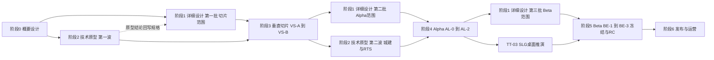

# 路线图与里程碑（Roadmap）

> 归属：`docs/60_production/`（制作计划，正典优先级第 5 级）。与 `../20_world/`、`../00_vision/`、`../30_story/` 冲突时以后者为准，并回头修订本文。
> 作用：回答"按什么顺序做、每一步做到什么程度才算过门、哪些问题在哪一步用什么方式决定、做不完时先砍什么"。
> 约束：`../00_vision/decision_log.md` 第 1 节全部已锁定决策，尤其 D-002（单人主线）、D-004（复用确定性 sim，在格子平面上计算）、
> D-005（等级 60）、D-007（模型提议，内核裁决）、D-008（女神双半结构）、D-009（五档分级推理）、D-010（无模型降级档必须能完整通关，
> 是垂直切片的硬性验收项）、D-011（自治度）、D-012（英雄是乘数，单位三层）、D-013（注册修正项）、D-015 与 D-017（许可）。
> 姊妹文档：[risks.md](risks.md)（风险登记与预演失败，本文用 `RK-xx` 引用）、[dev_process.md](dev_process.md)（文档分层、评审门、实施包、质量门）。
> 主要上游：[`game_framework.md`](../40_design/game_framework.md) 第 14、15 节；
> [`internal_playbooks.md`](../10_research/woc_reuse/internal_playbooks.md) 第 2、5、6 节；
> [`game_dev_methodology.md`](../10_research/open_share/game_dev_methodology.md) 第 7、8 节。
> 规则：本文不写任何日期承诺。阶段以"进入标准、退出标准、验收条目"表达；工作量用相对量级与人周，并在第 1.2 节写明假设。

## 0. 一页结论

1. **七个阶段，按门槛推进，不按日历。** 阶段 0 概要设计（当前）、阶段 1 详细设计、阶段 2 技术原型、阶段 3 垂直切片（序章 + 第一幕）、
   阶段 4 Alpha（第一到第三幕，含城建与 RTS）、阶段 5 Beta（全幕次）、阶段 6 发布与运营（造主天启的运营层）。
   里程碑是"管理门槛，不是日历节点"，通过意味着遗留问题被接受并登记，而不是没有问题
   （[`game_dev_methodology.md`](../10_research/open_share/game_dev_methodology.md) 第 7.4 节）。
2. **详细设计与技术原型交错进行。** 原型先回答阻塞详细设计的问题；详细设计按"切片范围、Alpha 范围、Beta 范围"分三批滚动，
   不一次写完全作规格。
3. **十个技术原型加三次桌面推演，一原型一问题。** 第一波八个（战斗手感、女神 GM、NPC 成本、认知传闻、千门发掘感、渲染基准、程序化素材样板、
   序章面试）阻塞切片入口；第二波两个（城建摆放与自治度、RTS 兵团基准）阻塞 Alpha 入口。原型代码默认丢弃。
4. **垂直切片 = 序章 + 第一幕，分两个内部里程碑。** VS-A（序章 + 第一幕落地拍，第 1 到 5 周）先验证核心假设与生产管线；
   VS-B（全幕）完成全部验收。硬性验收项共八条，第一条就是"无模型降级档能完整通关"（D-010），其余为模型版通关与故障韧性、
   确定性回放、零剧透、成本上限、素材合规、正典一致、生产单位成本实测。
5. **Alpha 以"层间衔接切片"开场。** 先回答"个人层的强大能否成为经营层与战场层的王牌而不让它们退化"（D-012），再铺第二、三幕内容。
   SLG 放在 Beta，是全作风险线上最靠后、也最可缩量的玩法。
6. **砍线以缩量、降级、替代为主，不整块删除支柱。** 保底线（不可砍）是 D-007、D-010、D-011、D-012、D-013、确定性回放与揭示台账；
   首批风险线是女神与 NPC 的模型自由对话、RTS 大规模手动指挥、SLG 全量（替代为事件制外交）。
7. **工作量量级。** 切片约 60 到 100 人周（假设见第 1.2 节）；Alpha 与 Beta 各约为切片的 2 到 3 倍，切片退出时以实测单位成本重估。
8. **需要用户尽快拍板的事项**集中在第 8 节"决定者"为用户的行：代码组织（Q-001）、大模型供应与费用承担方（Q-004、Q-009）、
   切片范围、内核文本与语言（R-04）。

---

## 1. 规划原则与假设

### 1.1 原则

| 原则               | 含义                                                                                               | 来源                                                                                                            |
| ------------------ | -------------------------------------------------------------------------------------------------- | --------------------------------------------------------------------------------------------------------------- |
| 门槛不是日历       | 每个阶段与里程碑只用可判定的进入、退出标准过门；未完成项必须写明延期、砍掉、降级或转入下一阶段     | [`game_dev_methodology.md`](../10_research/open_share/game_dev_methodology.md) 第 7.4 节（milestone）           |
| 风险先行           | 先做最能代表最终风险的部分，而不是最简单的部分                                                     | 同上第 7.3 节（vertical-slice）                                                                                 |
| 一原型一问题       | 每个原型写假设、范围、成功标准、截止条件，结束时必须决策（继续、转向、砍掉、重做），结论进决策日志 | 同上第 7.2 节（prototype）                                                                                      |
| 降级先行           | 每个 AI 功能先有规则版与预写台词版，再接模型；降级档不能等模型版做完再补                           | 同上第 7.10 节；D-010                                                                                           |
| 滚动详细设计       | 详细设计按切片、Alpha、Beta 三批推进，只为下一个门写规格                                           | [`internal_playbooks.md`](../10_research/woc_reuse/internal_playbooks.md) 第 6.2 节                             |
| 变更逐级收紧       | 预研期鼓励探索但要记录；Alpha 后新增功能必须配砍项；Beta 后原则上只修缺陷                          | [`game_dev_methodology.md`](../10_research/open_share/game_dev_methodology.md) 第 7.4 节（change-request）      |
| 大目标拆中间里程碑 | 切片拆成 VS-A 与 VS-B，Alpha 先做层间衔接切片                                                      | [`internal_playbooks.md`](../10_research/woc_reuse/internal_playbooks.md) 第 5.6 节（"实跑目标反复后移"的教训） |
| 证据不冒充         | 验收项不能确认就标 VERIFY，不得标 PASS；末次代码变更之后的一次完整通过才算完成                     | 同上第 5.5 节                                                                                                   |

### 1.2 工作量口径与假设

| 项       | 假设                                                                                                                                                                                                                                                                                                                                                                                                                                         |
| -------- | -------------------------------------------------------------------------------------------------------------------------------------------------------------------------------------------------------------------------------------------------------------------------------------------------------------------------------------------------------------------------------------------------------------------------------------------- |
| 团队     | 用户兼任制作人、正典负责人与主审；工程侧 1 到 2 人（大部分实现由 AI 代理承担，人负责评审、集成与拍板）；至少 1 名像素美术（可兼职或外包）负责风格包与调色、素材模板评审与仓库外的参考草图（[`art_pipeline.md`](../50_tech/art_pipeline.md) 第 1.4、6.1 节）；写作由用户主导、AI 代理起草                                                                                                                                                                      |
| 人周     | 一名熟练成员一周的有效产出，已包含与 AI 代理协作、评审与返工；不含等待拍板的时间                                                                                                                                                                                                                                                                                                                                                             |
| 量级     | 小：不超过 2 人周；中：2 到 6 人周；大：6 到 15 人周；特大：15 人周以上                                                                                                                                                                                                                                                                                                                                                                      |
| 估算依据 | 第一幕约 40 名有名 NPC、13 条主线、23 条支线、9 条纷争（[`act1_borderstone.md`](../30_story/arcs/act1_borderstone.md) 第 3 到 5 节）；切片的程序化模板清单与数量估计（[`art_pipeline.md`](../50_tech/art_pipeline.md) 第 9 节）；第一幕每游戏日约 110 到 170 次模型请求（[`npc_society_ai.md`](../40_design/systems/npc_society_ai.md) 第 13.1 节）；主工程 sim 的复用与剪裁步骤（[`reuse_map.md`](../50_tech/reuse_map.md) 第 3.11 节） |
| 不确定度 | 概要设计阶段的估算误差在正负一半以上；第一波原型结束时收窄；切片退出时以实测单位成本重估 Alpha 与 Beta（[`game_dev_methodology.md`](../10_research/open_share/game_dev_methodology.md) 第 7.3 节："切片必须产出每单位内容的量产工时与 token 成本"）                                                                                                                                                                                          |
| 不含     | 正式音乐与配音、多语言、移动端、市场与发行运营                                                                                                                                                                                                                                                                                                                                                                                               |

### 1.3 编号约定

| 前缀                             | 含义                     | 定义位置                           |
| -------------------------------- | ------------------------ | ---------------------------------- |
| 阶段 0 到 阶段 6                 | 七个制作阶段             | 本文第 2、3 节                     |
| `PT-xx`                          | 技术原型                 | 本文第 4 节                        |
| `TT-xx`                          | 桌面推演（纸面原型）     | 本文第 4.5 节                      |
| `VS-A`、`VS-B`、`VS-xx`          | 切片内部里程碑与验收条目 | 本文第 5 节                        |
| `AL-x`、`BE-x`                   | Alpha、Beta 的子里程碑   | 本文第 3 节                        |
| `CUT-xx`                         | 砍线条目                 | 本文第 7 节                        |
| `RK-xx`                          | 风险                     | [risks.md](risks.md)               |
| `D-xxx`、`Q-xxx`、`R-xx`、`A-xx` | 已锁定决策与未决问题     | `../00_vision/decision_log.md`     |
| `CB-x`、`EC-x`、`RTS-x`、`SLG-x` | 各系统文档的待决问题     | `../40_design/systems/` 各文档末节 |

序章场景节拍在 `prologue_antechamber.md` 中写作 P1 到 P16，第一幕任务写作 M1、S01，谜团写作 M01、S01；
为避免混淆，本文的原型一律用 `PT-`，里程碑一律用 `VS-`、`AL-`、`BE-`。

---

## 2. 阶段总览

| 阶段 | 名称                 | 一句话目标                                                                 | 主要产出                                                              | 量级                       | 过门                 |
| ---- | -------------------- | -------------------------------------------------------------------------- | --------------------------------------------------------------------- | -------------------------- | -------------------- |
| 0    | 概要设计（当前）     | 把愿景、正典、叙事落成可评审的系统概要卡，定下切片范围、原型问题与风险基线 | 缺失的系统概要卡、正典清理、本目录三份文档、原型问题卡                | 中（剩余工作）             | 概要评审门           |
| 1    | 详细设计（三批滚动） | 概要卡升格为可拆实施包的规格                                               | `systems/<系统>/` 规格目录、数值公式表、AI 契约、存档格式、实施包清单 | 每批中到大                 | 详细设计评审门       |
| 2    | 技术原型             | 用最小代价回答最大的技术与体验未知                                         | 原型结论文档、决策日志条目                                            | 第一波合计约 25 到 40 人周 | 原型验收六问         |
| 3    | 垂直切片             | 序章 + 第一幕端到端，品质接近目标，管线可复用，成本可估                    | 可玩构建、证据台账、单位成本台账、Alpha 重估                          | 特大（约 60 到 100 人周）  | 里程碑门（切片验收） |
| 4    | Alpha                | 第一到第三幕跑通，经营层与战场层功能完整                                   | 可玩构建、平衡模拟报告、已落地事实总览                                | 特大（约为切片 2 到 3 倍） | 里程碑门（Alpha）    |
| 5    | Beta                 | 全幕次、SLG、全部结局；功能冻结、内容冻结、发布候选                        | 发布候选构建、合规材料                                                | 特大（约为切片 2 到 3 倍） | 发布门（Go/No-Go）   |
| 6    | 发布与运营           | 上线，并以造主天启运营世界规则                                             | 运营后台、AI 运营手册、版本节奏                                       | 持续                       | 每个版本过发布门     |

说明：第二批详细设计与第二波原型可以在切片后半（VS-B 期间）提前启动，但不得占用切片的关键路径；第三批同理。

---

## 3. 阶段详情

### 3.1 阶段 0：概要设计（当前）

| 项                   | 内容                                                                                                                                                                                                                                                                                                                                                                                                                                                                                                                                                                                                                                                                                                                                                                                                                                                                                    |
| -------------------- | --------------------------------------------------------------------------------------------------------------------------------------------------------------------------------------------------------------------------------------------------------------------------------------------------------------------------------------------------------------------------------------------------------------------------------------------------------------------------------------------------------------------------------------------------------------------------------------------------------------------------------------------------------------------------------------------------------------------------------------------------------------------------------------------------------------------------------------------------------------------------------------- |
| 目标                 | 全作每个系统都有概要卡；正典内部矛盾清零或有处理结论；切片范围、原型问题、风险基线经用户认可                                                                                                                                                                                                                                                                                                                                                                                                                                                                                                                                                                                                                                                                                                                                                                                            |
| 要回答的问题         | 每个系统服务哪根支柱、与谁交互、不做什么；切片的 Must 是什么；哪些问题只能靠原型回答；最大的风险是什么                                                                                                                                                                                                                                                                                                                                                                                                                                                                                                                                                                                                                                                                                                                                                                                  |
| 现状                 | 已成稿：愿景与决策日志；正典七篇（`../20_world/`）；叙事大纲、揭示台账、角色、序章到第六幕全部分幕文档（`../30_story/`）；总框架；七张系统概要卡（城建、经济、女神 GM、SLG、NPC 社会、RTS、认知与声望）；复用映射、美术与素材方案（HD-2D 场景）与 AI 架构；术语表与 `docs/README.md` 索引。撰写中：`systems/quests_and_events.md`、`content/content_outline.md`。尚缺（待撰写）且已被多处引用：`systems/combat_and_classes.md`、`systems/thousand_doors.md`、`systems/companions_and_party.md`、`progression_and_pacing.md`                                                                                                                                                                                                                                                                                                                                                                              |
| 产出                 | 上述缺失文档；本目录三份文档；第一波原型问题卡；切片范围（第 5.2 节）的批准记录；正典清理记录                                                                                                                                                                                                                                                                                                                                                                                                                                                                                                                                                                                                                                                                                                                                                                                           |
| 进入标准             | 已满足（愿景、正典、叙事成稿）                                                                                                                                                                                                                                                                                                                                                                                                                                                                                                                                                                                                                                                                                                                                                                                                                                                          |
| 退出标准（全部满足） | 1. 总框架第 5 节系统地图中的每个系统都有概要卡，每张卡写明服务的支柱、核心循环、接口、非目标、开放问题，并通过概要评审门（[dev_process.md](dev_process.md) 第 1.3 节），无 BLOCKING。 2. `docs/README.md` 与术语表建立，所有文档登记状态（草案、评审中、已定稿、历史）。 3. 已知正典不一致全部登记且有处理结论：世界状态变量命名与量纲统一（[`goddess_gm.md`](../40_design/systems/goddess_gm.md) 第 18 节第 9 条）；第六幕证据编号对齐（同节第 15 条）；`history.md` 按 D-019 修订；神约执行方式（同节第 1 条）。 4. 第一波每个原型都有用户认可的问题卡（第 4.1 节字段）。 5. 切片范围的 MoSCoW（第 5.2 节）经用户批准并登记为决策。 6. 风险登记建立，优先级前十的风险都有预警信号与负责阶段（[risks.md](risks.md)）。 7. Q-001 的"原型期临时方案"已拍板（只定原型代码放哪，不必定终局）。 8. 风格规范与切片所需风格包的清单（[`art_pipeline.md`](../50_tech/art_pipeline.md) 第 1 节）经美术方向认可（PT-07 的前置）。 |
| 主要风险             | RK-09 范围过大、RK-25 单点决策瓶颈、RK-26 正典文档间不一致、RK-33 名称与 IP 雷同                                                                                                                                                                                                                                                                                                                                                                                                                                                                                                                                                                                                                                                                                                                                                                                                        |
| 本阶段决定           | Q-001（原型期临时方案）；女神 GM 第 18 节第 1、9 条（第 15 条已由 D-032 决定）；切片范围；实施包与原型代码位置（Q-010，[dev_process.md](dev_process.md) 第 3.1 节）                                                                                                                                                                                                                                                                                                                                                                                                                                                                                                                                                                                                                                                                                   |
| 量级                 | 中：六张概要卡与技术概要由 AI 代理起草、用户审定，外加正典清理                                                                                                                                                                                                                                                                                                                                                                                                                                                                                                                                                                                                                                                                                                                                                                                                                          |

### 3.2 阶段 1：详细设计（三批滚动）

| 项                             | 内容                                                                                                                                                                                                                                                                                                                                                                                                                                                                                                                                                                   |
| ------------------------------ | ---------------------------------------------------------------------------------------------------------------------------------------------------------------------------------------------------------------------------------------------------------------------------------------------------------------------------------------------------------------------------------------------------------------------------------------------------------------------------------------------------------------------------------------------------------------------- |
| 目标                           | 概要卡按 [dev_process.md](dev_process.md) 第 2 节"升格为目录"，产出可直接拆实施包的规格                                                                                                                                                                                                                                                                                                                                                                                                                                                                                |
| 要回答的问题                   | 每条需求如何测试；每个数值从哪里来；状态机的失败与回退态；每个 AI 介入点的意图枚举、校验、回退与预算；存档字段与版本                                                                                                                                                                                                                                                                                                                                                                                                                                                   |
| 第一批（切片范围，阻塞阶段 3） | 战斗与职能（格子平面化、60 级中 1 到 15 段、多资源、编外者）；千门回廊（回廊骨架与第一幕八扇门）；认知、传闻与声望；NPC 社会 AI（五档与降级档）；女神 GM（规则执行者、第一幕可用的神权菜单、序章）；任务与事件（主线 M1 到 M13、纷争链格式）；同伴与队伍（夜羽、临时同行）；门内庭院（[`city_building.md`](../40_design/systems/city_building.md) 第 2 节）；个人层经济与梅尔卡神龛（[`economy_and_trade.md`](../40_design/systems/economy_and_trade.md) 第 2、8.5 节）。技术：架构、AI 契约、存档格式、测试策略；数值公式表 1 到 15 级段；第一幕内容数据表；TT-01 纷争推演 |
| 第二批（阻塞 Alpha）           | 城建（据点到城镇）；经济（商会、区域经济、领地财政、注册修正项合同全集）；RTS（小队到军团）；同伴与将领；第二、三幕内容数据表；公式表 15 到 45 级段；TT-02 经济表格模拟                                                                                                                                                                                                                                                                                                                                                                                                |
| 第三批（阻塞 Beta）            | SLG；神庭辩论；雅努规则；结局与新周目；第四到六幕内容数据表；公式表 45 到 60 级段与位阶威压                                                                                                                                                                                                                                                                                                                                                                                                                                                                            |
| 产出                           | 规格目录、`../40_design/balance/formulas.md`、`../50_tech/ai_contract.md`、`../50_tech/save_format.md`、每批的实施包清单与依赖顺序                                                                                                                                                                                                                                                                                                                                                                                                                                     |
| 进入标准                       | 对应系统通过概要评审门；该批依赖的原型已有结论，或规格中显式保留两套方案并注明由哪个原型选择                                                                                                                                                                                                                                                                                                                                                                                                                                                                           |
| 退出标准（每批）               | 1. 每份规格通过详细设计评审门：需求编号且可测试；数值全部回链公式表或标"初值，待调"并写负责人与验证方式；状态机含失败与回退；AI 介入点有意图枚举、校验、回退、预算；存档字段带版本；验收条目编号。 2. 数值溯源审查与 AI 边界审查无 BLOCKING（[dev_process.md](dev_process.md) 第 4.3 节）。 3. 该批实施包清单与依赖顺序产出，第一阶段均为地基。 4. 该批涉及的未决问题已决定，或明确延后到哪个门并写入第 8 节。                                                                                                                                                |
| 主要风险                       | RK-12 等级扩展失衡、RK-13 多资源复杂度、RK-19 数值乘数失控、RK-20 经济失衡、RK-26 正典不一致、RK-27 文本体量爆炸                                                                                                                                                                                                                                                                                                                                                                                                                                                       |
| 本阶段决定                     | 第一批：Q-003（第一幕段）、R-02、R-04、EC-3、女神 GM 第 18 节第 3、14 条（第 2、4、5、13 条已由 D-026、D-027、D-047、D-028 决定），NPC 社会第 18 节第 3、4、7 条。第二批：Q-006、CB-2、CB-4、CB-6、EC-1、EC-2、EC-4、EC-5、RTS-3（RTS-4 已由 D-045 决定）、NPC 社会第 18 节第 2 条、女神 GM 第 18 节第 10 条。第三批：Q-007、SLG-1、SLG-5、SLG-6（SLG-2 到 SLG-4 已由 D-041 到 D-043、D-049 决定）、EC-6、Q-003（全段）、女神 GM 第 18 节第 12 条（第 6、7、8、11 条已由 D-033、D-034、D-022、D-035 决定）                                                             |
| 量级                           | 第一批大（约 8 到 14 人周，含公式表与 AI 契约）；第二批中到大；第三批中到大                                                                                                                                                                                                                                                                                                                                                                                                                                                                                            |

### 3.3 阶段 2：技术原型

| 项                     | 内容                                                                                                                                                                                                                                                                                                                                                                                                                                                         |
| ---------------------- | ------------------------------------------------------------------------------------------------------------------------------------------------------------------------------------------------------------------------------------------------------------------------------------------------------------------------------------------------------------------------------------------------------------------------------------------------------------ |
| 目标                   | 用最小代价回答切片与 Alpha 的最大未知；每个原型结束都给出"继续、转向、砍掉、重做"的结论                                                                                                                                                                                                                                                                                                                                                                      |
| 要回答的问题           | 见第 4 节每个原型的核心问题                                                                                                                                                                                                                                                                                                                                                                                                                                  |
| 产出                   | 每个原型一份结论文档（[dev_process.md](dev_process.md) 第 3.5 节"原型包"）；决策日志条目；可复用部分的清单（例如格子平面化补丁、校验器、风格包与素材模板），原型代码本身默认丢弃                                                                                                                                                                                                                                                                                       |
| 进入标准（每个原型）   | 问题卡经用户认可；Q-001 的原型期临时方案已定；AI 类原型已有模型访问与金额上限；PT-07 已有认可的风格规范                                                                                                                                                                                                                                                                                                                                                        |
| 退出标准（第一波整体） | 1. PT-01 到 PT-07 与 PT-10 都有结论文档，回答了原型验收六问：假设回答了没有、拿到反馈没有、能否决策、继续是否值得、还剩哪些风险、哪些能复用（[`game_dev_methodology.md`](../10_research/open_share/game_dev_methodology.md) 第 7.2 节）。 2. 第 8 节中标"阶段 2"的未决问题全部决定并登记。 3. 切片的成本阈值、性能阈值、试玩门槛已根据原型数据写入切片入口的决策记录。 4. 结论为"砍掉或转向"的原型，其替代方案已写入第 7 节砍线并更新受影响的规格。 |
| 第二波                 | PT-08、PT-09 在切片后半启动，Alpha 入口前完成；退出标准同上                                                                                                                                                                                                                                                                                                                                                                                                  |
| 主要风险               | RK-01 成本、RK-02 延迟、RK-11 格子平面化回归、RK-14 HD-2D 渲染性能、RK-16 风格一致性、RK-17 素材许可与来源、RK-34 原型代码滑入生产                                                                                                                                                                                                                                                                                                                                            |
| 本阶段决定             | Q-001（终局）、Q-002、Q-004、Q-005、R-03、R-05、A-06、A-15；第二波：CB-1、RTS-1、RTS-5；Q-009（大模型费用承担方与商业模式）                                                                                                                                                                                                                                                                                                                    |
| 量级                   | 第一波合计约 25 到 40 人周（逐项见第 4 节）；第二波约 6 到 10 人周                                                                                                                                                                                                                                                                                                                                                                                           |

### 3.4 阶段 3：垂直切片（序章 + 第一幕）

范围、内部里程碑与验收见第 5 节。此处只列过门标准。

| 项           | 内容                                                                                                                                                                                                                                                                                                                                                                                                       |
| ------------ | ---------------------------------------------------------------------------------------------------------------------------------------------------------------------------------------------------------------------------------------------------------------------------------------------------------------------------------------------------------------------------------------------------------- |
| 目标         | 验证 [`game_framework.md`](../40_design/game_framework.md) 第 15 节的六个核心假设；证明生产管线可复用；得到每单位内容的工时与成本                                                                                                                                                                                                                                                                          |
| 要回答的问题 | 女神序章对话是否有趣且锚点稳定；边石镇是否"活"；"凡人不信"能否稳定产出；格子平面战斗手感；千门发掘感；无模型能否完整通关；量产一幕要花多少                                                                                                                                                                                                                                                                      |
| 产出         | 切片构建；证据台账（`milestones/vs/verification_matrix.md`，见 [dev_process.md](dev_process.md) 第 7 节）；单位成本台账；Alpha 与 Beta 重估；切片后决策记录                                                                                                                                                                                                                                                |
| 进入标准     | 1. 详细设计第一批全部过门。 2. 第一波原型全部有结论，第 8 节"阶段 2"项全部决定。 3. Q-001 终局已定，代码仓库与工具链就位（来源记录、第三方声明，[`reuse_map.md`](../50_tech/reuse_map.md) 第 4.4、6.3 节）。 4. 切片所需风格包与首批素材模板经美术方向审定。 5. 成本阈值、性能阈值、试玩门槛已登记。 6. 首批实施包（模拟核心与表现接缝、AI 意图通道、内容数据层、程序化素材模板）已生成并过实施包门。 |
| 退出标准     | 第 5.4 节全部"硬性"条目为 PASS；"目标"条目为 PASS，或为 FAIL 但已由用户书面接受并登记处理去向；第 5.6 节的切片后决策已登记                                                                                                                                                                                                                                                                                 |
| 主要风险     | RK-08 降级体验差、RK-04 剧透、RK-05 正典冲突、RK-18 素材模板产能、RK-24 AI 代理协作失效、RK-29 确定性被 AI 输入破坏、RK-30 "活"感不足、RK-31 喜剧过密                                                                                                                                                                                                                                                          |
| 本阶段决定   | R-08（VS-A 退出前）、A-09 与 A-13（切片退出时）、Q-008（首次对外展示世界地图前）                                                                                                                                                                                                                                                                                                                                   |
| 量级         | 特大，约 60 到 100 人周（分项见第 5.7 节）                                                                                                                                                                                                                                                                                                                                                                 |

### 3.5 阶段 4：Alpha（第一到第三幕，含城建与 RTS）

| 子里程碑          | 范围                                                                                                                                                                 | 要回答的问题                                                                                                                                                                                                               |
| ----------------- | -------------------------------------------------------------------------------------------------------------------------------------------------------------------- | -------------------------------------------------------------------------------------------------------------------------------------------------------------------------------------------------------------------------- |
| AL-0 层间衔接切片 | 第二幕后半的据点到村落（旧哨村，`act2_wallenburg.md` 第 4、7 节）、城下潮小队战、第三幕领地起步（灰烬边境领 T1 到 T3）与首场连队战（北线红牙突袭）；可从预设存档进入 | 个人层的强大能否成为经营与战场层的王牌，又不让它们退化为"英雄清场"（D-012）；每个新层的"二次 Onboarding"是否顺滑（[`game_dev_methodology.md`](../10_research/open_share/game_dev_methodology.md) 第 8.1 节第 4 条）；RTS-2 |
| AL-1 第二幕全幕   | 瓦伦堡：城市政治、门扉商会、迷宫、村落建设、小队指挥、世界状态从第一幕传入                                                                                           | 城市规模的 AI 社会成本与"活"感；商会经济是否健康                                                                                                                                                                           |
| AL-2 第三幕全幕   | 王国之乱：领地经营、千军之门与 RTS 全面、宫廷、将领、第一次战争                                                                                                      | 军团规模性能；自治度对玩法的可感知影响；层叠后的认知负荷                                                                                                                                                                   |

| 项                   | 内容                                                                                                                                                                                                                                                                                                                                                                                                                                                                                                                                                                                                                                                                                                                                                |
| -------------------- | --------------------------------------------------------------------------------------------------------------------------------------------------------------------------------------------------------------------------------------------------------------------------------------------------------------------------------------------------------------------------------------------------------------------------------------------------------------------------------------------------------------------------------------------------------------------------------------------------------------------------------------------------------------------------------------------------------------------------------------------------- |
| 目标                 | 第一到第三幕端到端可玩；个人、队伍、社会、经营、战场五层功能完整；数值与经济经过模拟验证                                                                                                                                                                                                                                                                                                                                                                                                                                                                                                                                                                                                                                                            |
| 产出                 | Alpha 构建；经济分群模拟报告；层间转换漏斗报告；已落地事实总览（`docs/current_design.md`，名称待 [dev_process.md](dev_process.md) 第 7 节确定）                                                                                                                                                                                                                                                                                                                                                                                                                                                                                                                                                                                                     |
| 进入标准             | 1. 切片退出且切片后决策为"继续"。 2. 详细设计第二批过门。 3. PT-08、PT-09 有结论；TT-02 完成。 4. 依据切片单位成本完成的 Alpha 重估已登记，范围与砍线据此调整。                                                                                                                                                                                                                                                                                                                                                                                                                                                                                                                                                                            |
| 退出标准（全部满足） | 1. 第一到第三幕在模型版与无模型版下各至少一次完整通关（自动化加人工），无阻断。 2. 经营层从据点到城镇、战场层从小队到军团全部落地，三层单位模型可用（D-012）。 3. 经济分群模拟（[`economy_and_trade.md`](../40_design/systems/economy_and_trade.md) 第 9.2 节）三种画像每 10 游戏小时的期望变化落在门槛内；套利审计找不到可无限重复的获利回路（RK-20）。 4. 第三幕军团规模战场在目标硬件的帧预算内。 5. 第二、三幕规模下每游戏日模型成本不超过登记阈值（对照 [`npc_society_ai.md`](../40_design/systems/npc_society_ai.md) 第 13.1 节）。 6. 层间转换点（首次进入经营层、首场 RTS）的流失可观测且有处理结论。 7. 自治度分群数据足以决定 CB-3。 8. 存档跨 Alpha 内各版本加载测试通过。 9. 已落地事实总览建立，并与代码一致。 |
| 变更控制             | 进入 Alpha 后，新增功能必须同时提交一项砍线或降级（第 7.3 节）                                                                                                                                                                                                                                                                                                                                                                                                                                                                                                                                                                                                                                                                                      |
| 主要风险             | RK-10 层间互相拖累、RK-15 RTS 规模、RK-19 乘数失控、RK-20 经济失衡、RK-28 存档膨胀、RK-35 时间模型与成本耦合                                                                                                                                                                                                                                                                                                                                                                                                                                                                                                                                                                                                                                        |
| 本阶段决定           | RTS-2（AL-0）、A-14 与 A-16（战场与地图内容量产前）、A-17（AL-2 末）、CB-3（AL-2 末）、TT-03 的结论（SLG 全量还是事件制外交，见 CUT-04）                                                                                                                                                                                                                                                                                                                                                                                                                                                                                                                                                                                                                                                             |
| 量级                 | 特大，约为切片的 2 到 3 倍（切片退出时重估）                                                                                                                                                                                                                                                                                                                                                                                                                                                                                                                                                                                                                                                                                                        |

### 3.6 阶段 5：Beta（全幕次）

| 子里程碑          | 范围                                                                                                                                                                             |
| ----------------- | -------------------------------------------------------------------------------------------------------------------------------------------------------------------------------- |
| BE-1 第四幕       | 立国、首都与多城、SLG 大地图、外交、贸易、谍报、他神勇者                                                                                                                         |
| BE-2 第五幕       | 多战线大战、联盟战争、净澱工程、不在场战线自动结算与自治度挂钩                                                                                                                   |
| BE-3 第六幕与终章 | 神庭辩论（内核计分）、终战、全部 11 种结局、新周目、隐藏结局                                                                                                                     |
| 功能冻结          | 停止新增功能，变更需例外审批                                                                                                                                                     |
| 内容冻结          | 停止新增内容；资料中两种顺序并存，本作统一为"功能冻结在前、内容冻结在后"（[`game_dev_methodology.md`](../10_research/open_share/game_dev_methodology.md) 第 7.1 节的不一致提醒） |
| 发布候选（RC）    | 只允许 P0、P1 与发布阻塞修复                                                                                                                                                     |

| 项                             | 内容                                                                                                                                                                                                                                                                                                                                                                                                                                                                                                                                                                                                                                                                  |
| ------------------------------ | --------------------------------------------------------------------------------------------------------------------------------------------------------------------------------------------------------------------------------------------------------------------------------------------------------------------------------------------------------------------------------------------------------------------------------------------------------------------------------------------------------------------------------------------------------------------------------------------------------------------------------------------------------------------- |
| 目标                           | 全作内容完整、可通关、可发布                                                                                                                                                                                                                                                                                                                                                                                                                                                                                                                                                                                                                                          |
| 产出                           | 发布候选构建；平台合规材料（AI 内容说明、分级材料、隐私说明）；运营后台与降级开关就绪                                                                                                                                                                                                                                                                                                                                                                                                                                                                                                                                                                                 |
| 进入标准                       | 1. Alpha 退出。 2. 详细设计第三批过门。 3. TT-03 结论与 CUT-04 的决定已登记。 4. Beta 重估已登记。                                                                                                                                                                                                                                                                                                                                                                                                                                                                                                                                                           |
| 退出标准（全部满足，即发布门） | 1. 全幕次在模型版与无模型版下各完整通关。 2. 全部 11 种结局可达（自动化路线测试加人工抽检）。 3. P0 缺陷清零。 4. 揭示节奏在实测通关中成立：主谜团按 [`reveal_ledger.md`](../30_story/reveal_ledger.md) 第 9 节的幕次揭开，泄露检查命中为零。 5. 第五幕不在场战线的结算质量与自治度相关且可向玩家解释。 6. 平台与法律合规：AI 内容披露（[`art_pipeline.md`](../50_tech/art_pipeline.md) 第 6.7 节）、分级材料、对话日志的保留与删除说明。 7. 发布级门全绿（许可与素材来源扫描、专有名词扫描、恶意代码扫描的等价物、全量测试）。 8. 运营后台、远程配置、降级开关与 AI 运营手册通过演练。 9. Go/No-Go 写入决策日志，含回滚包与值守安排。 |
| 主要风险                       | RK-09 范围、RK-21 揭示被提前破解、RK-22 上游同步、RK-23 法律与平台政策、RK-32 心流矛盾                                                                                                                                                                                                                                                                                                                                                                                                                                                                                                                                                                                |
| 本阶段决定                     | R-09（功能冻结前）                                                                                                                                                                                                                                                                                                                                                                                                                                                                                                                                                                                                                                                    |
| 量级                           | 特大，约为切片的 2 到 3 倍（Alpha 退出时重估）                                                                                                                                                                                                                                                                                                                                                                                                                                                                                                                                                                                                                        |

### 3.7 阶段 6：发布与运营（造主天启的运营层）

| 项                       | 内容                                                                                                                                                                                                                                                                                                                                                                                                                                                                                       |
| ------------------------ | ------------------------------------------------------------------------------------------------------------------------------------------------------------------------------------------------------------------------------------------------------------------------------------------------------------------------------------------------------------------------------------------------------------------------------------------------------------------------------------------ |
| 目标                     | 上线；开发者以"造主"身份通过天启（世界规则修订）给全部女神 AI 下达高层指令（[`vision.md`](../00_vision/vision.md) 第 5 节；[`goddess_gm.md`](../40_design/systems/goddess_gm.md) 第 9 节）                                                                                                                                                                                                                                                                                                 |
| 运营层构成               | 1. 天启发布流程：天启草案、规则执行者落地预演（无头模拟回归）、古庭语碑文、灰度、全量唤醒女神解读。 2. 远程配置与功能开关：模型档、预算、降级级别、女神干预强度；远程改提示词必须先跑评估集（防绕过测试）。 3. 提示词与模型版本登记，任一变更触发评估集回归，一个阻断级失败即不可发布（[`game_dev_methodology.md`](../10_research/open_share/game_dev_methodology.md) 第 6.8 节）。 4. 成本、延迟、降级状态看板。 5. AI 运营手册：暂停生成、只关模型保留模板、全局止血、回滚。 |
| 进入标准                 | Beta 退出且 Go/No-Go 为 Go                                                                                                                                                                                                                                                                                                                                                                                                                                                                 |
| 版本门（每个版本或天启） | 评估集回归通过；无模型通关回归通过；成本看板在阈值内；回滚演练通过；上线后值守                                                                                                                                                                                                                                                                                                                                                                                                             |
| 远期（各自单独立项评估） | 异步"他人的箱庭"（D-002）；移动端（[`vision.md`](../00_vision/vision.md) 第 5 节）                                                                                                                                                                                                                                                                                                                                                                                                         |
| 主要风险                 | RK-07 模型供应变化、RK-01 成本、RK-23 平台政策、RK-36 本地模型门槛、RK-37 敏感题材与不当输出                                                                                                                                                                                                                                                                                                                                                                                               |
| 本阶段决定               | 他人的箱庭是否立项；移动端是否立项                                                                                                                                                                                                                                                                                                                                                                                                                                                         |

---

## 4. 技术原型清单

### 4.1 原型通则

| 规则         | 内容                                                                                                                                                                         |
| ------------ | ---------------------------------------------------------------------------------------------------------------------------------------------------------------------------- |
| 问题卡字段   | 编号、核心问题（一句）、关联未决问题、假设、最小范围、明确不做、成功判据（三档：成功、失败、继续观察）、失败时的转向、预计规模、截止条件（用工作量上限而非日期表达）、负责人 |
| 一原型一问题 | 一个原型只回答一个问题；需要回答两个问题就拆成两个原型                                                                                                                       |
| 降级档       | 每个涉及模型的原型都必须同时跑"模型关闭"一组，并记录差距                                                                                                                     |
| 丢弃规则     | 原型代码默认不进生产；可复用部分须在结论中列明，进入生产时走实施包重新实现或审查后迁入                                                                                       |
| 结论去向     | 结论文档放原型包（[dev_process.md](dev_process.md) 第 3.5 节）；被决定的未决问题移入决策日志第 1 节；影响到的规格同一改动内回写                                              |
| 试玩样本     | 体验类判据用 5 到 8 名试玩者，区分事实、玩家解释、团队推断（[`game_dev_methodology.md`](../10_research/open_share/game_dev_methodology.md) 第 7.7 节）                       |
| 门槛数值     | 下文"门槛"一词指问题卡中由用户确定的具体数值；本文给出建议值时标"建议"                                                                                                       |

### 4.2 总表

| 编号  | 名称                   | 波次 | 核心问题（一句）                                                  | 关联未决                                                   | 规模                          |
| ----- | ---------------------- | ---- | ----------------------------------------------------------------- | ---------------------------------------------------------- | ----------------------------- |
| PT-01 | 格子平面战斗手感       | 一   | 格子平面计算、HD-2D 斜俯视呈现下，目标锁定 + 快捷栏是否可读顺手  | Q-002、R-03、R-05                                          | 中，3 到 5 人周               |
| PT-02 | 女神 GM 双半结构       | 一   | 规则执行者 + 人格会话能否在模型出错时不卡、干预合法，且女神有个性 | D-008 验证；女神 GM 第 18 节第 1 条与 D-026 越约通道的落地 | 中，3 到 5 人周               |
| PT-03 | NPC 分级推理与成本实测 | 一   | 第一幕规模下五档推理的真实成本与延迟是否可承受，降级是否无缝      | Q-004、Q-005、NPC 社会第 18 节第 1、6 条                   | 大，4 到 6 人周               |
| PT-04 | 认知与传闻             | 一   | 纯规则能否稳定产出"被小看再打脸"的误会链且不过密                  | 无（体验假设 3）                                           | 中，2 到 4 人周               |
| PT-05 | 千门回廊发掘感         | 一   | 以门与钥解锁能力，玩家是否感到在发掘自己                          | R-02（界面部分）                                           | 小到中，2 到 3 人周           |
| PT-06 | HD-2D 渲染基准         | 一   | HD-2D 场景能否在目标硬件达到性能与像素清晰度指标                  | A-06（性能侧）                                             | 中，3 到 5 人周               |
| PT-07 | 程序化素材样板         | 一   | 代码模板加风格包能否以可接受的单位成本产出风格一致的素材          | A-06                                                      | 中到大，4 到 6 人周（含美术） |
| PT-10 | 序章面试对话           | 一   | 女神自由对话是否有趣，锚点能否稳定落地且不泄露                    | 体验假设 1                                                 | 中，2 到 4 人周（含写作）     |
| PT-08 | 城建摆放与自治度       | 二   | 微操与授权的取舍能否被玩家感知                                    | CB-1、CB-3（初值）、D-011                                  | 中，3 到 5 人周               |
| PT-09 | RTS 兵团规模基准       | 二   | 兵团与完整实体混合的战场能否在目标规模下保持确定性与帧预算        | RTS-1、RTS-5、D-012、A-14                                  | 中，3 到 5 人周               |

编号说明：PT-10 属于第一波，编号靠后只因它在 PT-08、PT-09 之后补入。

### 4.3 第一波原型卡

**PT-01 格子平面战斗手感**

| 项       | 内容                                                                                                                                                                                                                                                                                                                                                                                                                                                                                 |
| -------- | ------------------------------------------------------------------------------------------------------------------------------------------------------------------------------------------------------------------------------------------------------------------------------------------------------------------------------------------------------------------------------------------------------------------------------------------------------------------------------------ |
| 核心问题 | 主工程战斗 sim 压平到格子平面、在 HD-2D 斜俯视镜头下呈现后，"目标锁定 + 快捷栏 + 公共冷却"是否可读、顺手，值得作为默认操作（Q-002）                                                                                                                                                                                                                                                                                                                                                                             |
| 最小范围 | 按 Q-001 原型期方案拷贝固定提交的 sim；完成格子平面化五处中的压平地形、显式边界、关闭垂直运动，碰撞先保留圆形与 OBB（[`reuse_map.md`](../50_tech/reuse_map.md) 第 3.5 节）；约 60 码见方的测试场（墙、柱、窄道、水边）；编外者 1 名，8 到 10 个跨两职能技能；普通怪 3 种、精英 1 种、首领 1 个（守护巨鸦模板，[`act1_borderstone.md`](../30_story/arcs/act1_borderstone.md) 第 10.3 节）；占位立牌；三种操作方案并排（目标锁定、方向施放、混合）与两种朝向规则（自动面向目标、跟随鼠标） |
| 明确不做 | 正式美术、音效、任务、对话、门系统、存档                                                                                                                                                                                                                                                                                                                                                                                                                                             |
| 成功判据 | 1. 盲测记录三方案的首战完成率、首领首败后继续率、主观偏好与"你为什么输"可答率；默认方案在偏好与可答率上不低于其他方案。 2. 原样复用的战斗测试全绿；金样轨迹的每一处变化都有原因记录（[`reuse_map.md`](../50_tech/reuse_map.md) 第 3.11 节第 2、3 步）。 3. 新增的"追击、冲锋、击退、闪现、恐惧逃跑不出界"测试通过。 4. 试玩者事后能指认首领的地面预警与施法条（全部试玩者）。                                                                                               |
| 失败转向 | 目标锁定不成立则采用混合方案，并在战斗规格中登记手感改造清单；卡位频发则转瓦片碰撞（R-03）                                                                                                                                                                                                                                                                                                                                                                                           |
| 附带产出 | 剪裁可行性的第一手数据，供 R-05（剪裁协调器还是新写薄协调器）                                                                                                                                                                                                                                                                                                                                                                                                                        |

**PT-02 女神 GM 双半结构**

| 项       | 内容                                                                                                                                                                                                                                                                                                                                                                                                                     |
| -------- | ------------------------------------------------------------------------------------------------------------------------------------------------------------------------------------------------------------------------------------------------------------------------------------------------------------------------------------------------------------------------------------------------------------------------ |
| 核心问题 | 规则执行者 + 人格会话的拆分，能否在模型慢、错、缺席时保持世界不停表、干预合法，同时让女神表现出可辨识的个性与误判（D-008）                                                                                                                                                                                                                                                                                               |
| 最小范围 | 无渲染的文本世界（边石镇简化事件流：信徒见闻样本、价格、灾害、祈祷）；两位第一幕活跃女神（梅尔卡、艾琉恩）的人格卡（[`goddess_gm.md`](../40_design/systems/goddess_gm.md) 第 14 节草案）；规则执行者实现神力账、澱账、冷却、作用域、神约检查与 5 到 6 个菜单动作（神谕、价格修正、加护授予、托梦、任务发布、小神迹）；每游戏日一次规划轮加尊名唤醒；加速运行 30 个游戏日；故障注入（超时、非法输出、越权动作、过时回执） |
| 明确不做 | 渲染、NPC 社会、神庭辩论、雅努                                                                                                                                                                                                                                                                                                                                                                                           |
| 成功判据 | 1. 故障注入下世界时钟从不停表；非法提案全部被闸门拒绝并带可读原因。 2. 注册修正项之外不存在直接改数值的路径（测试断言，D-013）。 3. 关闭模型后，同种子 30 天由效用打分加写定神行节点产出合法、非空的干预序列。 4. 盲读 30 天日志的评审者能按行为区分两位女神，比例达到门槛（建议八成）。 5. 每游戏日女神调用的 token 与延迟完整记录，供 Q-004。                                                              |
| 失败转向 | 个性不足则加强人格卡与偏差档案而不放松闸门；成本过高则改为隔日规划加规则填充（[`npc_society_ai.md`](../40_design/systems/npc_society_ai.md) 第 13.3 节第 7 级）                                                                                                                                                                                                                                                          |

**PT-03 NPC 分级推理与成本实测**

| 项       | 内容                                                                                                                                                                                                                                                                                                                                                                                                                                       |
| -------- | ------------------------------------------------------------------------------------------------------------------------------------------------------------------------------------------------------------------------------------------------------------------------------------------------------------------------------------------------------------------------------------------------------------------------------------------ |
| 核心问题 | 第一幕规模（约 40 名有名 NPC）下，五档分级推理的真实请求数、token、金额与延迟是否可承受，降级切换能否不停表、不穿帮                                                                                                                                                                                                                                                                                                                        |
| 最小范围 | 无渲染的边石镇拓扑（地点与路程分钟数）；40 张人设卡（AI 代理按 [`act1_borderstone.md`](../30_story/arcs/act1_borderstone.md) 第 3 节起草，用户抽检）；L1 5 到 8 人、L2 约 15 人、L3 两到三个地区批量；日程模板加效用打分；行动空间取生活、经济、社交三类；分层记忆与整理轮；"先预留后结算"的预算与七级降级；至少两种模型档组合与一次本地小模型试验；游戏日 12、24、48 现实分钟三档对比                                                     |
| 明确不做 | 渲染、战斗、政治与冲突类动作、势力首领                                                                                                                                                                                                                                                                                                                                                                                                     |
| 成功判据 | 1. 每种组合至少 10 个游戏日的真实账单与 token 统计，并与 [`npc_society_ai.md`](../40_design/systems/npc_society_ai.md) 第 13.1 节估算对照，偏差写入结论。 2. 玩家发起交谈的首字延迟 p95 达到门槛（由用户在问题卡中定）。 3. 七级降级逐级触发与回升的演练通过，过程中不停表、会话状态不损坏。 4. 校验闸门对对抗样本（越权动作、编造知识、剧透诱导）全部拦截，误拒率有记录。 5. 给出每游戏日与每现实小时的成本区间和推荐默认档。 |
| 失败转向 | 成本不可承受则启动 CUT-02、CUT-03；延迟不可承受则改为"交谈先出预写开场白、模型续写"                                                                                                                                                                                                                                                                                                                                                        |

**PT-04 认知与传闻**

| 项       | 内容                                                                                                                                                                                                                                                                                         |
| -------- | -------------------------------------------------------------------------------------------------------------------------------------------------------------------------------------------------------------------------------------------------------------------------------------------- |
| 核心问题 | 信念画像 + 常识上限 + 传闻失真这套纯规则系统，能否在无模型时稳定产出"被小看再打脸"的误会链，且不过密、不重复                                                                                                                                                                                 |
| 最小范围 | 纯规则模拟；边石镇社交网络 40 人；按 [`act1_borderstone.md`](../30_story/arcs/act1_borderstone.md) 第 6.2 节桥段清单注入 6 个玩家事迹；传闻变形器（同文第 6.1 节）；信念跃迁阈值；喜剧节流；可读日志与"传闻画像"快照；挑一段接入 PT-03 的 L1 会话做措辞增色对照                              |
| 成功判据 | 1. 固定 20 个种子，每个种子在 12 个游戏周内出现可辨识的"不信、误解、证据、跃迁"弧不少于门槛（建议 4 条），且没有一次无证据跃迁。 2. 喜剧节流生效：同一 NPC 的同类误会在节流窗口内不重复。 3. 盲读评审中无模型版被评为"有趣"的比例达到门槛，并记录与增色版的差距。 4. 同种子同结果。 |
| 失败转向 | 误会链不稳定则把关键桥段改为写定事件、规则系统只负责扩散与失真                                                                                                                                                                                                                               |

**PT-05 千门回廊发掘感**

| 项       | 内容                                                                                                                                                                                                                                                                                                                                                                                   |
| -------- | -------------------------------------------------------------------------------------------------------------------------------------------------------------------------------------------------------------------------------------------------------------------------------------------------------------------------------------------------------------------------------------- |
| 核心问题 | 以"门 + 钥"而不是经验值解锁能力，玩家是否感到"在发掘自己"，而不是"在点一棵天赋树"                                                                                                                                                                                                                                                                                                      |
| 最小范围 | 先做纸面原型：门卡、钥卡与解锁卡（首次预示、首次展示、练习、组合、新规则，[`game_dev_methodology.md`](../10_research/open_share/game_dev_methodology.md) 第 8.1 节第 5 条）；再做数字原型：回廊界面、第一幕八扇门、4 到 6 扇"可见未开"与 1 到 2 扇隐藏门；钥来自 PT-01 测试场里的脚本事件；门效果用 `DoorEffect` 草案的最小子集（[`reuse_map.md`](../50_tech/reuse_map.md) 第 3.9 节） |
| 成功判据 | 1. 看过回廊的试玩者能说出"下一扇门可能是什么、怎么拿钥"的比例达到门槛（建议过半）。 2. 录屏中可观察到为找钥而自愿探索。 3. 访谈编码中"发现、原来、没想到"类表述多于"加点、天赋"类。 4. 可据数据推算第一幕"每 1 到 2 小时至少开一扇门"的节奏（[`game_framework.md`](../40_design/game_framework.md) 第 4 节）。 5. 为 R-02 给出至少一种可行的资源池界面呈现。               |
| 失败转向 | 发掘感不足则加强预示（门缝、门纹、梦）而不是加门数                                                                                                                                                                                                                                                                                                                                     |

**PT-06 HD-2D 渲染基准**

| 项       | 内容                                                                                                                                                                                                                                                                                                                     |
| -------- | ------------------------------------------------------------------------------------------------------------------------------------------------------------------------------------------------------------------------------------------------------------------------------------------------------------------------ |
| 核心问题 | Three.js HD-2D 场景（正交斜俯视相机、像素贴图地面与立体房屋、实例化立牌、光照图与太阳阴影、后期链），能否在目标硬件达到 [`art_pipeline.md`](../50_tech/art_pipeline.md) 第 2.11 节的指标                                                                                                                                                                         |
| 最小范围 | 一个街角（`lothar_plain` 风格包：像素地面贴图与抖动过渡、动态水面、两栋立体房屋、掀顶溶解、太阳阴影、光照图、调色、泛光、移轴、雾）；压力场景 1000 个动画立牌加 200 个光照图光源与 8 盏动态光；覆盖层画布（名字、浮字、气泡）；街景与俯视两个视角预设对比；平面档（Canvas2D）只验证"能玩"；素材用 PT-07 首批模板或占位模板                                                                                     |
| 成功判据 | 1. 1080p 集显（机型写入问题卡）上 1000 个立牌 + 200 个光照图光源 + 8 盏动态光在默认画质档稳定 60 帧，绘制调用不超过 30 次。 2. 整数缩放档、方位旋转与镜头跟随下像素不闪。 3. 回放驱动的逐帧截图同输入同像素。 4. 画质公平清单（同文第 2.12 节）在全部档位成立，含平面档。 5. 给出角色方向数（A-06）在帧数与性能上的上限，并确认默认俯角与缩放档；附街景俯角下的远景天幕样张（A-15）。 |
| 失败转向 | 性能不达标先降画质档（阴影、泛光、移轴），再收紧立牌与光源数量；平面档（Canvas2D）保底                                                                                                                                                                                                                                                        |

**PT-07 程序化素材样板**

| 项       | 内容                                                                                                                                                                                                                                                                                                    |
| -------- | ------------------------------------------------------------------------------------------------------------------------------------------------------------------------------------------------------------------------------------------------------------------------------------------------------- |
| 核心问题 | 代码模板加风格包（模型挑参数，代码出像素）能否以可接受的单位成本，稳定产出风格一致、来源可追溯的场景与角色                                                                                                                                                                                                                                |
| 前置     | 阶段 0 认可的风格规范（[`art_pipeline.md`](../50_tech/art_pipeline.md) 第 1 节）                                                                                                                                                                                                               |
| 最小范围 | 两个风格包（`lothar_plain`、`sealed_ruins`）；纸娃娃发型与服装部件各一组（含调色板变体）；3 到 4 个魔物体型模板；各功能建筑的外观候选；装饰种类（路灯、井、木桶、货摊等）；在 HD-2D 场景里摆出一个街角与一段遗迹；自动校验（同文第 6.6 节）；模板评审清单；每类至少 10 个模板或变体                                                                                        |
| 成功判据 | 1. 模板清单逐项带模板编号、风格包、来源与审核状态（同文第 6.5 节），自动校验全绿。 2. 同一外观参数重画像素一致。 3. 新模板与已审定模板在场景里随机混排，评审者挑不出"异类"的比例达到门槛。 4. 测得每类"可入库一个模板"的人工分钟数与返工次数。 5. 美术方向据此定 A-06。 |
| 失败转向 | 风格不统一或单位成本过高则减少模板种类、提高复用（换色与词缀变体）；由像素美术给出色板与关键模板的手绘参考（仓库外，不入库）                                                                                                                                                                                                |

**PT-10 序章面试对话**

| 项       | 内容                                                                                                                                                                                                                                                                                                                                                                                                                          |
| -------- | ----------------------------------------------------------------------------------------------------------------------------------------------------------------------------------------------------------------------------------------------------------------------------------------------------------------------------------------------------------------------------------------------------------------------------- |
| 核心问题 | 五位 AI 女神在序章的自由对话是否有趣，锚点台词能否在任意对话路径下稳定落地，且不泄露揭示台账                                                                                                                                                                                                                                                                                                                                  |
| 最小范围 | 文本界面；候见厅偷听固定稿、五场面试、鉴定判决丢弃（[`prologue_antechamber.md`](../30_story/arcs/prologue_antechamber.md) 第 3 到 5 节）；锚点台词触发器（同文第 6 节）；回答映射与结算（第 4.8、4.9 节）；无模型分支对话树（第 7 节）同场对照；对抗评估集（诱导剧透、诱导发奖、提示注入、追问造主是谁）                                                                                                                      |
| 成功判据 | 1. 锚点台词在全部测试路径中按触发条件落地（自动化脚本加人工路径）。 2. 对抗集阻断级失败为零（[`reveal_ledger.md`](../30_story/reveal_ledger.md) 第 8.0、8.1 节）。 3. 试玩者对"想继续和女神说话"与"被冒犯但不甘"的情绪打分达到门槛（[`vision.md`](../00_vision/vision.md) 第 4 节序章情绪目标）。 4. 无模型版可从开场走到坠落，结算出与模型版同结构的世界状态（序章第 8 节）。 5. 每场面试的 token 与延迟有记录。 |
| 失败转向 | 自由对话不稳则启动 CUT-01（选项式对话 + 关键节点模型生成）                                                                                                                                                                                                                                                                                                                                                                    |

### 4.4 第二波原型卡

**PT-08 城建摆放与自治度**

| 项       | 内容                                                                                                                                                                                                                                                                                                                       |
| -------- | -------------------------------------------------------------------------------------------------------------------------------------------------------------------------------------------------------------------------------------------------------------------------------------------------------------------------- |
| 核心问题 | 地段摆放 + 可走性校验 + 委托工具，能否让"微操立刻见效、授权慢但长期更强"的取舍被玩家感知（D-011 的玩法可行性）                                                                                                                                                                                                             |
| 最小范围 | 一个据点到村落的聚落图（12 到 30 个地段）；10 到 12 种建筑；摆放规则与拒绝原因的屏幕解释（[`art_pipeline.md`](../50_tech/art_pipeline.md) 第 5.5 节）；L4 人口池；一名 AI 村长（维尔纳原型，降级用效用打分）；自治账本（[`city_building.md`](../40_design/systems/city_building.md) 第 8.2 节）；领主视图 1x、2x、4x |
| 成功判据 | 1. 放手型与微操型两种画像的无头分群模拟各 20 个种子，自治度与产出曲线出现设计预期的交叉（短期微操领先，长期授权领先）。 2. 试玩者能解释"为什么自治度掉了"的比例达到门槛。 3. 摆放校验对可走性零漏判。 4. 4x 加速下模型请求量不随倍速线性上升。                                                                    |
| 失败转向 | 取舍不可感知则启动 CUT-06 的部分措施（地段槽位化），把注意力集中到授权与官员                                                                                                                                                                                                                                               |

**PT-09 RTS 兵团规模基准**

| 项       | 内容                                                                                                                                                                                                                                           |
| -------- | ---------------------------------------------------------------------------------------------------------------------------------------------------------------------------------------------------------------------------------------------- |
| 核心问题 | 共用战斗内核下，兵团（期望值结算、低频）与完整实体（20 Hz）混合的战场，能否在目标规模下保持确定性与帧预算                                                                                                                                      |
| 最小范围 | 无头基准：每方 8、16、32 个兵团乘以完整实体 6、12、24；流场寻路加空间网格避让；状态哈希；再接 PT-06 的 HD-2D 渲染跑 2000 到 4000 个士兵立牌（烘焙帧图集加实例化）；一场简化的连队战作为指挥手感初试（[`warfare_rts.md`](../40_design/systems/warfare_rts.md) 第 1、5.4 节） |
| 成功判据 | 1. 兵团数、完整实体数、立牌数各自的帧时间曲线齐全。 2. 同种子重放状态哈希一致。 3. 定出战场单位上限的基准数字（RTS-5）。 4. 5 Hz 与 20 Hz 混合未被试玩者感知为卡顿，或给出明确的补偿方案（RTS-1）。                                   |
| 失败转向 | 规模不达标则降上限并加大"援军波次"的设计权重；手感不达标则启动 CUT-05                                                                                                                                                                          |
| 提前量   | 无头基准部分不依赖切片，可在第一波期间以小规模先做                                                                                                                                                                                             |

### 4.5 桌面推演

| 编号  | 推演对象         | 核心问题                                                                | 方法                                                                                                                                                                                       | 时机                    | 规模   |
| ----- | ---------------- | ----------------------------------------------------------------------- | ------------------------------------------------------------------------------------------------------------------------------------------------------------------------------------------ | ----------------------- | ------ |
| TT-01 | 第一幕九条纷争链 | 玩家介入与不介入时，每条纷争是否都走得到合理结局、没有死锁              | 纷争卡加规则表；设计者扮内核，不得暗改规则，每轮保存规则版本；可让模型按固定提示词版本扮演 NPC（[`game_dev_methodology.md`](../10_research/open_share/game_dev_methodology.md) 第 7.2 节） | 详细设计第一批          | 小     |
| TT-02 | 经济资源账本     | 资源源汇、价格、税收在三种玩家画像下是否通胀或枯竭                      | 表格模拟，给出每 10 游戏小时的期望变化（同上第 7.9 节的迁移写法）                                                                                                                          | 详细设计第二批          | 小到中 |
| TT-03 | SLG 外交与反联盟 | 7 到 10 个 AI 国家的外交是否有趣、反滚雪球是否有效；全量 SLG 是否值得做 | 纸面地图加条约卡；模型按固定提示词版本扮演统治者，从枚举意图菜单中选择                                                                                                                     | Alpha 期间，Beta 入口前 | 小到中 |

TT-03 的结论直接决定 CUT-04：若全量 SLG 在推演中不能稳定产出有意义的外交抉择，Beta 采用事件制外交。

---

## 5. 垂直切片（序章 + 第一幕）

### 5.1 目标

1. 验证 [`game_framework.md`](../40_design/game_framework.md) 第 15 节六个核心假设：序章女神对话、边石镇 AI 社会、"凡人不信"、格子平面战斗手感、千门发掘感、无模型完整通关。
2. 证明生产管线可复用：内容从分幕文档到数据、从外观参数到入库素材模板，每一步都走正式管线，不用一次性手工方案堆出来
   （[`game_dev_methodology.md`](../10_research/open_share/game_dev_methodology.md) 第 7.3 节的常见误区）。
3. 产出每单位内容的工时与成本，作为 Alpha、Beta 重估的唯一依据。

### 5.2 切片范围（MoSCoW）

| 级别                | 内容                                                                                                                                                                                                                                                                                                                                                                                                                                                                                                                                                                                                                                                                                                                                                                                                                                                                                                                                                                                                                                                                              |
| ------------------- | --------------------------------------------------------------------------------------------------------------------------------------------------------------------------------------------------------------------------------------------------------------------------------------------------------------------------------------------------------------------------------------------------------------------------------------------------------------------------------------------------------------------------------------------------------------------------------------------------------------------------------------------------------------------------------------------------------------------------------------------------------------------------------------------------------------------------------------------------------------------------------------------------------------------------------------------------------------------------------------------------------------------------------------------------------------------------------- |
| Must（切片保底线）  | **序章**：四个地球开场、偷听、五场面试、鉴定判决丢弃、坠落；模型版与无模型分支对话树。 **第一幕主线**：M1 到 M13 全部可完成；兽潮之夜（NPC 行动判定表、伤亡结算、归功）；拉远（梦、门纹、门内庭院、布伦、伯爵来信）。 **纷争**：税与匪（第 4.1 节）、魔女审判（第 4.2 节）、林地之争（第 4.4 节）三条完整事件链（主线 M5 到 M9 依赖它们）。 **系统**：格子平面战斗（编外者，加第一幕所需的 NPC 职能与怪物）；千门回廊（固定四门：初门·醒、契约之门、识才之门、门内庭院；可选门至少包括互斥的借形之门与渊契之门）；从者夜羽；公会登记与鉴定失败；委托板；梅尔卡硬币与神龛；信任与关系；传闻与信念画像；识才之门；门内庭院（小屋、仓库、复活点）；死亡退回门内；存档与读档。 **AI**：五位女神（四位活跃加雅努梦境）的规则执行者与人格会话；第一幕 NPC 五档推理；全部降级档；预算与七级降级；审计与回放。 **内容**：区域魔物（第 10.1 节）至少 10 种，全部精英与首领；约 40 名有名 NPC 的人设卡与降级台词包。 **美术**：风格规范与切片所需的风格包（`lothar_plain`、`wild_forest`、`sealed_ruins`、`divine_court`）；边石镇与封门遗迹的 P0 素材模板达到最终品质（[`art_pipeline.md`](../50_tech/art_pipeline.md) 第 9 节）；音频可用来源清晰的占位素材。 |
| Should              | 纷争盐与药（第 4.3 节）、酒馆的眼睛（第 4.5 节）、布伦的旧伤（第 4.6 节）；四扇可选门全部；支线至少 12 条；喜剧桥段清单（第 6.2 节）全部；识才潜质全部（第 5.3 节）；P1 素材（道具与装饰模板、图标完整版）。若盐与药被砍，M11 中"让奈拉放药"退化为一项普通准备目标                                                                                                                                                                                                                                                                                                                                                                                                                                                                                                                                                                                                                                                                                                                                                                                                                    |
| Could               | 三条生活纷争（第 4.7 到 4.9 节）；其余支线；功绩与称号；门内庭院的园子与研究；P2 素材（界面装饰完整版）；正式音乐                                                                                                                                                                                                                                                                                                                                                                                                                                                                                                                                                                                                                                                                                                                                                                                                                                                                                                                                                                 |
| Won't（切片内不做） | 第二幕以后的任何内容；据点以上的城建；RTS；SLG；移动端；多语言；在线功能与"他人的箱庭"；新周目                                                                                                                                                                                                                                                                                                                                                                                                                                                                                                                                                                                                                                                                                                                                                                                                                                                                                                                                                                                    |

节号均指 [`act1_borderstone.md`](../30_story/arcs/act1_borderstone.md)。

### 5.3 内部里程碑

| 里程碑    | 范围                                                                                                                                       | 退出标准                                                                                                                                                                                                                |
| --------- | ------------------------------------------------------------------------------------------------------------------------------------------ | ----------------------------------------------------------------------------------------------------------------------------------------------------------------------------------------------------------------------- |
| VS-A 落地 | 序章加第一幕第 1 到 5 周（M1 到 M6：遗迹醒来、巢井首领、进镇登记、首批委托、林缘、矿道），纷争推进到第 5 周状态；L0 到 L4 推理在这一段跑通 | 1. 模型版与无模型版都能从开场玩到第 5 周末，无阻断。 2. VS-01、VS-03、VS-04 在这一段的子集上为 PASS。 3. 生产管线每类内容至少跑通一批，单位成本有首批数据。 4. R-08 已决定（无模型通关回归需要机器人玩家时）。 |
| VS-B 全幕 | 加入暗面、高潮、拉远（M7 到 M13）与全部 Must 纷争；补齐 Should 项（按砍线规则取舍）                                                        | 第 5.4 节全部条目（见第 3.4 节过门规则）                                                                                                                                                                                |

### 5.4 验收标准

"硬性"条目任何一条 FAIL，切片即不通过；"目标"条目 FAIL 时须由用户书面接受并登记处理去向。全部条目进入证据台账，状态只能是 PASS、FAIL、VERIFY、N/A，不接受空白（[`internal_playbooks.md`](../10_research/woc_reuse/internal_playbooks.md) 第 5.5 节）。

| 编号  | 类型 | 验收条目                                                                                                          | 判定方式                                                                                                                                                                                                                                                                                                                                                                |
| ----- | ---- | ----------------------------------------------------------------------------------------------------------------- | ----------------------------------------------------------------------------------------------------------------------------------------------------------------------------------------------------------------------------------------------------------------------------------------------------------------------------------------------------------------------- |
| VS-01 | 硬性 | **无模型降级档能完整通关（D-010）。** 全部模型提供方关闭（配置开关一次、断网一次），新存档从序章开场玩到 M13 结束 | (a) 自动化通关：Must 范围内每条主线的每种可选解法至少覆盖一次，阻断为零（机器人玩家或录制输入加决策点脚本，取决于 R-08）；(b) 至少 3 名试玩者完整通关，卡死为零；(c) 每个主线决策点、纷争决策点、女神写定神行节点都有降级路径，覆盖率由测试清点为全部；(d) 降级档预写台词按台账解锁条件分版本，泄露检查通过                                                             |
| VS-02 | 硬性 | 模型版完整通关与故障韧性                                                                                          | 至少 3 名试玩者完整通关；运行中注入超时、非法输出、预算耗尽，世界不停表、主线不卡                                                                                                                                                                                                                                                                                       |
| VS-03 | 硬性 | 确定性回放                                                                                                        | 输入日志（含已校验的 AI 意图）重放后，每个游戏周末的世界状态哈希与原局一致；回放过程中模型调用次数为零（[`reuse_map.md`](../50_tech/reuse_map.md) 第 5 节"大模型输出视为外部输入"）                                                                                                                                                                                     |
| VS-04 | 硬性 | 零剧透                                                                                                            | 每位女神与每名 L1 NPC 的评估集（常规、边界、失败、回归、对抗、金样六类）阻断级失败为零；会话日志按幕禁区（[`reveal_ledger.md`](../30_story/reveal_ledger.md) 第 8.0 到 8.2 节）与 D-023 的被禁之名自动扫描，命中为零                                                                                                                                                    |
| VS-05 | 硬性 | 成本上限                                                                                                          | 模型版每游戏日平均成本与每现实小时成本不超过切片入口登记的阈值（来自 PT-03）；超阈值时自动降级生效且有界面提示                                                                                                                                                                                                                                                          |
| VS-06 | 目标 | 性能                                                                                                              | 目标硬件 1080p 中档，城镇同屏 100 到 300 个单位时 60 帧；读档时间不超过登记阈值                                                                                                                                                                                                                                                                                         |
| VS-07 | 目标 | 首小时与验证型 KPI                                                                                                | 记录首战完成率、首败后继续率、开门间隔、NPC 主动对话率、降级档通关率、单玩家成本（[`game_dev_methodology.md`](../10_research/open_share/game_dev_methodology.md) 第 7.8 节）并达到门槛；"第一次"节点（穿越开场、第一次战斗、第一次开门、第一次 NPC 对话、第一次女神介入、第一次失败）逐个有试玩结论；每场试玩问"你为什么赢、为什么输、哪位女神做了什么"，可答率达到门槛 |
| VS-08 | 目标 | AI 社会演化                                                                                                       | 玩家完全不介入的无头运行（20 个种子）中，每条 Must 纷争都走到合法结局，无死锁；玩家介入可改变结局，每条 Must 纷争至少触达两个不同结局；幕末世界状态变量全部写入，第二幕初始化可读取                                                                                                                                                                                     |
| VS-09 | 目标 | "凡人不信"                                                                                                        | 每次完整通关中可辨识的"不信到打脸"弧不少于 PT-04 定下的门槛，模型版与无模型版都满足                                                                                                                                                                                                                                                                                     |
| VS-10 | 硬性 | 素材合规                                                                                                          | 入库素材全部带来源与许可元数据，自动校验通过；禁用素材扫描（D-015、D-017）与专有名词扫描（[`reuse_map.md`](../50_tech/reuse_map.md) 第 6.3 节）命中为零                                                                                                                                                                                                                 |
| VS-11 | 硬性 | 正典一致                                                                                                          | 正典一致性审查无 BLOCKING；玩家可见文本中无"雅努"之名（D-023）与已废弃地名（D-020）                                                                                                                                                                                                                                                                                     |
| VS-12 | 目标 | 存档                                                                                                              | 任意时刻可存读；存档带版本号；切片期间每个历史存档版本都有加载测试                                                                                                                                                                                                                                                                                                      |
| VS-13 | 目标 | 画质公平                                                                                                          | [`art_pipeline.md`](../50_tech/art_pipeline.md) 第 2.12 节的保留清单在所有画质档（含平面档）成立                                                                                                                                                                                                                                                                               |
| VS-14 | 硬性 | 生产单位成本                                                                                                      | 第 5.5 节的每类单位成本都有实测值，Alpha 与 Beta 已据此重估并登记                                                                                                                                                                                                                                                                                                       |

### 5.5 切片要产出的生产数据

| 内容单位                                     | 记录项                                           |
| -------------------------------------------- | ------------------------------------------------ |
| 一个地点（地图三层数据加场景部件）           | 设计工时、外观层配置工时、新增模板数与工时       |
| 一名有名 NPC（人设卡加降级台词包）           | 起草 token、审定工时、台词条数、泄露检查返工次数 |
| 一扇门（门卡、钥条件、门效果、解锁卡、图标） | 设计工时、数值溯源返工次数                       |
| 一种怪物（换皮数据加体型模板与配色）         | 数据工时、体型模板工时（复用或新写）、帧数       |
| 一栋建筑（外壳、屋顶与外观参数）             | 定义工时、外观候选工时、新增模板工时             |
| 一条主线任务、一条纷争链                     | 状态机工时、推演与测试工时、缺陷数               |
| 一套纸娃娃部件（发型或服装）                 | 模板工时、调色板变体数、返工次数                 |
| 一游戏小时的模型运行                         | token、金额、降级触发次数                        |

### 5.6 切片后的决策

切片退出时必须给出四选一的决策并写入决策日志：**继续**（按重估进入 Alpha）、**转向**（调整核心玩法或范围后进入 Alpha）、
**砍掉**（停止项目或改为更小的产品形态）、**重做**（回到某个原型或详细设计批次）（[`game_dev_methodology.md`](../10_research/open_share/game_dev_methodology.md) 第 7.4 节 MVP 规则）。
决策同时记录复查条件：模型价格与能力变化大到一定程度时，重新评估 Q-004 与 CUT-01 到 CUT-03。

### 5.7 切片工作量分项（量级，切片入口时用原型数据重估）

| 工作流                                                                          | 量级（人周） | 说明                                                             |
| ------------------------------------------------------------------------------- | ------------ | ---------------------------------------------------------------- |
| 内核剪裁与改造（剪在线系统、格子平面化、60 级中切片所需段、多资源、编外者、门与钥）  | 6 到 10      | [`reuse_map.md`](../50_tech/reuse_map.md) 第 3.11 节第 1 到 7 步 |
| AI 运行时（意图通道、校验闸门、五档推理、记忆、预算与降级、审计与回放）         | 8 到 14      | 原型中可复用部分进入生产时需重新实现或审查迁入                   |
| 女神规则执行者、五位人格卡、序章                                                | 4 到 8       |                                                                  |
| 认知、传闻、声望                                                                | 4 到 6       |                                                                  |
| 渲染与界面（HD-2D 场景：相机、地面与水、建筑与掀顶、立牌、光照与阴影、后期；平面档；覆盖层、HUD、千门回廊界面、对话与神谕） | 8 到 12      |                                                                  |
| 内容数据（第一幕任务、纷争链、怪物、物品、门）                                  | 6 到 10      |                                                                  |
| 人设卡与降级台词包（约 40 名 NPC，台词按解锁条件分版本）                        | 4 到 8       | RK-27                                                            |
| 美术与素材模板（风格包、纸娃娃部件、魔物体型、建筑外观、装饰与特效模板）                                          | 12 到 24     | 最大的不确定项，PT-07 后重估                                     |
| 音频占位                                                                        | 1 到 3       |                                                                  |
| QA、试玩、平衡、守卫测试与证据台账                                              | 6 到 10      |                                                                  |
| 合计                                                                            | 约 60 到 100 |                                                                  |

---

## 6. 内容生产管线与节奏

### 6.1 内容波次

以幕为单位组织内容波次。每个波次按依赖顺序经过八个工位，相邻两幕的波次重叠：幕 N 在集成与试玩时，幕 N+1 已在前三个工位。

| 工位                | 内容                                                                                              | 输入                                                                                        | 输出                                     | 波次门                                               |
| ------------------- | ------------------------------------------------------------------------------------------------- | ------------------------------------------------------------------------------------------- | ---------------------------------------- | ---------------------------------------------------- |
| W1 世界与剧情清单化 | 从分幕文档抽出地点、人物、任务、纷争、怪物、物品、门的结构化清单                                  | 正典与分幕文档（全部幕次已成稿）                                                            | `../40_design/content/` 下该幕的内容清单 | 正典一致性审查通过                                   |
| W2 AI 人格卡        | L1、L2 全卡，L3 简卡；降级台词包按台账解锁条件分版本                                              | `../30_story/characters.md`、分幕人物表、[`reveal_ledger.md`](../30_story/reveal_ledger.md) | 人设卡数据与台词包                       | 泄露检查、字段完整性检查                             |
| W3 任务与纷争数据   | 事件链状态机、决策点、降级路径、世界状态变量                                                      | 分幕第 4、5 节                                                                              | 任务与事件数据表                         | 可达性与无死锁检查；TT 推演（首次）                  |
| W4 门               | 门卡、钥条件、门效果、解锁卡                                                                      | `../20_world/power_system.md` 第 9 节、千门规格                                             | 门图数据                                 | 门图导入校验（互斥、可达、钥触发词汇封闭）；数值溯源 |
| W5 怪物与首领       | 主工程原型换皮表（写法照 [`act1_borderstone.md`](../30_story/arcs/act1_borderstone.md) 第 10 节） | 战斗规格、复用映射                                                                          | 怪物数据与机制                           | 引用完整、等级带覆盖、专有名词扫描                   |
| W6 地图与建筑       | 地图三层数据（逻辑、空间、外观）、建筑定义与外观参数                                                                  | 地理正典、城建规格                                                                          | 地图与建筑数据                           | 可走性与摆放校验                                     |
| W7 素材模板         | 编写代码模板与风格包色板、自动校验、在 HD-2D 场景里评审、登记模板清单                             | 风格规范与风格包、W5 与 W6 的结构化数据                                                     | 入库模板与模板清单                       | 素材自动校验与场景混排评审                           |
| W8 集成与试玩       | 集成、补台词池、平衡、模型版与无模型版通关                                                        | 以上全部                                                                                    | 该幕可玩构建                             | 该幕的无模型通关回归与泄露检查                       |

### 6.2 各类内容的生产卡

| 内容       | AI 代理负责                              | 人工负责                                         | AI 辅助分级               | 自动校验                                           |
| ---------- | ---------------------------------------- | ------------------------------------------------ | ------------------------- | -------------------------------------------------- |
| 世界与剧情 | 调研、起草、一致性比对、清单抽取         | 用户主导审定；主线揭秘结构与正典变更只由用户决定 | D（核心取舍不交 AI 决策） | 正典术语与禁用名扫描、台账字段完整性、相对链接     |
| AI 人格卡  | 批量起草多候选                           | L1 全审，L2 抽检                                 | B（多候选加规则校验）     | 字段完整、知识层级不越台账、禁区词、说话指纹不雷同 |
| 降级台词包 | 按解锁版本起草                           | 抽检语气与笑点                                   | B                         | 泄露扫描、文本键存在、长度                         |
| 门         | 起草门卡与解锁卡                         | 设计审定门图结构与互斥                           | C（只作参考）             | 门图导入校验、数值溯源                             |
| 怪物与首领 | 起草换皮表与机制改名                     | 审机制与首领阶段                                 | B                         | 引用完整、等级带覆盖、专有名词扫描                 |
| 任务与纷争 | 起草状态机与降级路径                     | 设计审定结局与世界状态                           | C                         | 可达性、无死锁、奖励预算、变量注册表               |
| 建筑       | 起草建筑定义与外观参数                   | 审占地与可读性                                   | B                         | 占地、外观层引用                                   |
| 素材模板   | 按模板规范编写代码模板，外观枚举从结构化数据挑选 | 美术定风格包色板，在场景里混排评审模板   | B                         | 模板清单完整、调色板、尺寸与锚点、像素密度、许可与来源 |

AI 辅助分级来自 [`game_dev_methodology.md`](../10_research/open_share/game_dev_methodology.md) 第 6.8 节：A 低风险高频，可在自动校验通过后直接合入；
B 中风险，多候选加规则校验加抽检；C 高风险，只作参考，由人决定；D 不交给 AI 决策（核心取舍、玩家承诺、正典、里程碑放行、平衡拍板）。

### 6.3 AI 代理协作方式

| 规则                       | 内容                                                                                                                             |
| -------------------------- | -------------------------------------------------------------------------------------------------------------------------------- |
| 一切批量内容走"内容批次包" | 每批内容一个轻量实施包（[dev_process.md](dev_process.md) 第 3.5 节），含批次目标、输入清单、校验命令、抽检比例、验收条目         |
| 起草者与审查者分离         | 审查一律新起会话，不让实现者自审（[`internal_playbooks.md`](../10_research/woc_reuse/internal_playbooks.md) 第 4.2 节）          |
| 按领域垂直切分并行         | 例如"第一幕人设卡加其校验""第一幕怪物加其测试"；手动并行约 5 个为上限，超过时用确定性工作流脚本并逐项对抗式核验（同上第 5.3 节） |
| 跨会话靠文件               | 状态、进度、交接三件套（[dev_process.md](dev_process.md) 第 6 节），不依赖对话记录                                               |
| 用户只审 D 级与抽检        | 用户的审定时间是全项目最稀缺的资源（RK-25），批次包要预先标出"需用户决定"的条目，集中送审                                        |
| 产出可追溯                 | 文本类记录起草模型与提示词版本；素材在模板清单中记录模板编号、风格包与来源（[`art_pipeline.md`](../50_tech/art_pipeline.md) 第 6.5 节） |

### 6.4 节奏

- 切片期：只跑序章与第一幕一个波次，但每个工位都要完整走通一次并记录单位成本（第 5.5 节）。
- Alpha 期：第二幕波次与第三幕波次重叠；AL-0 层间衔接切片需要的第二幕后半与第三幕开头内容提前进入 W1 到 W3。
- Beta 期：第四到第六幕三个波次；第六幕的证据链与结局文本在 W1 就要与 [`reveal_ledger.md`](../30_story/reveal_ledger.md) 第 7 节、第六幕分幕文档逐条对齐。
- 每个波次结束时，该幕的无模型通关回归与泄露检查纳入全量门，之后每次改动都会重跑。

---

## 7. 砍线（Cut Lines）

### 7.1 保底线（不可砍）

以下各项砍掉即违反已锁定决策或设计支柱；若确需改动，必须先走正典变更流程（[dev_process.md](dev_process.md) 第 5 节）并由用户批准。

| 项                                 | 依据                                                         | 允许的简化                       |
| ---------------------------------- | ------------------------------------------------------------ | -------------------------------- |
| 模型提议、内核裁决；每个决策可回放 | D-007                                                        | 无                               |
| 无模型降级档完整通关               | D-010                                                        | 无                               |
| 注册修正项，禁止暗改结算           | D-013                                                        | 修正通道数量可以缩减             |
| 确定性内核与回放                   | D-004、D-007                                                 | 无                               |
| 揭示台账约束（题面装配规则）       | [`reveal_ledger.md`](../30_story/reveal_ledger.md) 第 0.2 节 | 无                               |
| 自治度作为真结局条件之一           | D-011                                                        | 计算可简化（分项合并），不可删除 |
| 英雄是乘数；单位三层               | D-012                                                        | 规模可缩，不可退回"英雄清场"     |
| 六层玩法每层至少保留一个可玩形态   | [`vision.md`](../00_vision/vision.md) 支柱 6                 | 可缩量、可降级，不可整层删除     |
| 等级上限 60                        | D-005                                                        | 高等级段的技能等级行可合并       |

### 7.2 分阶段砍线表

"层"一栏采用六层裁剪线：保底、体验、品质、扩展、展示、风险（[`game_dev_methodology.md`](../10_research/open_share/game_dev_methodology.md) 第 7.4 节）。
"MoSCoW"一栏按"切片 / Alpha / Beta"三个阶段分别标注，"无"表示该阶段不涉及。

| 编号   | 对象                                    | 层   | MoSCoW（切片 / Alpha / Beta）      | 砍法 | 替代方案                                                                                                     | 替代方案的验收                                                     | 启动信号                             |
| ------ | --------------------------------------- | ---- | ---------------------------------- | ---- | ------------------------------------------------------------------------------------------------------------ | ------------------------------------------------------------------ | ------------------------------------ |
| CUT-01 | 女神自由对话（序章与神域层）            | 风险 | Must / Must / Should               | 降级 | 选项式对话 + 关键节点模型生成 + 预写锚点                                                                     | 锚点落地全部成立；剧透为零                                         | PT-10 失败；RK-04、RK-01 触发        |
| CUT-02 | L2、L3 居民的模型推理                   | 风险 | Should / Should / Should           | 替代 | 规则日程 + 离线预生成台词池，模型只补长尾                                                                    | VS-08、VS-09 仍满足                                                | PT-03 成本超阈值                     |
| CUT-03 | L1 持续会话数量                         | 风险 | Should / Should / Should           | 缩量 | 同时在线的 L1 从 12 降到 6，其余改话题菜单加人设台词包                                                       | 关键角色体验抽检不降                                               | 同上                                 |
| CUT-04 | SLG 全量（省份、补给、谍报、渗透）      | 风险 | 无 / Won't / Should                | 替代 | 事件制外交：外交事件卡、条约菜单、战争按 C 层抽象战力自动结算（D-012 的 C 层保留）；大地图降为符号层的势力图 | 第四幕主线可通关；反联盟机制在事件制下仍可触发；国家自治度仍可计算 | TT-03 失败；Beta 重估超范围          |
| CUT-05 | RTS 大规模手动指挥（军团、联军）        | 风险 | 无 / Should / Should               | 降级 | 小队、连队保留手动；军团以上改为暂停式指令卡加 B 层期望值结算，玩家只亲身参与关键战场（英雄乘数保留）        | 第三、五幕主线可通关；不在场战线结算与自治度相关                   | PT-09 不达标；RTS-2 失败             |
| CUT-06 | 城建自由摆放（城市、首都规模）          | 扩展 | 无 / Should / Could                | 替代 | 预设地段槽位加区划：只选建筑类型，不摆具体位置                                                               | 自治度与产出仍可感知（PT-08 判据）                                 | PT-08 取舍不可感知；Alpha 重估超范围 |
| CUT-07 | 门总数（目标 120 到 160）               | 扩展 | 无 / Should / Should               | 缩量 | 降到 80 到 100，保住"每 1 到 2 小时至少开一扇门"的节奏                                                       | 节奏数据仍满足                                                     | 门的单位成本过高                     |
| CUT-08 | 怪物种类与首领（目标 120 以上与约 40）  | 扩展 | 无 / Should / Should               | 缩量 | 怪物约 80 种，加大换色与词缀变体；首领约 28                                                                  | 每幕区域都有专属魔物与至少一名首领                                 | 怪物单位成本过高                     |
| CUT-09 | 建筑种类与兵种（目标 60 到 80 与约 50） | 扩展 | 无 / Should / Should               | 缩量 | 建筑约 40；兵种每族 4 到 6，共约 30                                                                          | 克制关系表无空洞                                                   | 素材模板产能不足（RK-18）                |
| CUT-10 | 结局数量（目标 9）                      | 扩展 | 无 / 无 / Should                   | 合并 | 5 个主结局加隐藏结局，保留真结局与回收结局                                                                   | 全部结局可达                                                       | Beta 重估超范围                      |
| CUT-11 | 神庭辩论的模型扮演                      | 风险 | 无 / 无 / Should                   | 替代 | 写定辩论树 + 内核证据计分（计分本来就由内核做）                                                              | 辩论可完整进行，证据击破规则不变                                   | 第六幕剧透或成本风险                 |
| CUT-12 | 新周目                                  | 扩展 | Won't / Won't / Could              | 后置 | 发布后以版本形式提供                                                                                         | 回收结局仍可触发并正确收尾                                         | Beta 范围紧张                        |
| CUT-13 | 头像表情差分数量                        | 品质 | Could / Should / Should            | 降级 | 头像一律从纸娃娃导出（A-09）；配角表情差分每人 2 到 3 个                                                             | 对话可读性不降                                                     | 美术产能不足                         |
| CUT-14 | 8 向角色、可选后期（移轴、颗粒）        | 品质 | Won't / Could / Could              | 关闭 | 4 向角色（A-06 推荐）；可选后期默认关闭                                                                    | 画质公平清单不受影响                                               | 性能或产能不足                       |
| CUT-15 | 第一幕纷争数量（9 条）                  | 体验 | Should（Must 三条不可砍）/ 无 / 无 | 缩量 | 保留 Must 三条加 Should 三条，生活纷争三条后置                                                               | VS-08 仍满足                                                       | 切片范围紧张                         |
| CUT-16 | 每幕支线数（目标 15 到 25）             | 体验 | Should / Should / Should           | 缩量 | 每幕 10 到 15，动态事件补足                                                                                  | 每幕仍有至少一条同伴线与一条势力线                                 | 内容单位成本过高                     |
| CUT-17 | 有名 NPC 总数（目标 300 到 400）        | 体验 | 无 / Should / Should               | 缩量 | 降到 220 到 260，其余以 L4 具名化补位                                                                        | 每幕人物表的阶层与势力覆盖核对仍通过                               | 人设卡与台词包成本过高               |
| CUT-18 | 女神模型会话数                          | 风险 | Should / Should / Should           | 降级 | 每幕只给当幕主要女神开模型会话，其余女神走规则执行者加预写台词                                               | 女神个性盲读区分率不降                                             | 成本超阈值                           |
| CUT-19 | 门内庭院后期隐城                        | 扩展 | 无 / Could / Could                 | 降级 | 菜单界面管理，不做可走场景                                                                                   | 遗民事务仍可推进                                                   | 美术产能不足                         |
| CUT-20 | 移动端                                  | 展示 | Won't / Won't / Won't              | 后置 | 发布后单独立项                                                                                               | 无                                                                 | 无                                   |
| CUT-21 | 多语言                                  | 展示 | Won't / Won't / Won't              | 后置 | 内核按"键 + 参数"发文本（若 R-04 如此决定），为日后留口                                                      | 文本键守卫通过                                                     | 无                                   |
| CUT-22 | 异步"他人的箱庭"                        | 展示 | Won't / Won't / Won't              | 后置 | 发布后单独立项（D-002）                                                                                      | 无                                                                 | 无                                   |

### 7.3 砍线执行规则

1. 启动砍线的依据是 [risks.md](risks.md) 中对应风险的预警信号命中，或某个阶段的重估超出范围。
2. 每次砍线写入决策日志：砍什么、为什么、替代方案、替代方案的验收、复查条件。
3. 降级后的替代方案同样要有验收标准，并进入证据台账（第 7.2 节"替代方案的验收"一栏）。
4. 砍线触及 [`vision.md`](../00_vision/vision.md) 支柱或已锁定决策时，必须先走正典变更流程。
5. 进入 Alpha 后，任何新增功能都必须同时提交一项砍线或降级；进入 Beta 后原则上只修缺陷。
6. 砍掉的功能把设计稿与否决理由留在对应规格的"已否决方案"一节，避免被重新提出（[`internal_playbooks.md`](../10_research/woc_reuse/internal_playbooks.md) 第 5.2 节）。

---

## 8. 未决问题排期总表

"方式"指用什么方法决定；"最晚门"指不决定就不能通过的门。被决定的问题按 [dev_process.md](dev_process.md) 第 5.4 节移入决策日志第 1 节。

### 8.1 决策日志中的未决问题

| 编号                   | 问题（简）                     | 决定阶段                                 | 方式                                                                                              | 决定者             | 最晚门                                                                            |
| ---------------------- | ------------------------------ | ---------------------------------------- | ------------------------------------------------------------------------------------------------- | ------------------ | --------------------------------------------------------------------------------- |
| Q-001 / R-01           | 代码组织                       | 阶段 0 定原型期临时方案；阶段 2 末定终局 | 对照 [`reuse_map.md`](../50_tech/reuse_map.md) 第 4 节比较表与 PT-01 的剪裁经验                   | 用户               | 原型期方案：第一行原型代码之前；终局：切片入口                                    |
| Q-002                  | 战斗操作手感                   | 阶段 2                                   | PT-01 盲测                                                                                        | 用户依原型结论     | 切片入口                                                                          |
| Q-003                  | 位阶差与命中封顶               | 阶段 1 第一批定第一幕段；第三批定全段    | 数值设计加 PT-01 数据                                                                             | 数值设计，用户批准 | 第一幕段：切片入口；全段：Beta 入口                                               |
| Q-004                  | 大模型供应组合与默认档         | 阶段 2 末                                | PT-02、PT-03、PT-10 实测，加费用承担方决策（见 8.3）                                              | 用户与技术方案     | 切片入口；并登记复查条件（模型价格与能力变化快）                                  |
| Q-005                  | 游戏日时长                     | 阶段 2                                   | PT-03 三档对比，PT-08 加速数据                                                                    | 原型结论，用户批准 | 切片入口（切片试玩中可微调）                                                      |
| Q-006                  | 同伴与将领永久死亡             | 阶段 1 第二批                            | 详细设计（同伴与将领规格）                                                                        | 设计，用户批准     | Alpha 入口                                                                        |
| Q-007                  | 离手结局后能否返回地球         | 阶段 1 第三批                            | 用户决定；在此之前，切片的序章文本不得对"能否回地球"作出承诺                                      | 用户               | Beta 入口                                                                         |
| Q-008                  | "龙脊山脉"是否改名             | 阶段 3 内                                | 用户决定                                                                                          | 用户               | 首次对外展示世界地图前；最晚 Alpha 第三幕内容录入前                               |
| R-02                   | 编外者多资源模型               | 阶段 1 第一批                            | 战斗规格加 PT-01、PT-05                                                                           | 战斗设计           | 切片入口                                                                          |
| R-03                   | 平面碰撞表示                   | 阶段 2                                   | PT-01、PT-06                                                                                      | 技术               | 切片入口                                                                          |
| R-04                   | 内核文本与源语言               | 阶段 1 第一批（技术方案）                | 架构评审                                                                                          | 用户与技术方案     | 切片代码的剪裁第 4 步之前（[`reuse_map.md`](../50_tech/reuse_map.md) 第 3.11 节） |
| R-05                   | 协调器剪裁还是新写             | 阶段 2 末                                | PT-01 剪裁经验                                                                                    | 技术               | 切片入口                                                                          |
| R-08                   | 是否保留无头强化学习环境       | 阶段 3                                   | 视无模型通关回归是否需要机器人玩家                                                                | 技术               | VS-A 退出                                                                         |
| R-09                   | 内部技能 id 是否改为自有       | 阶段 5                                   | 存档与模组可见性评估                                                                              | 用户               | 功能冻结前                                                                        |
| A-06                   | 角色方向数                     | 阶段 2                                   | PT-06、PT-07                                                                                      | 美术方向与技术     | 切片入口                                                                          |
| A-09                   | 像素头像之外的大幅立绘         | 阶段 3 末                                | 切片评审                                                                                          | 用户与美术方向     | Alpha 入口                                                                        |
| A-13                   | GPU 计时自动降档               | 阶段 3 末                                | 切片性能实测                                                                                      | 技术               | Alpha 入口                                                                        |
| A-14                   | 战场进入 HD-2D 场景的时机      | 阶段 4 前段                              | PT-09 结论加 PT-06 性能数据                                                                       | 技术与战争系统设计 | 战场内容量产前                                                                    |
| A-15                   | 室外远景天幕                   | 阶段 2                                   | PT-06 街景样张                                                                                    | 美术方向           | 切片场景生产前                                                                    |
| A-16                   | 编辑器内嵌 HD-2D 预览          | 阶段 4 前段                              | 外观层编辑工作量评估                                                                              | 工具               | 地图内容量产前                                                                    |
| A-17                   | 依赖深度的高级效果             | 阶段 4                                   | 切片后按性能余量评估                                                                              | 美术方向与技术     | Beta 入口                                                                         |

### 8.2 系统文档中的待决问题

| 编号                                                                                              | 决定阶段                  | 方式                                    | 最晚门      |
| ------------------------------------------------------------------------------------------------- | ------------------------- | --------------------------------------- | ----------- |
| 女神 GM 第 18 节第 1、9 条（神约执行、变量量纲；封印变量命名已由 D-031、证据编号已由 D-032 决定） | 阶段 0                    | 正典清理（用户确认）                    | 阶段 0 退出 |
| 女神 GM 第 18 节第 3、14 条（第 2、4、5、13 条已由 D-026、D-027、D-047、D-028 决定）              | 阶段 1 第一批             | 详细设计；涉及正典的条目走正典变更      | 切片入口    |
| 女神 GM 第 18 节第 10 条（加速时节拍）                                                            | 阶段 1 第二批             | PT-03、PT-08 数据                       | Alpha 入口  |
| 女神 GM 第 18 节第 12 条（第 6、7、8、11 条已由 D-033、D-034、D-022、D-035 决定）                 | 阶段 1 第三批             | 详细设计加正典确认                      | Beta 入口   |
| NPC 社会第 18 节第 1 条（不停表已由 D-036 决定；余降级切换时的一致性）                            | 阶段 2                    | PT-03                                   | 切片入口    |
| NPC 社会第 18 节第 3、4、7 条                                                                     | 阶段 1 第一批             | 详细设计加台账条目                      | 切片入口    |
| NPC 社会第 18 节第 2 条（L1 上限）                                                                | 阶段 1 第二批             | AL-1 前的成本测算                       | Alpha 入口  |
| NPC 社会第 18 节第 5 条（社会学参数）                                                             | 阶段 0 到阶段 1 第一批    | 随 `../20_world/society.md` 定稿        | 切片入口    |
| NPC 社会第 18 节第 6 条                                                                           | 同 Q-005                  |                                         |             |
| CB-1                                                                                              | 阶段 2 第二波             | PT-08                                   | Alpha 入口  |
| CB-2、CB-4、CB-6                                                                                  | 阶段 1 第二批             | 详细设计（CB-2 与女神 GM 澱生态一起定） | Alpha 入口  |
| CB-3（D-043 已决定另设阈值，余初值 60 的调校）                                                    | 阶段 4                    | PT-08 初值，Alpha 分群模拟定稿          | Beta 入口   |
| CB-5                                                                                              | 随 `../20_world/races.md` | 正典定稿后整体替换                      | Alpha 入口  |
| EC-3                                                                                              | 阶段 1 第一批             | 战斗规格                                | 切片入口    |
| EC-1、EC-2、EC-4、EC-5                                                                            | 阶段 1 第二批             | 详细设计加 TT-02                        | Alpha 入口  |
| EC-6                                                                                              | 阶段 1 第三批             | 第五幕政策卡                            | Beta 入口   |
| RTS-1、RTS-5                                                                                      | 阶段 2 第二波             | PT-09                                   | Alpha 入口  |
| RTS-2                                                                                             | 阶段 4                    | AL-0 层间衔接切片                       | AL-1 开始前 |
| RTS-3（RTS-4 已由 D-045 决定）                                                                    | 阶段 1 第二批             | 正典确认                                | Alpha 入口  |
| SLG-1、SLG-5、SLG-6（SLG-2 到 SLG-4 已由 D-041 到 D-043、D-049 决定）                             | 阶段 1 第三批             | 详细设计加 TT-03                        | Beta 入口   |

### 8.3 建议新增的未决问题（已由决策日志登记为 Q-009、Q-010、Q-011）

| 问题                                                                                                    | 为什么必须早定                                                                                                             | 建议决定阶段          | 决定者                |
| ------------------------------------------------------------------------------------------------------- | -------------------------------------------------------------------------------------------------------------------------- | --------------------- | --------------------- |
| Q-009：大模型费用由谁承担，以及对应的商业模式（官方代理并计入售价或订阅、玩家自带密钥、本地模型为默认） | 它决定切片的成本阈值（VS-05）与 Q-004 的默认档，也决定"无模型降级档"是少数玩家的兜底还是多数玩家的主体验（RK-01、RK-08）   | 阶段 2 末，切片入口前 | 用户                  |
| Q-010：实施包目录与原型代码位置                                                                         | 原型与切片的文件落点；需要同步修改 `hakoniwa/CLAUDE.md` 的目录分工表（[dev_process.md](dev_process.md) 第 3.1 节给出建议） | 阶段 0                | 用户                  |
| Q-011：世界状态变量注册表的归属文件与命名规范                                                           | 女神 GM 第 18 节第 9 条暴露的命名与量纲不一致会直接变成代码缺陷                                                            | 阶段 0                | 用户确认，AI 代理执行 |

---

## 9. 依据

- 方法论：[`internal_playbooks.md`](../10_research/woc_reuse/internal_playbooks.md) 第 2 节（标准流程与停止条件）、第 5 节（AI 代理长期推进与反模式）、第 6 节（研发流程建议与首批规划包切分）；
  [`game_dev_methodology.md`](../10_research/open_share/game_dev_methodology.md) 第 7.1 到 7.10 节（立项流程、原型、切片、MVP、里程碑、范围控制、裁剪线、变更请求、测试、数据验证、上线质量评估的迁移）、第 8.1 节第 28 到 30 条。
- 设计与技术：[`game_framework.md`](../40_design/game_framework.md) 第 2、4、14、15 节；[`npc_society_ai.md`](../40_design/systems/npc_society_ai.md) 第 13、14、18 节；
  [`goddess_gm.md`](../40_design/systems/goddess_gm.md) 第 0、9、13、18 节；[`city_building.md`](../40_design/systems/city_building.md) 第 1、8、16 节；
  [`warfare_rts.md`](../40_design/systems/warfare_rts.md) 第 1、5.4、12 节；[`grand_strategy_slg.md`](../40_design/systems/grand_strategy_slg.md) 第 12 节；
  [`economy_and_trade.md`](../40_design/systems/economy_and_trade.md) 第 9、12 节；[`reuse_map.md`](../50_tech/reuse_map.md) 第 3 到 7 节；
  [`art_pipeline.md`](../50_tech/art_pipeline.md) 第 2、6、9、10 节；[`comparison_and_plan.md`](../10_research/ai_npc/comparison_and_plan.md) 第 6 节。
- 叙事：[`act1_borderstone.md`](../30_story/arcs/act1_borderstone.md) 第 1 到 10 节；[`prologue_antechamber.md`](../30_story/arcs/prologue_antechamber.md) 第 3 到 8 节；
  [`reveal_ledger.md`](../30_story/reveal_ledger.md) 第 0.2、8、9 节；[`story_outline.md`](../30_story/story_outline.md) 总览。
- 正典与决策：[`vision.md`](../00_vision/vision.md)、[`decision_log.md`](../00_vision/decision_log.md)。
